# Reelward · 转轮守卫

一台守着一道废墟城门的**三轴老虎机**：转轮出守卫，守卫自动迎战，波次之间逛军械商店，
用金币把转轮的概率掰向自己。Godot 4.6 / GDScript，1280×720，**GL Compatibility**，
全部像素图形与音效在运行时程序化生成。

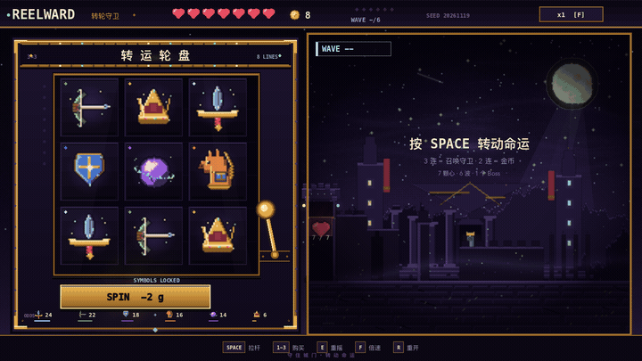

> 视频版：`docs/reelward.mp4`（10 秒，1280×720 / 20fps）。
> 机制参考了 Slotbound（转运军团）公开演示里“老虎机 → 召唤 → 自动战斗 → 商店改概率”
> 的玩法循环；本工程是**净室实现**，角色、符号、UI 布局、文案、品牌与代码均为原创。
> 详见 `assets/CREDITS.md`。

**第 2 轮美术升级（2026-11-19）**：32×32 描边像素符号、运行时预烘焙的分层视差背景
（天空 / 云 / 远山 / 神殿 / 废墟 / 地面 / 雾 / 月光），金属+玻璃机台与回弹卷轴，
系统字体排版，以及投射物 / 火花 / 描边伤害数字 / 闪白 / 彩带等 VFX。
核心玩法、数值与 94 项无头断言不变。

### 美术对比（before / after）

| before（第 1 轮） | after（第 2 轮） |
| --- | --- |
| 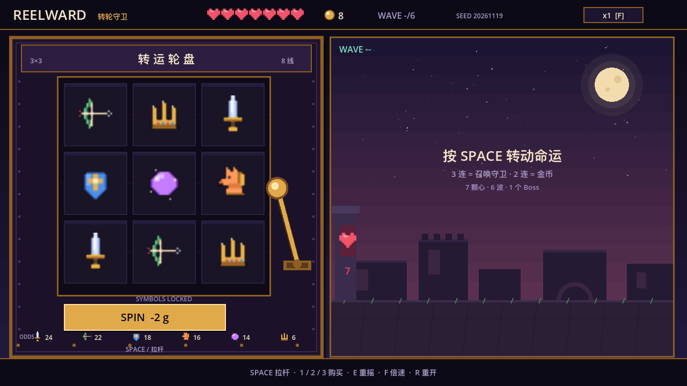 | 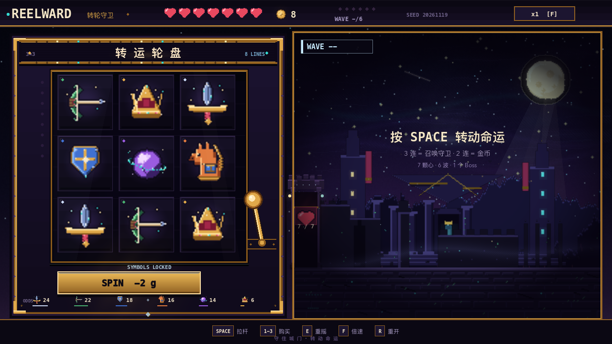 |
| 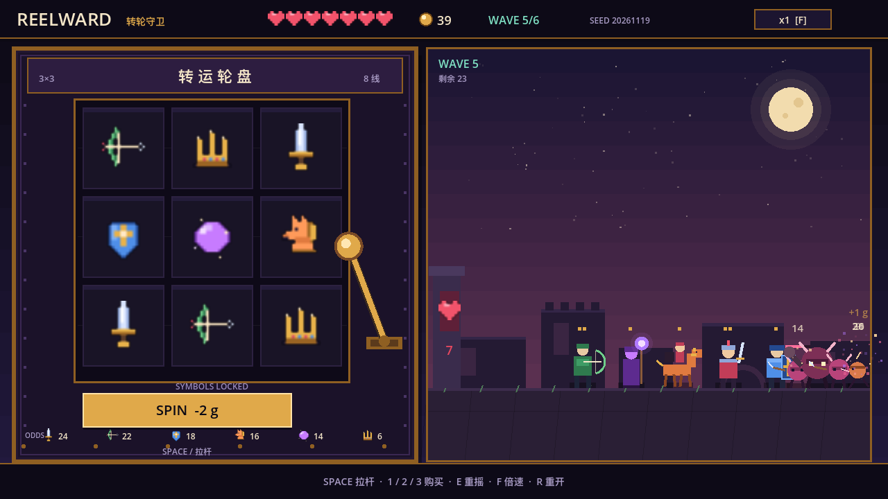 | 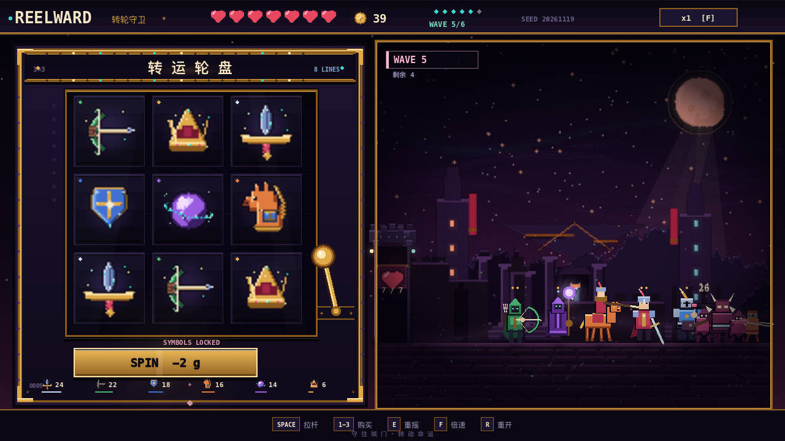 |
| 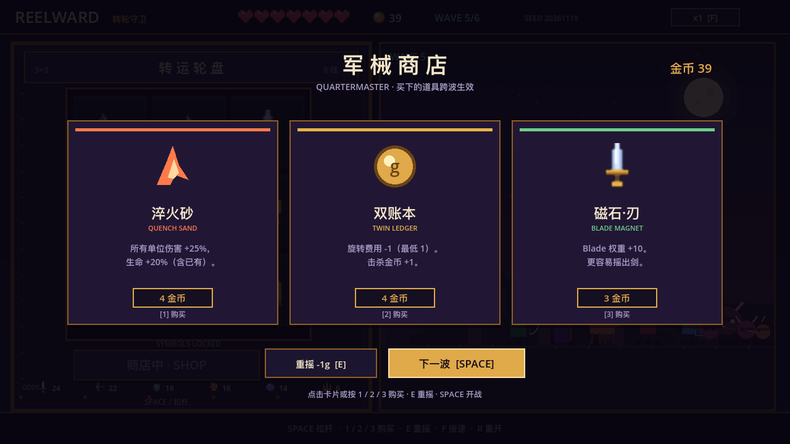 | 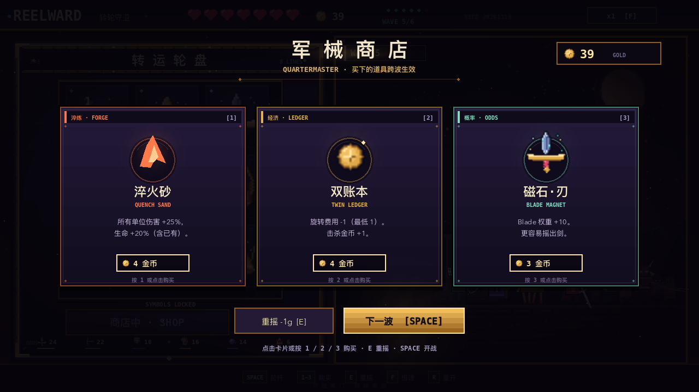 |
| 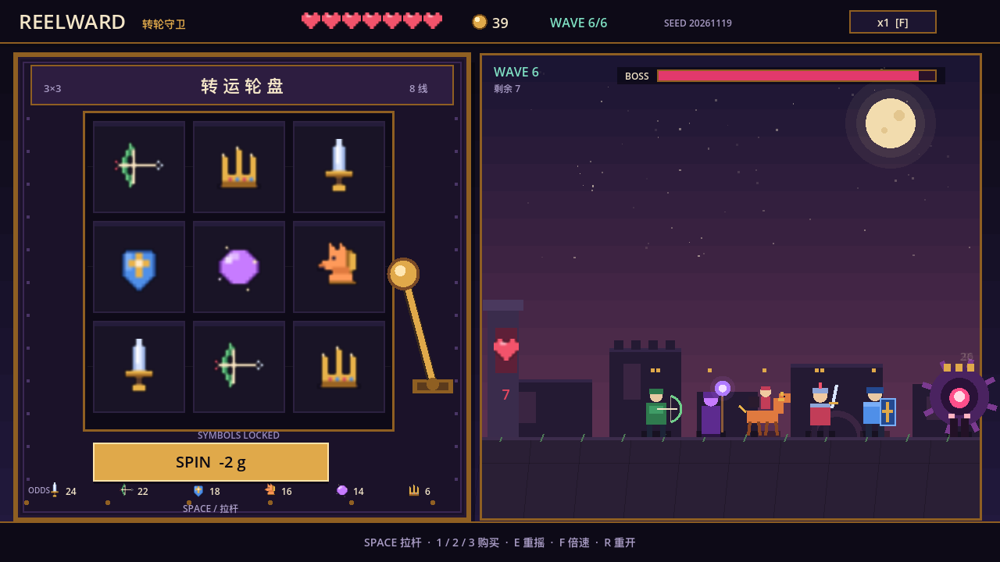 | 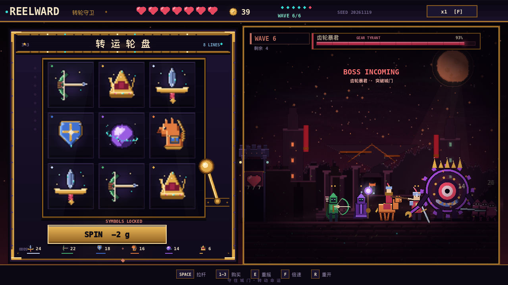 |

更多 after 截图：`docs/shots/02_spin.png`、`06_win.png`、`07_lose.png`。
第 1 轮的 GIF/MP4 快照保留在 `docs/before/reelward_v1.*`。

## 运行

```bash
godot --path godot-slot-defense
```

- Godot 4.6（实测 `4.6.stable.official.89cea1439`）。
- 首次运行需导入：`godot --headless --path godot-slot-defense --editor --quit`。
- 无第三方运行时依赖；未打包任何贴图/字体文件，全部图形由 GDScript 生成。
- 排版使用系统字体（SF Mono / Menlo / Consolas / Avenir Next，CJK 回退 PingFang SC / Noto Sans CJK），
  不随工程分发字体文件。

## 操作

| 输入 | 作用 |
| --- | --- |
| `SPACE` / 拉杆 / `SPIN` 按钮 | 旋转转轮（消耗金币） |
| `1` / `2` / `3` / 点击卡片 | 商店购买 |
| `E` / 点击重摇 | 花 1 金币重摇商店（可选） |
| `SPACE` / 点击“下一波” | 关闭商店，开始下一波（Boss 战前同样可买东西） |
| `F` | 1× / 2× 倍速 |
| `R` | 重开一局（胜负画面里 `SPACE` 也可重开） |

## 玩法循环

1. **3×3 转轮、8 条赔付线**（3 行 + 3 列 + 2 对角线）。每次旋转花费 2 金币
   （买过“双账本”后最低 1）。
2. **6 种原创符号**：剑 Blade（近战）、弓 Bow（远程）、盾 Shield（坦克）、
   马 Steed（高攻速）、球 Orb（远程 AoE）、冠 Crown（万能/升级）。
   - 一条线 **3 连** → 召唤对应守卫；场上 5 格已满时改为升级同类单位。
   - 一条线 **2 连** → 1 金币。
   - **Crown 当万能牌**补齐三连；3 个 Crown 直接升级场上等级最低的单位。
   - 多条线可同时结算（行列交叉会一次召唤/升级多次）。
3. **一条战线、5 个格位**：守卫自动攻击；敌人从右侧推进，近身会攻击最前排守卫；
   漏过城门扣心。初始 **7 颗心**。
4. **5 波 + 1 个 Boss**：每波清空后进入商店；打完第 5 波进店补给，再挑战第 6 波
   的“齿轮暴君”。Boss 倒下即胜利。
5. **商店 3 选 1**：磁石·刃（改概率）、冠冕换面（改符号权重）、双账本（加经济）、
   淬火砂（加单位属性）。**买下的效果跨波保留**；未买道具每波刷新。
6. **一局约 70–110 秒**（1× 速度，实测 8 个种子 68–76 秒自动通关）；
   `F` 倍速可压缩到 ~35 秒。

## 验收

```bash
bash tools/verify.sh
# == import == / == boot (600 frames) == / BOOT_OK
# == smoke == / SLOT_SMOKE_OK checks=94
# == structure == / VERIFY_OK
```

真实 GPU 帧率探针（Intel HD Graphics 6000 / OpenGL Compatibility，关闭垂直同步，
14 个敌人 + 满员队伍 + 彩带的压力场景）：

```bash
godot --path godot-slot-defense --resolution 1280x720 -s tools/perf_slot.gd
# SLOT_FPS avg=36.7 low=17.3 frames=360
# SLOT_FPS_OK   (5 次采样中位数；共享机高负载时可能掉到 19.7)
```

无头 smoke 覆盖：同 seed 转轮序列一致、不同 seed 有差异、8 条线检测、Crown 万能、
2 连金币、3 连召唤、场上满员升级、多线同时结算、旋转扣费、商店四类道具效果与购买/售罄、
效果跨波保留、波次推进、Boss 出场与胜利、漏怪扣心与失败、重开清空状态，以及
`SPACE` / `F` / `1-3` / `R` / SPIN 按钮的输入接线。

单独运行：

```bash
godot --headless --path godot-slot-defense -s tools/smoke_slot.gd
# SLOT_SMOKE_OK checks=94
```

真实 GPU 截图（需要窗口）：

```bash
godot --path godot-slot-defense --resolution 1280x720 -s tools/screenshot_slot.gd
# -> docs/shots/{01_idle,02_spin,03_battle,04_shop,05_boss,06_win,07_lose}.png
```

| | |
| --- | --- |
|  |  |
|  |  |
| 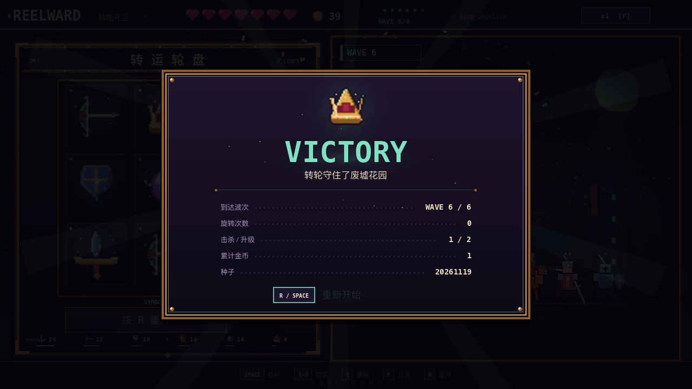 | 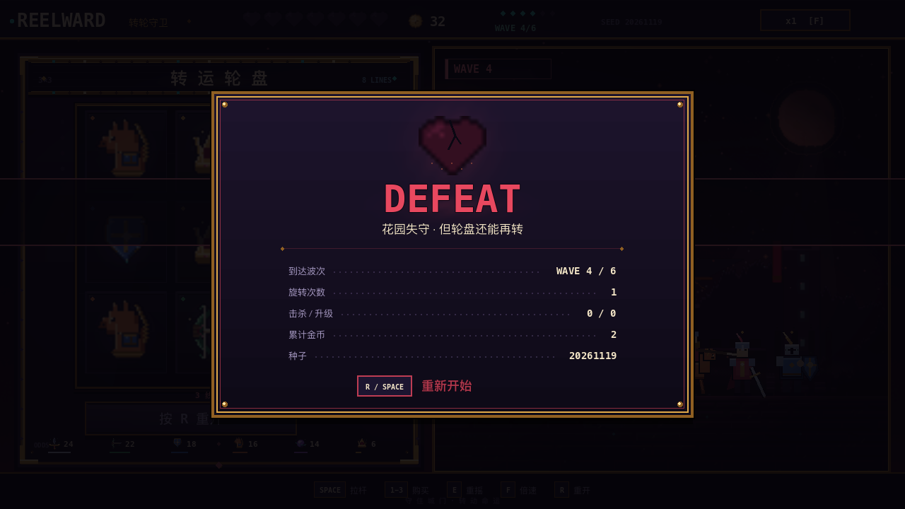 |

符号 / 背景美术调试图：`tools/art_sheet.gd` → `docs/shots/art_sheet.png`。

录 GIF / MP4：

```bash
godot --path godot-slot-defense --resolution 1280x720 -s tools/capture_slot_gif.gd
ffmpeg -y -framerate 20 -i /tmp/slot_gif/frame_%03d.png \
  -vf "fps=12,scale=720:-1:flags=lanczos,split[a][b];[a]palettegen=max_colors=128[p];[b][p]paletteuse=dither=bayer:bayer_scale=3" \
  -loop 0 docs/reelward.gif
ffmpeg -y -framerate 20 -i /tmp/slot_gif/frame_%03d.png \
  -c:v libx264 -pix_fmt yuv420p -crf 20 -movflags +faststart docs/reelward.mp4
```

平衡探针（8 个种子自动游玩）：

```bash
godot --headless --path godot-slot-defense -s tools/playtest_slot.gd
# PLAYTEST_DONE wins=8/8（68–76 秒）
```

## 文件落点

| 文件 | 作用 |
| --- | --- |
| `scenes/main.tscn` | 单场景入口（Node2D + 脚本） |
| `src/reel_game.gd` | 整局状态机、战斗/波次/商店/经济、背景/机台/UI 绘制、VFX 与程序化音效 |
| `src/reel_slot.gd` | 纯逻辑：seeded RNG、权重、3×3 旋转、8 线判定 |
| `src/reel_art.gd` | 32×32 符号、心形/金币/光晕/暗角，以及预烘焙的视差背景、机台、卷轴底板、按钮与影子纹理 |
| `tools/smoke_slot.gd` | 无头验收（94 项断言） |
| `tools/screenshot_slot.gd` | 7 张真实 GPU 截图（含胜负） |
| `tools/capture_slot_gif.gd` | 200 帧 20fps 巡览录制（idle→spin→战斗→商店→Boss→胜利） |
| `tools/perf_slot.gd` | 真实 GPU 压力场景帧率探针 |
| `tools/art_sheet.gd` | 符号 + 背景调试图（不入验收回路） |
| `tools/playtest_slot.gd` | 8 种子自动平衡探针 |
| `tools/verify.sh` | 导入 + 启动 + smoke + 结构一键检查 |
| `docs/TECH.md` | 技术架构、参数、踩坑 |
| `docs/迭代记录.md` | 两轮实现与验证记录 |

## 已知限制

- 单战线、无英雄/遗物/多商店页，符合本轮 vertical slice 范围。
- 敌人只有 4 种（小兵/疾行者/蛮兵/Boss），波次表是固定脚本 + 血量/伤害随波次缩放。
- 程序化音效是简单正弦/噪声合成，没有混音总线与音效池。
- 单位/敌人仍以 2D 图元分层拼装（无骨骼/贴图动画），但 idle 呼吸、攻击前倾与斩击、
  受击闪白+击退、死亡溶解余烬四种状态均有可见变化；Boss 有独立齿轮轮廓与光环。
- 性能优化以“静态部分预烘焙成纹理 + 控制 draw call”为主；Intel HD 6000 压力场景
  空闲 37–40fps，正常对局更高；共享机高负载时中位数 36.7fps（5 次中 4 次 >30）。
  若继续加特效应先做角色精灵缓存与自适应画质。
