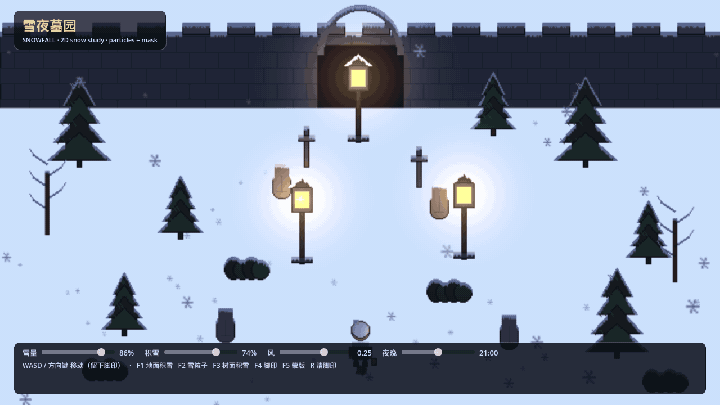

# 雪夜墓园 · Snowfall

参考 B 站 **BV18DYt6mE24**《2D游戏中的雪天效果 DEV LOG.05》（UP：Mushreb，
Godot 4.7 + C#）做的 **Godot 4.6 / GDScript 原创复刻**。视频里讲的雪粒子 +
地面积雪两条主线都做了，另外补了雪帽、脚印、风、夜灯。

场景、角色、雪帽、蒙版、雪花图集全部由 `tools/gen_art.py` 程序化生成；
没有使用任何原游戏素材。



视频版：`docs/snowfall.mp4`（10s，1280×720）。

## 复刻的效果

- **雪粒子**：8×3 雪花图集 + GPUParticles2D（前后两层、风、缩放、转速）。
- **地面积雪**：一张噪声蒙版 + 覆盖度阈值 → 雪地、草地的消长；F5 可看蒙版。
- **树面积雪**：从每个精灵的“向上边缘”自动生成雪帽，随覆盖度淡入淡出。
- **脚印**：角色走动时左右交替留下脚印，12 秒渐隐；可 F4/R 开关/清除。
- **夜晚/路灯**：CanvasModulate 压暗 + 暖色 PointLight2D + 加色 glow 光池，
  雪粒子在灯下飘。
- **风/雪量**：滑杆控制飘雪密度与风向；积雪滑杆演示“积雪/消退”。

## 运行

```bash
godot --path godot-snowfall
```

- **WASD / 方向键** 移动（雪地留脚印）
- **滑杆**：雪量 / 积雪 / 风 / 夜晚
- **F1** 地面积雪 · **F2** 雪粒子 · **F3** 树面积雪 · **F4** 脚印 · **F5** 蒙版 · **R** 清脚印

世界 640×360 最近邻 2× 放大；HUD 1280×720 保持中文清晰。

## 结构

```
godot-snowfall/
├── scenes/main.tscn        640×360 SubViewport + 1280×720 HUD
├── scenes/world.tscn       Ground(雪 shader) / Wall / SnowBack / World / SnowFront / Lights
├── scenes/player.tscn      角色 + 提灯 PointLight2D
├── src/
│   ├── world.gd            雪帽、雪粒子、路灯、覆盖度、脚印、夜晚
│   ├── player.gd           移动、四方向动画、脚印节奏
│   ├── hero_frames.gd      从图集切 SpriteFrames
│   ├── hud.gd              滑杆 / F 键 / 状态
│   └── main.gd             HUD 装配
├── assets/
│   ├── shaders/snow_ground.gdshader
│   ├── world/              地面、雪蒙版
│   ├── props/              松树/墓碑/十字/枯树/灌木/路灯 + *_snow 雪帽
│   ├── char/hero.png       4 方向 ×（2 idle + 4 walk）
│   └── fx/                 雪花图集、脚印、光斑、光贴图
├── tools/
│   ├── gen_art.py          全部像素素材生成器
│   ├── smoke_snow.gd       无头验收
│   ├── screenshot_snow.gd  夜景/小雪/黄昏/蒙版/脚印截图
│   ├── capture_snow_gif.gd GIF 录制
│   └── verify.sh           一键导入 + 验收
└── docs/
    ├── TECH.md             技术拆解
    ├── 迭代记录.md          本轮问题与修复
    └── snowfall.gif / mp4
```

## 验证

```bash
python3 tools/gen_art.py
godot --headless --path godot-snowfall --editor --quit   # 重新导入改过的 PNG
godot --headless --path godot-snowfall -s tools/smoke_snow.gd
godot --path godot-snowfall --resolution 1280x720 -s tools/screenshot_snow.gd
godot --path godot-snowfall --resolution 1280x720 -s tools/capture_snow_gif.gd
```

- `SNOW_SMOKE_OK`：雪帽数量、两层粒子、蒙版、覆盖度、风、夜晚、脚印增删、
  角色帧与移动、开关。
- 截图 `/tmp/snow_shots/`；GIF 帧 `/tmp/snow_gif/`。

## 说明

- 像素风是参考视频的选择；和 `godot-garden` 的写实路线不同。
- 地表是 640×360 像素网格；雪花/雪帽/脚印都按像素绘制，放大不变糊。
- 素材/代码原创；参考仅来自视频可见效果。详见 `assets/CREDITS.md`。
