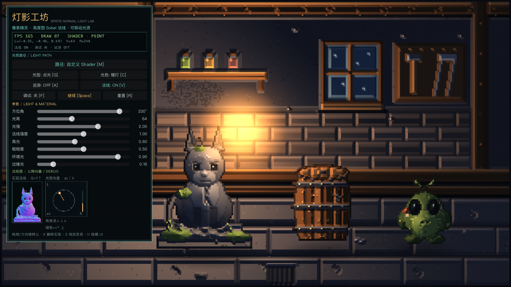

# 灯影工坊 · Sprite Normal Light Lab

一个可交互的 **2D 像素精灵法线贴图光照** demo：夜间工坊里有一盏可拖拽的暖色小灯，
墙、地板、石狐、木桶、苔灵五张精灵都带 albedo + 高度图导出的法线图。
默认走**自定义 CanvasItem 光照 Shader**（可调光角/光高/强度/颜色/法线强度/高光/粗糙度/环境光/边缘光），
按 `M` 切到 **Godot 原生 CanvasTexture + Light2D** 路径对照。

- Godot **4.6**，GL Compatibility，2D；1280×720 逻辑，可 1920×1080。
- 美术 320×180 世界像素，`Camera2D.zoom = 4` → 1280 下 1 美术像素 = 4 屏幕像素，1920 下 6 屏幕像素。
- 所有精灵/高度图/法线图均为本项目原创，由 `tools/gen_assets.py` 固定种子生成；没有引入第三方运行时依赖。



## 运行

```bash
godot --path godot-sprite-normal-light
```

建议窗口 1280×720 或 1920×1080。第一次导入后直接运行；不需要外部插件。

## 操作

| 操作 | 作用 |
| --- | --- |
| 鼠标左键拖拽世界 | 移动点光源（自动巡游关闭） |
| `← → ↑ ↓` | 点光模式下平移光源；方向光模式下调整方位角/仰角 |
| `Space` | 暂停 / 继续（暂停冻结自动巡游） |
| `R` | 重置全部参数与路径 |
| `V` | 法线贴图 ON/OFF（平面贴图对比） |
| `F` | 调试视图循环：关 → 法线图 → 光照向量 → 漫反射 → 光矢量标注 |
| `M` | 自定义 Shader ↔ 原生 Light2D |
| `G` | 点光 ↔ 方向光 |
| `A` | 自动巡游 ON/OFF |
| `C` | 光源颜色：暖灯 → 月光 → 炉火 → 中性 |
| `X` | 翻转石狐（验证 flip_h 光照） |
| `Z` | 苔灵 2× 缩放（保持脚底锚点，验证缩放光照） |
| `H` | 隐藏 / 显示 UI |

## 参数

| 参数 | 范围 | 说明 |
| --- | --- | --- |
| 方位角 | 0–360° | 点光在巡游椭圆上的位置；0°=正上，90°=右侧。拖动滑杆会关闭巡游 |
| 光高 | 8–160 | 光源离精灵平面的 z 高度，进入 `L = normalize(vec3(to_light.xy, height))` |
| 光强 | 0–3 | 点光/方向光能量 |
| 法线强度 | 0–2 | 法线贴图 xy 分量缩放；0 = 平面 |
| 高光 | 0–1.5 | Blinn–Phong 高光强度 |
| 粗糙度 | 0–1 | 全局偏移；与法线图 alpha 中的逐像素粗糙度叠加 |
| 环境光 | 0–1 | 冷色环境项；Shader 路径是加色，原生路径映射到 CanvasModulate + 补光 |
| 边缘光 | 0–1 | Fresnel 风格轮廓光（仅 Shader 路径） |
| 光色 | 4 预设 | 暖灯 / 月光 / 炉火 / 中性 |

原生 Light2D 路径下，法线强度 / 高光 / 粗糙度 / 边缘光不可用（原生 pass 不接受这些参数），
HUD 会变灰并显示提示；这是有意的“两条路径差异”展示。

## 两条路径

1. **自定义 Shader（默认）**：`shaders/sprite_normal_light.gdshader`，`canvas_item, unshaded`；
   每个受光 Sprite 一个 `ShaderMaterial`，共享 `[shader_globals]` 参数；手动计算环境、点光/方向光、
   Blinn–Phong 高光、逐像素粗糙度、rim 和调试视图。
2. **原生 Light2D**：受光 Sprite 的 `texture` 换成 `CanvasTexture(diffuse_texture, normal_texture)`；
   `PointLight2D` / `DirectionalLight2D` 负责光照；另有冷色 `DirectionalLight2D` 补光 +
   `CanvasModulate` 作为环境底色（因为 CanvasModulate 会乘到光照结果上，只靠它会压死点光）。
   `M` 切换，HUD 显示当前路径、draw calls 与 FPS。

## 调试 / 验证

- `F` 的法线图模式直接在场景里显示切线空间法线 RGB；光照向量模式显示逐像素 `L`；
  “光矢量标注”模式保留正常光照并在世界坐标画 L 箭头。
- HUD 左侧有石狐法线贴图预览和 `az / h` 光照向量小表盘；世界里有光半径环、巡游轨迹和高度竖杆。
- `tools/smoke_sprite_normal_light.gd`（headless，181 checks）覆盖资产/法线图、Shader 参数、
  光源移动/暂停、法线对比、调试、原生路径、翻转/缩放、重置、像素完美与导入设置。
- `tools/probe_sprite_normal_light.gd` / `_1080.gd` 测真实 GPU FPS。
- `tools/screenshot_sprite_normal_light.gd` 输出 9 张 1920×1080 截图。
- `tools/build_media.sh` 生成 10s MP4/GIF。

```bash
godot --headless --path godot-sprite-normal-light -s tools/smoke_sprite_normal_light.gd
godot --path godot-sprite-normal-light --resolution 1280x720 -s tools/probe_sprite_normal_light.gd
godot --path godot-sprite-normal-light -s tools/probe_sprite_normal_light_1080.gd
godot --path godot-sprite-normal-light -s tools/screenshot_sprite_normal_light.gd
godot --path godot-sprite-normal-light --fixed-fps 30 -s tools/capture_sprite_normal_light.gd
```

实测（Intel HD Graphics 6000，关 VSync，系统同时有其他 worker）：

| 分辨率 | 模式 | avg FPS | min FPS | draw calls |
| --- | --- | ---: | ---: | ---: |
| 1280×720 | Shader + HUD | 274.9 | 249.2 | 87 |
| 1280×720 | Shader 仅世界 | 395.5 | 393.5 | 9 |
| 1280×720 | 原生仅世界 | 289.6 | 287.5 | — |
| 1280×720 | 法线图 debug + HUD | 194.0 | 188.1 | — |
| 1920×1080 | Shader + HUD | 150.2 | 144.5 | 87 |
| 1920×1080 | Shader 仅世界 | 154.3 | 154.9* | — |
| 1920×1080 | 原生仅世界 | 121.7 | 120.2 | — |

`*` 1920 世界层的 “min” 略高于同段 avg，是 1s 采样窗口重叠造成的噪声，以 avg 为准。
截图工具里 HUD 的 FPS 读数是在逐帧抓图/窗口裁剪环境下的瞬时值，以 probe 结果为准；
系统负载会明显影响帧率，最终复测值比前一次更高/更低都正常。

## 截图与视频

9 张真实 1920×1080 截图在 [`docs/shots/`](docs/shots/)：

| 文件 | 内容 |
| --- | --- |
| `01_ui_shader.png` | Shader 路径 + 完整参数面板（FPS/DRAW/光向量/法线预览） |
| `02_normal_on.png` | 同一光位，法线贴图 ON |
| `03_normal_off.png` | 同一光位，法线贴图 OFF（平面贴图） |
| `04_debug_normal.png` | 场景内切线空间法线图 + 光向量箭头 |
| `05_debug_light.png` | 逐像素光照向量 RGB |
| `06_ui_native_light2d.png` | 原生 CanvasTexture + Light2D + HUD 提示 |
| `07_highlight_closeup.png` | 高光特写（低粗糙度、金属箍/眼睛高光） |
| `08_flip_scale.png` | 石狐翻转 + 苔灵 2× 缩放，光照不破 |
| `09_debug_vectors.png` | 正常光照 + 世界光向量标注 |

- [`docs/sprite_normal_light.mp4`](docs/sprite_normal_light.mp4)：10s，1920×1080（源 1280×720 固定 30fps 最近邻放大），展示法线 ON/OFF、点光巡游、调试、高光、原生路径、翻转/缩放。
- [`docs/sprite_normal_light.gif`](docs/sprite_normal_light.gif)：10s，960×540，15fps。

## 文件结构

```
project.godot                       1280×720 / GL Compatibility / shader globals
scenes/main.tscn                    Main + World + Camera2D + DebugOverlay + HUD
scripts/main.gd                     光照状态、光源移动、路径切换、输入、参数入口
scripts/lit_room.gd                 五张受光 Sprite、材质、CanvasTexture、阴影
scripts/hud.gd                      中文参数面板 / 预览 / 表盘 / stats
scripts/light_dial.gd               HUD 光照向量表盘
scripts/debug_overlay.gd            光半径、巡游轨迹、L 箭头、高度竖杆
shaders/sprite_normal_light.gdshader  自定义 2D 法线光照
assets/sprites/                     原创 albedo / height / normal (+ roughness alpha)
tools/gen_assets.py                 Pillow 资产生成器（固定种子）
tools/smoke_sprite_normal_light.gd  headless 验收
tools/probe_*.gd / screenshot_*.gd / capture_*.gd / build_media.sh / verify.sh
docs/TECH.md                        技术拆解、公式、Godot 设置、性能、差异与限制
docs/迭代记录.md                    实现过程、问题与修复
docs/verification.txt               自测输出存档
CREDITS.md                          原创与教程引用说明
```

更细的公式、切线空间、导入设置、原生路径差异与已知限制见 [`docs/TECH.md`](docs/TECH.md)。
