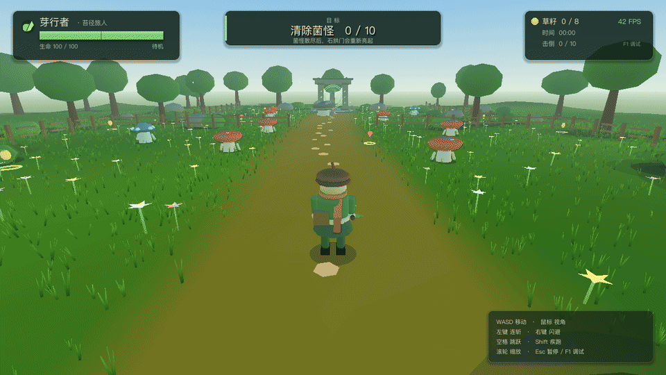
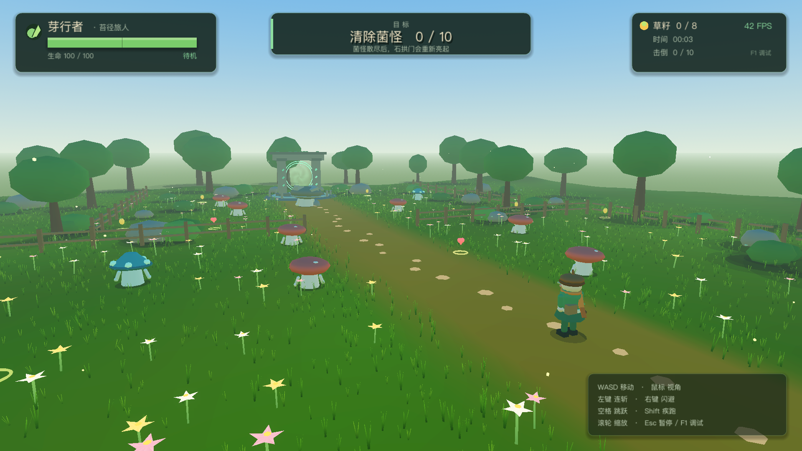
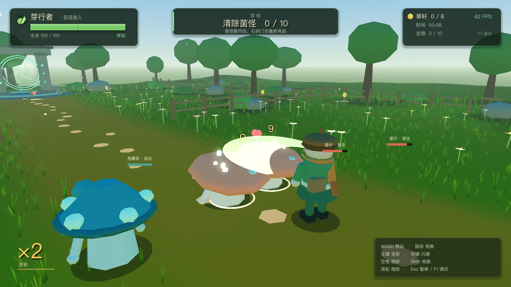
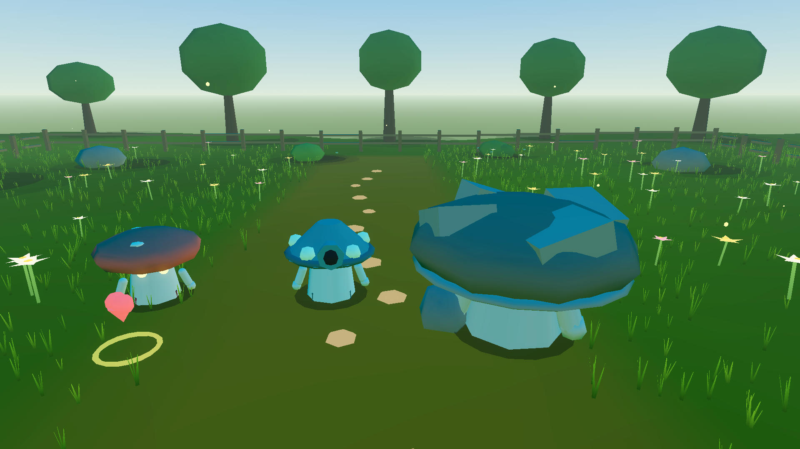
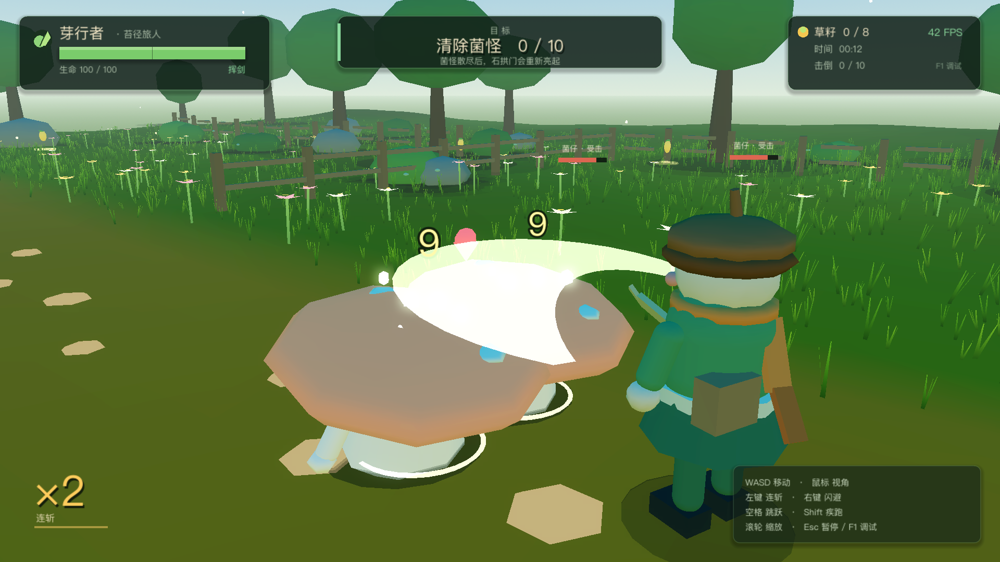
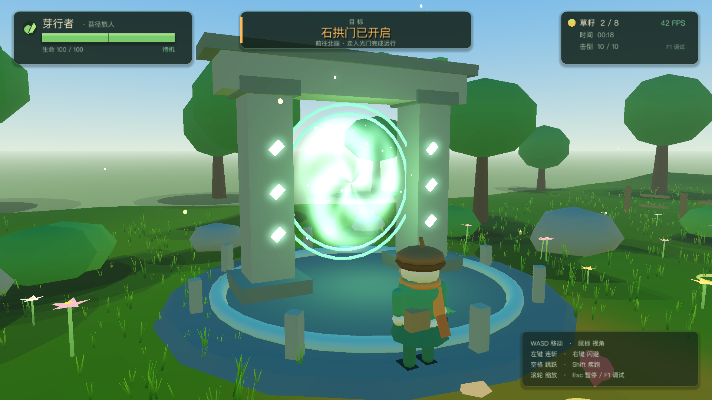
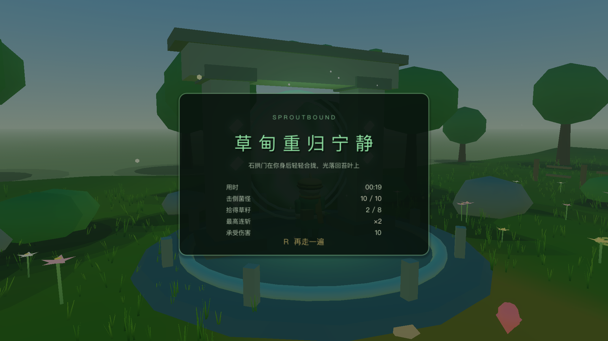
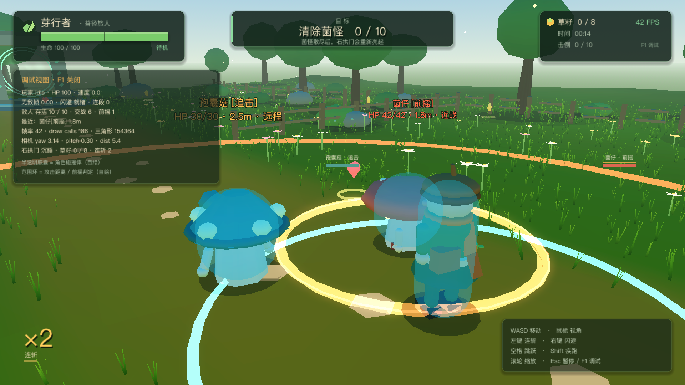
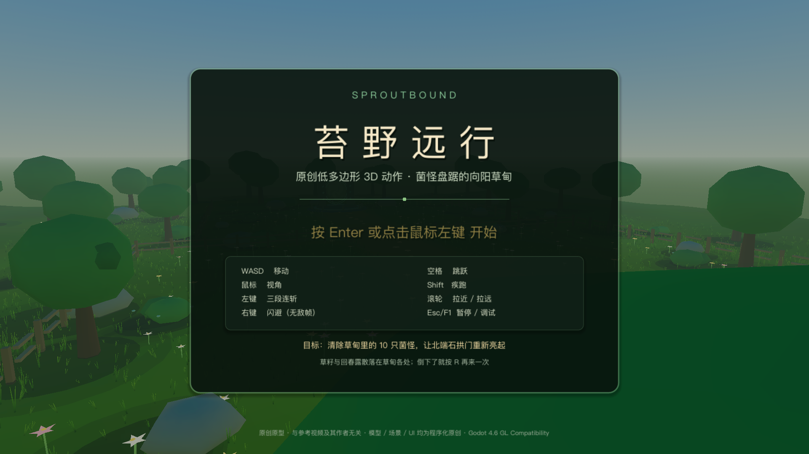

# Sproutbound · 苔野远行

原创低多边形 **3D 动作 vertical slice**：阿栎帽小行者「芽行者」穿过被菌怪占据的向阳草甸，用树枝剑与闪避清理 10 只菌怪，唤醒北端的石拱门并走入光门。

> **原创声明**：本作只把 B 站参考视频当作“AI 辅助开发 3D 游戏”的类型研究；没有复制视频中的角色、蘑菇、场景、UI、图标、品牌或任何生成素材。角色 / 菌怪 / 草甸 / 石拱门 / UI / 特效 / 代码均为本项目程序化原创。参考视频：*Claude + Codex + Godot，3小时25分钟做出一款3D游戏！*（BV1Z8yCz2Er7）。详见 [`CREDITS.md`](CREDITS.md)。



> 10 秒实机录屏：`docs/media/sproutbound_10s.mp4`（1280×720，H.264，20fps 源帧）；GIF 为同源 960×540 / 12fps。画面为脚本化机位 + 真实运行 / 真实渲染，不是后期合成。

## 玩起来

```bash
cd godot-sproutbound
godot --headless --path . --editor --quit   # 首次导入 / 注册全局类
godot --path . --resolution 1280x720        # 打开游戏
```

Godot **4.6 stable**，GL Compatibility；1280×720 逻辑分辨率（`canvas_items` 拉伸），可 1920×1080 输出。无第三方运行时依赖；全部低模在启动时程序化生成。

## 操作

| 输入 | 作用 |
| --- | --- |
| `WASD` / 方向键 | 相机相对移动 |
| 鼠标移动 | 环绕相机 |
| 滚轮 | 拉近 / 拉远（2.7–8.0m） |
| 鼠标左键 | 三段连斩：横斩 → 回斩 → 落叶斩（可按节奏连按；第三段重击） |
| 鼠标右键 | 闪避（0.04–0.28s 无敌帧；地面限定） |
| `Space` | 跳跃（可躲开矮个菌怪的横扫；带空中控制） |
| `Shift` | 疾跑 |
| `Esc` | 暂停 / 释放鼠标；再按继续 |
| `R` | 暂停 / 失败 / 胜利后重新开始 |
| `F1` | 调试视图：角色碰撞胶囊、敌人状态标签、攻击范围 / 前摇判定环 |

进入游戏后鼠标被捕获；`Esc` 暂停时会释放。标题界面按 `Enter` 或点击鼠标左键开始。

## 目标与内容

- **目标**：清除草甸里的 **10 只菌怪** → 北端 **石拱门** 开启 → 走入光门。
- **失败**：生命归零；等待 1.1s 进入结算，按 `R` 重新出发。
- **拾取**：8 枚草籽（计数）、3 朵回春露（+25 生命，满血时不消耗）。
- **敌人（3 种原创变体）**：
  - **菌仔**：近战，前摇短，会追击与横扫。
  - **孢囊菇**：远程，口中充能后发射孢弹；喜欢保持距离。
  - **菌卫**：精英，体型大、有霸体，拍地 AoE。
- **场景**：76×64m 草甸、两片木栅栏空地、树林 / 岩石 / 花 / 灌木 / 踏石小径 / 石拱门；日落侧光、雾、程序化接触阴影。
- **表现**：命中闪白、伤害数字、火花、冲击环、命中连斩、相机震屏；敌人前摇 / 突进 / 硬直 / 死亡孢尘。
- **HUD**：中文气血 / 目标 / 击杀 / 草籽 / 时间 / FPS / 连斩 / 敌人血条 / 操作提示 / 传送门标记；暂停、失败、胜利面板。
- **调试**：自绘碰撞胶囊、敌人状态（中文）、索敌/攻击范围环、玩家状态与 draw calls / 三角形 / FPS。

## 截图（1920×1080，真实 GPU）

| | |
| --- | --- |
|  |  |
| 草甸全景 | 战斗 / 连斩 |
|  |  |
| 三种菌怪 | 命中瞬间 |
|  |  |
| 石拱门开启 | 胜利结算 |
|  |  |
| 调试视图 | 标题 |

更多：`docs/shots/`。截图工具用 1920×1080 SubViewport 做真实 1080 渲染；录屏工具在 1280×720 下运行。采集时 HUD 的 FPS 冻结为**已记录的 1280×720 正常游玩实测基准 42**（来自性能表），避免 PNG 读回 / 编码开销污染读数；正常游玩时 HUD 实时更新。详见 TECH §7.1。

## 测试与性能

```bash
# 无头冒烟（末行 SPROUTBOUND_SMOKE_OK）
godot --headless --path . -s tools/smoke_sproutbound.gd

# 1280×720 性能探针（idle / combat）
godot --path . --resolution 1280x720 -s tools/perf_sproutbound.gd

# 重新生成 1920×1080 截图
godot --path . --resolution 1920x1080 -s tools/screenshot_sproutbound.gd

# 重新生成 10 秒录屏帧（编码命令见下）
godot --path . --resolution 1280x720 -s tools/capture_sproutbound_video.gd
ffmpeg -framerate 20 -i /tmp/sproutbound_gif/frame_%03d.png \
  -c:v libx264 -pix_fmt yuv420p -crf 20 -movflags +faststart docs/media/sproutbound_10s.mp4
```

**实测（MacBook Intel HD Graphics 6000，Godot 4.6 GL Compatibility，VSync 关闭，1280×720，5 秒预热后 4 秒采样）：**

| 场景 | FPS | 平均帧 | 最低帧 | draw calls | 三角形 |
| --- | --- | --- | --- | --- | --- |
| 草甸待机 | **41.9** | 23.9ms | 8.4ms | 345 | 205,654 |
| 战斗（3 敌 + 连斩） | **44.1** | 22.7ms | 6.6ms | 196 | 144,862 |

- 冒烟：**54 checks / 0 failures**，`SPROUTBOUND_SMOKE_OK`。
- 同一机器在其它后台 worker 并发时复测：待机 34.5–37.8 / 战斗 29.3–33.7 FPS（load average 5–10）。表中是较低负载样本；FPS 随系统负载波动，属于同时跑多个任务的共享机器环境，不是游戏逻辑退化。
- 真实 GPU 运行无 SCRIPT ERROR；截图工具日志见 `docs/agency/gpu_screenshot_run.log`，冒烟/性能日志见 `docs/agency/`。
- 1920×1080 为截图 / 输出支持；游戏窗口使用 `canvas_items` 拉伸，以 1280 逻辑分辨率渲染后上采样，这是为 Intel 集显保留 30fps+ 的取舍。截图工具单独用 1920 SubViewport 做真正的 1080 渲染。

## 已知限制

- 本机 GL Compatibility + Intel 组合下方向光实时阴影**没有可见输出**，仍会生成约 270 个阴影 pass 绘制；因此关闭实时阴影，改用程序化圆盘接触阴影（仍是“阴影”，但不是动态投影）。详见 TECH。
- 关卡是脚本化摆位的 10 只菌怪，不是参考视频里的大规模割草；这是按“第三人称动作 vertical slice”的规格做的取舍。
- 无音频（参考规格中音效可选）；无存档 / 多关卡；连击 / 受击使用距离+扇区判定，不是物理 Hitbox。
- HUD 的 FPS 为 5 秒平滑值；录屏 / 截图时冻结为 1280 正常游玩基准 42（不是采集进程的瞬时帧率，见 TECH §7.1）。

## 文件

```
project.godot / scenes/main.tscn
scripts/  main.gd world.gd player.gd enemy.gd spore_bolt.gd hud.gd style.gd
shaders/  grass_wind.gdshader portal_field.gdshader
tools/    smoke_sproutbound.gd perf_sproutbound.gd screenshot_sproutbound.gd capture_sproutbound_video.gd
docs/     TECH.md 迭代记录.md shots/ media/ agency/
```

## 致谢 / 许可

全部程序化原创；Godot Engine 4.6（MIT）；HUD 使用系统 CJK 字体（PingFang SC / Hiragino / Noto Sans CJK 等）。无付费资产、无第三方 IP 素材。参考视频只用于类型与迭代研究，详见 [`CREDITS.md`](CREDITS.md)。
