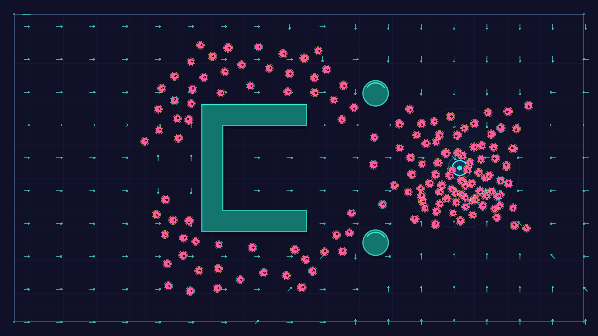

# 转向行为实验场 · Steering Behavior

> 群体寻路与避障 · Godot 4.6 可交互复刻
> 参考视频：B 站 **BV1yCqfYuEh1**《〈群体寻路与避障〉Steering Behavior 转向行为如何实现避障智能体》（仅研究引用，无素材复制）。



**10 秒演示**：[MP4](docs/media/steering_tour_10s.mp4) · [GIF](docs/media/steering_tour_10s.gif)

## 这是什么

一个从零实现的 Godot 4.6 俯视 2D Demo，用视频里实际出现的视觉语言（深蓝底 + 青色流场箭头 + 青绿障碍 + 粉色单位）重做“群体寻路与避障”：

- **流场寻路**：以目标为源做 8 邻域 BFS，箭头绕开 C 形障碍，单位沿流场推进并在目标区汇合。
- **转向行为**：Seek / Flee / Arrive / Pursue / Evade / Wander + Separation / Alignment / Cohesion / Leader（队列）+ Flow + Avoidance，全部可在中文控制台里开关并调权重。
- **三须局部避障**：每帧向前发 3 根探测射线（±31.5° + 正前），对矩形/圆形障碍做精确求交；避障力 = 法线斥力 + 切向“动力”，即将碰撞时优先于其它行为。
- **可解释可视化**：流场箭头、目标区、主导行为高亮、选中单位的力向量/胡须射线/邻居连线。
- **可控制**：4 个场景预设、20–300 智能体、行为权重、速度/转向力/探测距离/邻域半径、暂停/重置、点击选中、双击设目标。
- **可复现**：固定 60Hz 步长、固定种子、确定性空间哈希与遍历顺序。

## 运行

要求：Godot **4.6**（GL Compatibility），64 位桌面环境。

```bash
# 在仓库根目录
godot --path godot-steering

# 或直接用 Godot 打开 godot-steering/project.godot
```

默认 1280×720，关闭垂直同步，场景为「视频绕障」，120 个体。

## 操作

| 操作 | 作用 |
| --- | --- |
| 左键点击单位 | 选中，显示力向量 / 避障射线 / 邻居连线 / 主导行为 |
| 双击空地 | 设置新目标（重算流场） |
| `空格` | 暂停 / 继续 |
| `R` | 重置（保留当前设置） |
| `1` `2` `3` `4` | 切换预设：视频绕障 / 追逐 / 走廊拥堵 / 羊群 |
| `V` / `B` / `N` / `G` / `L` | 力向量 / 射线 / 邻居连线 / 流场箭头 / 行为高亮 |
| `H` | 显隐控制台 |
| 右侧滑杆 | 行为开关与权重、数量、参数、显示项 |

## 场景预设

| 预设 | 场景 | 默认行为组合 | 观察点 |
| --- | --- | --- | --- |
| **视频绕障** | C 形障碍 + 两个圆形石柱，目标在右侧；初始大量单位分布在左/上/下 | Flow 1.30 + Separation 1.35 + Avoidance 2.40 | 单位分两股绕过 C 形障碍，再在目标区汇合；青色箭头同步显示流场 |
| **追逐** | 4 个圆形石柱 + 1 个方块；1 个猎物（橙）从右侧逃跑 | 猎物 Flee + Evade + Wander；追捕者 Pursue + Separation；全员 Avoidance | 动态目标、预测追逐、绕柱 |
| **走廊拥堵** | 中间竖墙 + 156px 窄门，目标在右侧 | Flow + Separation 1.25 + Alignment 0.18 + Avoidance | 窄门处的拥堵、分流、再合流 |
| **羊群** | 3 个圆形石柱，无目标（不画目标标记） | Separation 1.30 + Alignment 1.00 + Cohesion 0.75 + Wander 0.90 + Avoidance | 自由漫游、群体聚散、障碍绕行 |

> 追逐模式下，猎物与追捕者使用各自的行为白名单；UI 中显示的开关是“团队配置”，角色会按职责取用。

## 行为清单

| 类别 | 行为 | 说明 |
| --- | --- | --- |
| 个体 | Seek 靠近 | 期望速度指向目标，转向力 = 期望速度 − 当前速度 |
| | Flee 逃离 | 远离最近威胁（猎物优先选追捕者；无猎物时选最近邻居） |
| | Arrive 抵达 | 在减速半径内按距离缩放期望速度，近目标制动 |
| | Pursue 追逐 | 按距离/速度预测目标位置后 Seek（近距离转 Arrive） |
| | Evade 躲避 | 预测威胁位置后 Flee |
| | Wander 漫游 | 在单位前方圆环上随机偏转航向 |
| 群体 | Separation 分离 | 最近邻居按 1/距离² 加权反向推力 |
| | Alignment 对齐 | 邻居平均速度方向 |
| | Cohesion 聚合 | 邻居重心方向的 Seek |
| | Leader 队列 | i 号跟随 i−1 号（0 号按主行为行动） |
| 环境 | Flow 流场跟随 | 采样 BFS 流场方向，近目标按距离减速 |
| | Avoidance 避障 | 三须射线 + 法线斥力 + 切向滑行 + 近场排斥 |

所有行为均可单独开关、权重 0–3；被关闭的行为不参与合成。

## 可视化

- **流场箭头**：每 4 个流场格绘制一支青色箭头（约 180 支），阻塞格不绘制。
- **主导行为高亮**：单位外圈细弧，颜色对应贡献最大的行为（流场青 / 避障橙 / 分离黄 / 对齐绿 / 聚合紫 / 漫游白 / 追逐红）。
- **选中单位**：白色外环 + 速度（白）+ 总转向力（粉）+ 避障分力（橙）+ 流场分力（青）+ 邻域圆 + 邻居连线（最多 8 条）+ 三根胡须（命中红、未命中浅蓝）+ 命中点法线。
- **目标区**：目标点 + 160px 目标区（细环）+ 冲脉圆环；追逐模式额外用橙环标记移动猎物。

## 自测与性能

### 无渲染冒烟测试

```bash
godot --path godot-steering --headless -s tools/smoke_steering.gd
```

实测输出（2026-11-21，本机 Intel HD Graphics 6000 / macOS 12.7.6）：

```text
· 视频绕障 100 体 / 2400 步: 穿墙帧 0, 穿墙次数 0, 最小间隙 23.62, NaN 0, 到达 98%, CPU 84 步/秒, 接触修正 0
· 走廊拥堵 200 体 / 1800 步: 穿墙帧 0, 穿墙次数 0, 最小间隙 9.46, NaN 0, 到达 99%, CPU 56 步/秒, 接触修正 2
· 追逐 30 体 / 1200 步: 穿墙帧 0, 穿墙次数 0, 猎物移动 719 px, CPU 417 步/秒
· 羊群 150 体 / 900 步: 穿墙帧 0, 穿墙次数 0, 平均速度 62.0, CPU 98 步/秒
· 确定性: A=3911648486 B=3911648486 C=2802785969
· CPU 压力 200 体 × 300 步: 15.19 ms/步 (≈ 66 步/秒), 接触 0
— 冒烟测试总耗时: 92098 ms
STEERING_SMOKE_OK
```

覆盖项：逐帧静态障碍穿透、NaN/Inf、最大速度约束、到达率、追逐移动距离、羊群速度、同种子可复现、不同种子有差异、200 体 CPU 步进耗时。

### 真实 GPU 帧率

```bash
godot --path godot-steering --resolution 1280x720 -s tools/bench_steering.gd
```

实测（1280×720，关垂直同步，Intel HD Graphics 6000，视频绕障，2s 预热 + 4s 采样）：

| 智能体 | FPS | 模拟步耗时 |
| --- | --- | --- |
| 50 | **73.5** | 3.73 ms |
| 100 | **45.9** | 7.32 ms |
| 200 | **33.4** | 15.16 ms |

> 200 体属于压力档；为防“物理死亡螺旋”，项目限制每渲染帧最多追赶 1 个物理步（`max_physics_steps_per_frame=1`）。极端密度下模拟时间可能略慢于实时，但画面保持 30fps+。电影模式（`--tour`）临时放宽为 2 步，以保证录制为 60Hz 实时动作。

### 截图 / 录屏

```bash
# 1920×1080 离屏截图（不受显示器尺寸限制）→ docs/screenshots/
godot --path godot-steering --resolution 1280x720 -s tools/screenshot_steering.gd

# 30fps 电影模式录制（需 Godot 带 Movie Maker；随后用 ffmpeg 裁 10s）
godot --path godot-steering --resolution 1280x720 \
  --write-movie /tmp/steering_tour.avi --fixed-fps 30 --quit-after 480 -- --tour
```

## 目录

```text
godot-steering/
├── project.godot                 # Godot 4.6 / GL Compatibility / 1280×720
├── scenes/main.tscn              # 主场景：Sim + Camera2D + UI CanvasLayer
├── scripts/
│   ├── main.gd                   # 快捷键、面板显隐、电影模式巡演
│   ├── steering_sim.gd           # 行为/力合成/避障/流场/碰撞/绘制
│   ├── flow_field.gd             # 8 邻域 BFS 流场
│   └── steering_ui.gd            # 程序化中文控制台
├── tools/
│   ├── smoke_steering.gd         # 无渲染验收：穿墙/NaN/到达/确定性/CPU
│   ├── bench_steering.gd         # 真实 GPU FPS：50/100/200
│   └── screenshot_steering.gd    # 1920×1080 离屏截图矩阵
├── docs/
│   ├── TECH.md                   # 公式、力合成、探测、复杂度、与视频差异
│   ├── 迭代记录.md                # 取证 → 实现 → 性能/缺陷 → 最终验证
│   ├── agency/T-20261121-006.md  # 本次 worker 交付报告
│   ├── screenshots/              # 6 张 1920×1080 截图
│   └── media/                    # 10s MP4 + GIF
├── README.md
└── CREDITS.md
```

## 已知限制

- 静态障碍 + 移动目标；不支持移动障碍或运行时编辑障碍形状（双击可改目标并重算流场）。
- 200 体时单步约 15 ms，靠“每帧最多 1 个物理步”避免螺旋；极端密度下模拟时间可能略慢于实时（见上）。
- 到达统计使用 160px 目标区：有分离力时，大群体会围着目标形成环，而不是全部挤到同一点。
- Leader 队列是简化链式跟随（i→i−1），未放入四个预设，可在 UI 开启观察。
- 参考视频以幻灯片讲解为主；本 Demo 复刻其最终流场演示的形态与 Seek/Separation/Avoidance 语义，另补齐视频清单里出现过的其它行为（非逐镜头复刻）。

## 授权

原创代码、场景、UI、程序化贴图；无第三方运行时依赖。研究引用与素材声明见 [CREDITS.md](CREDITS.md)。
