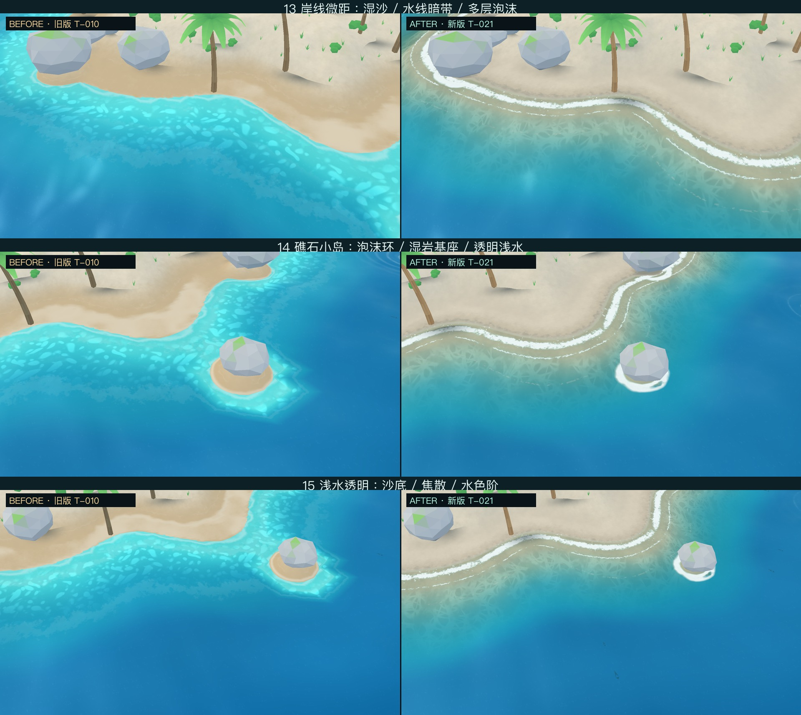
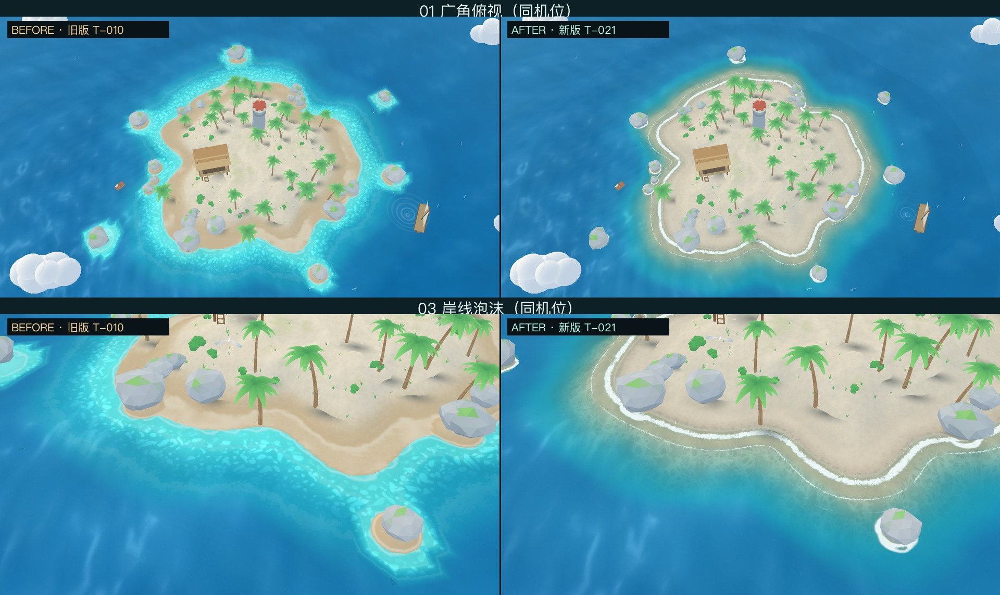
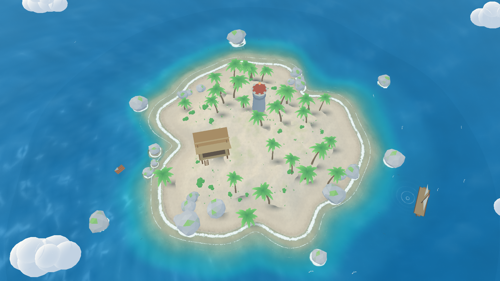
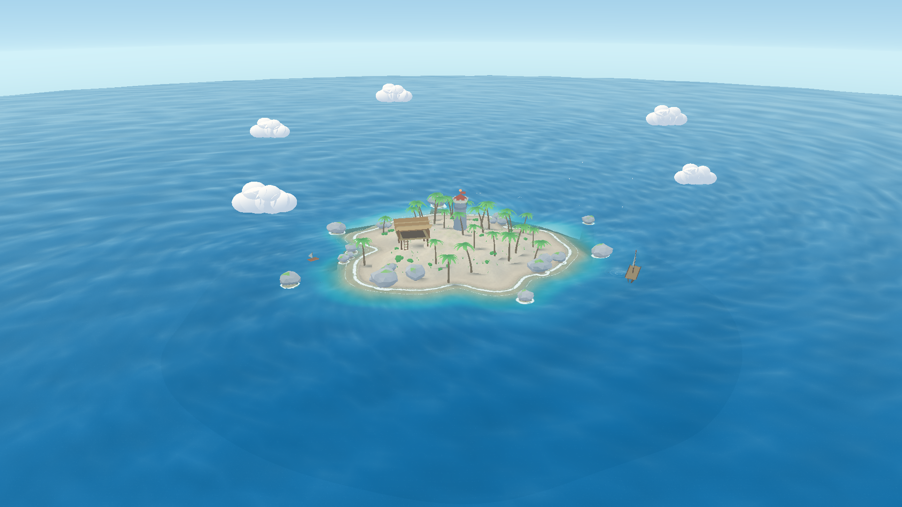

# 风格化海洋 · 第二版（Godot 4.6）

原创低模、程序化材质与实时水面的“卡通海岛 / 野生海洋”互动 demo。视觉语言参考 B 站 UP TechFusion 的《风格化海洋第二版》公开视频（构图、色阶、泡沫、俯视环绕镜头、昼夜与雨），**未复制其代码、模型、贴图、音频或视频素材**。

2026-11-26 岸线整改（T-20261126-021）：加入 **1024² 岸距场（SDF）**、**透明浅水（真实沙底/礁石透出）**、湿沙/水线暗带、2–3 条不规则泡沫带（成团/孔洞/拍岸涨落）、礁石湿岩基座 + 泡沫环；水下地形加密并延伸到 72 m，焦散改为细线光网。下方为同机位 before/after。







## 运行

```bash
# 需要 Godot 4.6（GL Compatibility）
godot --path godot-stylized-ocean-v2 --resolution 1280x720

# 1920×1080
godot --path godot-stylized-ocean-v2 --resolution 1920x1080
```

逻辑分辨率 1280×720（`canvas_items` 拉伸，可 1920×1080），渲染器 GL Compatibility，MSAA 关闭，无 SSR/SSAO/全屏流体。

## 操作

| 输入 | 行为 |
| --- | --- |
| 左键拖拽 | 水面持续扩散涟漪 / 尾迹（多源、随拖拽方向衰减） |
| 左键单击 | 落石 → 落水水花 + 大涟漪 + 扩散白环 |
| 右键拖拽 | 轨道相机旋转 |
| 滚轮 | 相机推拉 |
| H | 显示 / 隐藏 UI |
| Space | 暂停 / 继续水面与环境时间 |
| R | 下雨（粒子 + 水面雨点涟漪 + 轻微压暗） |
| C | 自动环绕开 / 关 |
| F1–F8 | 调试视图：关闭 / 浪高 / 法线 / 泡沫 / 涟漪源 / 水深 / 岸距场(SDF) / 岸线分层 |
| 1–3（面板按钮） | 正午 / 黄昏 / 夜晚 |

右侧中文参数面板：时间/太阳高度、太阳高光、浪高、浪速、浪向、岸边泡沫、水色三预设、涟漪强度/持续时间、鼠标涟漪开关、岸线编辑可视化、雨、自动环绕、俯瞰仰角、相机距离、调试视图、重置。

## 视觉与交互

- **海面**：环形渐变 LOD 单网格（近岸密、远海疏），6 层 Gerstner 波；解析法线；无 CPU 流体。
- **浅水**：浅水区真透明（alpha 随水深 0.14→1），沙底/礁石真实透出；1024² 岸距场（R 岸距、G 道具接触环、B 泡沫宽度、A 拍岸相位）同时驱动水面与地形。
- **水体**：深度色阶（深海 `#12669d` → 中水 `#1a74a8` → 礁盘 `#1a97b3` → 潟湖 `#3fc4c5` → 水膜 `#a8cbb8`），菲涅尔天空反射、卡通日光/闪点、水下细线焦散、浪尖泡沫、次表面色。
- **岸线**：湿沙带 3.6–6.0 m（干沙→潮湿→湿沙→水线暗带）、0.30–0.80 m 水线暗带、主泡沫带 + 第二道白线 + 稀疏第三道 + 离岸泡沫团、礁石泡沫环/湿岩基座；拍岸相位使宽度和位置随岸线变化。
- **场景**：程序化海岛高度场（沙丘、湿沙、潮线）、低模棕榈/礁石/木屋/瞭望塔/帆船/小筏、海鸥、鱼影、云、昼夜调色；软接触阴影（无阴影贴图开销）。
- **交互**：鼠标射线解析求交水面，12 路涟漪源叠加高度与法线；落石弹道 + 水花 + 白环；船尾自动尾迹；雨点自动涟漪；相机自动环绕/手动轨道。
- **调试**：8 种视图 + FPS/draw calls/涟漪数；中文 UI 可缩放至 1.5×（1920×1080 截图）。

## 性能（真实 GPU：Intel HD Graphics 6000）

`tools/probe_stylized_ocean.gd`，vsync 关闭，固定机位，SSAA/MSAA 关闭：

| 场景 | 视口 | 平均 FPS | draw calls |
| --- | --- | --- | --- |
| 默认（白天广角） | 1280×720 | **77.3** | 66 |
| 下雨 | 1280×720 | **58.6** | 67 |
| 显示 UI 面板 | 1280×720 | **54.5** | 171 |
| 默认（白天广角） | 1920×1080 | **31.9** | 65 |

1280×720 目标 30fps+ 有约 2.5× 余量；1920×1080 约 32fps（透明浅水 + 岸距场采样的代价，仍满足 Intel 30fps+；后续可按半径拆分透明浅水盘/不透明深海环获得更大余量）。

## 自测 / 证据

```bash
# 无头 smoke（69 项检查；末行 STYLIZED_OCEAN_SMOKE_OK）
godot --headless --path godot-stylized-ocean-v2 -s tools/smoke_stylized_ocean.gd

# 真实 GPU 1920×1080 截图矩阵（19 张 + before 对照）
godot --path godot-stylized-ocean-v2 -s tools/screenshot_stylized_ocean.gd

# 性能探针
godot --path godot-stylized-ocean-v2 -s tools/probe_stylized_ocean.gd

# 10s 展示片帧 + 编码
godot --path godot-stylized-ocean-v2 -s tools/capture_stylized_ocean.gd
bash tools/build_media.sh

# 一键导入/smoke/600 帧启动/截图
bash tools/verify.sh
```

产物：

- 截图：`docs/shots/01–17`（1920×1080，真实 GPU；含岸线微距/礁石/浅水/夜景岸线/泡沫相位）
- Before 对照：`docs/shots/before/`（旧版 01/02/03/08/10/11 + 13–17 同机位旧版渲染）
- 对照表：`docs/shots/compare_wide.jpg`、`compare_shore_detail.jpg`、`compare_night_rain.jpg`、`compare_swash.jpg`
- 视频：`docs/ocean_v2.mp4`（10s / 1280×720 / 15fps：广角 → 岸线微距 → 礁石 → 黄昏 → 夜景岸线）；GIF 同目录
- 技术细节：`docs/TECH.md`；参考对照与整改记录：`docs/迭代记录.md`

## 目录

```
scenes/main.tscn               主场景（Node3D + ocean_world.gd）
scripts/island_field.gd        海岛高度场 / 水深贴图 / 岸距场(SDF) 烘焙
scripts/ocean.gd               环形 LOD 海面、6 波、12 路涟漪
scripts/world_builder.gd       地形、植被、建筑、船、云、鸟、鱼、雨、昼夜、阴影
scripts/props.gd               程序化低模（石/棕榈/木屋/塔/船/云/鸟/鱼）
scripts/ocean_world.gd         交互、落石、水花、相机、HUD 主控
scripts/camera_rig.gd          轨道相机 + 水面射线
scripts/hud.gd                 中文参数面板 / 调试 / 统计
scripts/tex_factory.gd         可平铺泡沫/法线/焦散/太阳闪点/阴影贴图
shaders/water.gdshader         海面（Gerstner/色阶/泡沫/焦散/高光/涟漪）
shaders/terrain.gdshader       沙地/水下沙底（湿沙/水线暗带/沙纹/焦散/手绘方向光/夜间灯晕）
shaders/rock/foliage/...       低模道具、云、鸟、天空
tools/                         smoke / 截图 / 录制 / 性能探针 / verify
docs/                          TECH / 迭代记录 / 截图 / 视频
```

## 备注 / 已知取舍

- 为了在 Intel HD 6000 + GL Compatibility 上稳定 30fps+，方向光实时阴影关闭，改用美术可控的软椭圆接触阴影；沙地/岩石/植被采用“手绘方向光”unshaded 着色，避免 GL 兼容路径下方向光的异常表现。
- 浅水为单网格透明绘制，深海 alpha=1；鱼群以水面剪影表示，无 SSR/平面反射。1080p 默认约 31.9 fps。
- 泡沫/焦散为程序噪声风格化，不是流体模拟；礁石泡沫环在个别角度偏亮。
- 岸距场是启动时一次性烘焙（1024²，约 1.5–4 s，取决于机器负载），运行时无 CPU 距离计算。
- 低机位海平线处可见水面圆盘边缘（带空气透视柔和），不是无限海洋。
- 参考视频只用于视觉语言对照；所有资产为原创程序化生成。

## Credits

见 [CREDITS.md](CREDITS.md)。引擎：Godot 4.6（GL Compatibility）。参考：TechFusion《风格化海洋第二版》BV1AE4u6KEAR（仅视觉参考，未使用素材）。
