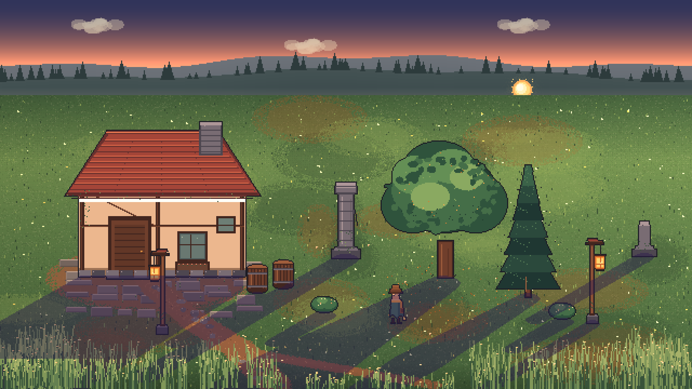
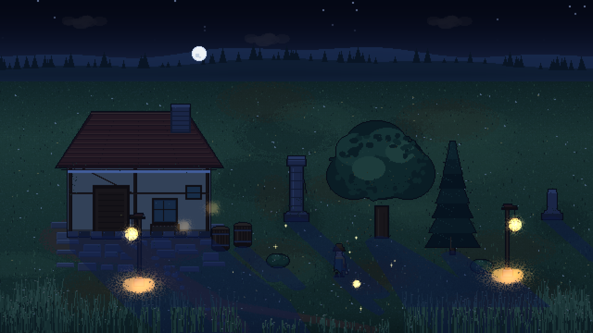

# 日月双影 · Sun & Moon Shadows

Godot 4.6 / GL Compatibility / 2D 像素 / 640×360 内部画布，1280×720 与 1920×1080 整数放大。

一个固定机位的原创林间空地。白天太阳与夜晚月亮沿同一南天弧东升西落，交接时
光强与影 alpha 淡入淡出；**3 个全局 Shader 向量**统一驱动所有实体、天空与地面影；
影子是 CPU 顶点坍缩 + 多边形并集的**单一网格**（重叠区域只覆盖一层）；单通道
**R8 高度图**做 2.5D 接收面遮挡；影长在 **3H 的 60%** 处进入软膝；21:00 冷蓝月影与
暖黄路灯照明池同时成立。





## 操作

底部控制条（鼠标）：0–24h 时间滑杆、播放/暂停、重置、1× / 4× / 16× / 64×、
影子 / 软膝 / 路灯开关、调试按钮。

| 键 | 功能 |
| --- | --- |
| 空格 | 暂停 / 播放 |
| 1 / 2 / 3 / 4 | 12:00 正午 / 18:20 黄昏 / 21:00 月夜 / 00:30 午夜 |
| S / K / L | 影子 / 软膝 / 路灯 |
| F3 | 调试面板（曲线 + 四个视图开关） |
| G / O / B / V | 高度图 / 遮挡热力 / 影子网格 / 重叠采样 |
| H | 隐藏 / 显示 UI |
| R | 重置到 08:00、16×、全开 |

速度：`1× = 0.02 游戏小时/秒`（一天 20 分钟），`16× = 75 秒/天`，`64× ≈ 18.75 秒/天`。
默认 08:00、16× 自动播放。

## 模型参数

- **太阳**：05:00 东升，12:00 最高 68°，19:00 西落；`arc=(h-12)/7`，
  `elev=68°·cos(arc·π/2)`，`az=90°+arc·90°`。
- **月亮**：18:30 东升，00:30 最高 52°，06:30 西落；`arc=2p-1`，
  `elev=52°·cos(arc·π/2)`，同一方位扫掠。
- **影向**：`(-arc, 0.55).normalized()`——晨右、午下、昏左，0.55 是 3/4 俯视压缩。
- **影长**：`H/tan(elev)`；`cap=3H`，`knee=0.6·cap=1.8H`；过膝后
  `knee + span·(1-e^{-(raw-knee)/span})`，C1 连续渐近 3H。
- **3 个全局向量**（`project.godot` 注册，`RenderingServer.global_shader_parameter_set`）：
  - `u_light_dir` = `(光向.x, 光向.y, 高度/90, 夜权重)`
  - `u_light_color` = `(当前主光 RGB, 强度)`
  - `u_ambient_sub` = `(环境扣除/阴影 RGB, 扣除强度)`
  所有实体共用一份 `lit_sprite.gdshader`，地面/天空/影子各一份共享材质；没有逐物体灯光参数。
- **高度图**：640×360 单通道 `Image.FORMAT_R8`（GL Compatibility 下 R16F 采样不稳定，
  用 R8 等价，256 级；归一化 160px）。影子 shader 在 `SCREEN_UV` 采样，
  `receiver + bias < caster` 才落影。
- **夜景**：月亮主光强度 0.55，月影环境扣除 alpha ≤0.5；路灯/窗光/萤火是阴影之后的
  加法层（z 44–55 > 阴影 z 30），不会把月影洗成暖色，月影也不会乘到灯色上。

完整推导、视频帧对照与算法说明见 [docs/TECH.md](docs/TECH.md)，
迭代记录见 [docs/迭代记录.md](docs/迭代记录.md)。

## 运行与验收

```bash
# 直接运行
godot --path godot-sun-moon-shadows --resolution 1280x720

# headless 自测（末行 SUN_MOON_SHADOW_SMOKE_OK）
godot --headless --path godot-sun-moon-shadows -s tools/smoke_sun_moon_shadows.gd

# 真实 GPU 像素/FPS 探针（1280 + 1920）
godot --path godot-sun-moon-shadows --resolution 1280x720 -s tools/probe_sun_moon_shadows.gd

# 1920×1080 截图矩阵
godot --path godot-sun-moon-shadows -s tools/screenshot_sun_moon_shadows.gd

# 一键验收（可选 WITH_MEDIA=1 重建 GIF/MP4）
tools/verify.sh
WITH_MEDIA=1 tools/verify.sh
```

（`tools/verify.sh` 已包含 import、smoke、headless/GPU 600 帧、探针与 1920 截图；
`WITH_MEDIA=1 tools/verify.sh` 额外采集 10s 序列并重建媒体。）

### 自测结果

- headless smoke：`SUN_MOON_SHADOW_SMOKE_OK`，280 checks / 0 fails。
- GPU 探针：`SUN_MOON_SHADOW_PROBE_OK`，18 checks / 0 fails。
- 影子重叠 alpha：单影 0.443 / 重影 0.431 / 配置 0.444（一次覆盖，不是两层）。
- 夜景探针：公开月影点 `#102427`（冷）、路灯池 `#ffc165`（暖）、灯池内月影仍有 0.097 亮度差。
- 1280×720：**112.6–183.0 FPS**；1920×1080：**62.6–68.5 FPS**（Intel HD Graphics 6000，
  GL Compatibility，关闭垂直同步，多次 3 秒采样，均 ≥30）。HUD 静态截图 draw calls 约 66–86，影子始终一个 draw layer。
- headless / GPU 600 帧启动均无 `SCRIPT ERROR` / `ERROR:`（日志在 `docs/logs/`）。

## 截图与媒体

1920×1080，真实 GPU，3× 整数放大：

| 文件 | 说明 |
| --- | --- |
| `docs/shots/01_0800_clean.png` | 08:00 晨光长影 |
| `docs/shots/02_noon_clean.png` | 12:00 正午短影 |
| `docs/shots/03_dusk_clean.png` | 18:20 黄昏长影 |
| `docs/shots/03b_handoff_1900.png` | 19:00 日月交接：太阳落山、月亮低升、路灯亮起、影 alpha 归零 |
| `docs/shots/04_night_2100_clean.png` | 21:00 冷蓝月影 + 暖黄路灯 |
| `docs/shots/05_midnight_moon_clean.png` | 00:30 月亮最高 |
| `docs/shots/06_overlap_markers.png` + `06b_overlap_crop.png` | 08:00 两树影重叠采样标记 |
| `docs/shots/07_heightmap.png` | R8 高度图调试 |
| `docs/shots/08_occlusion_heat.png` | 遮挡热力（按投影体高度着色） |
| `docs/shots/09_mesh_wireframe.png` | 并集影子网格线框 |
| `docs/shots/10_debug_panel_curve_soft.png` | 软膝曲线（开） |
| `docs/shots/11_debug_panel_curve_hard.png` | 硬截对比（关） |
| `docs/shots/12_noon_ui.png` | 正午中文 UI |
| `docs/shots/13_night_ui.png` | 夜间中文 UI（月亮从面板右侧露出） |

10 秒延时：`docs/sun_moon_shadows.mp4`（1280×720 / 15fps）、
`docs/sun_moon_shadows.gif`（640×360 / 12fps，约 2.9MB）。

## 项目结构

```
scripts/light_model.gd     日月弧、接力淡入、软膝、色温
scripts/shadow_builder.gd  顶点坍缩 / 凸包 / 并集 / 单网格
scripts/world.gd           场景、高度图、材质、路灯、调试
scripts/pixel_art.gd       全部原创程序化像素图
scripts/hud.gd             中文 HUD
scripts/curve_plot.gd      软膝曲线
scripts/debug_overlay.gd   网格 / 重叠 / 高度图调试线
shaders/                   lit / ground / sky / shadow_union / lamp_glow
tools/                     smoke / probe / screenshot / capture / verify
```

## 许可与致谢

代码与像素素材为本项目原创（运行时代码生成，无外部图像素材）。中文像素字体使用
Fusion Pixel 12px / 10px（OFL-1.1），详见 [CREDITS.md](CREDITS.md) 与
`assets/fonts/OFL.txt`。参考视频只用于技术学习，未复制任何 Unity/C# 源码或视频素材。
