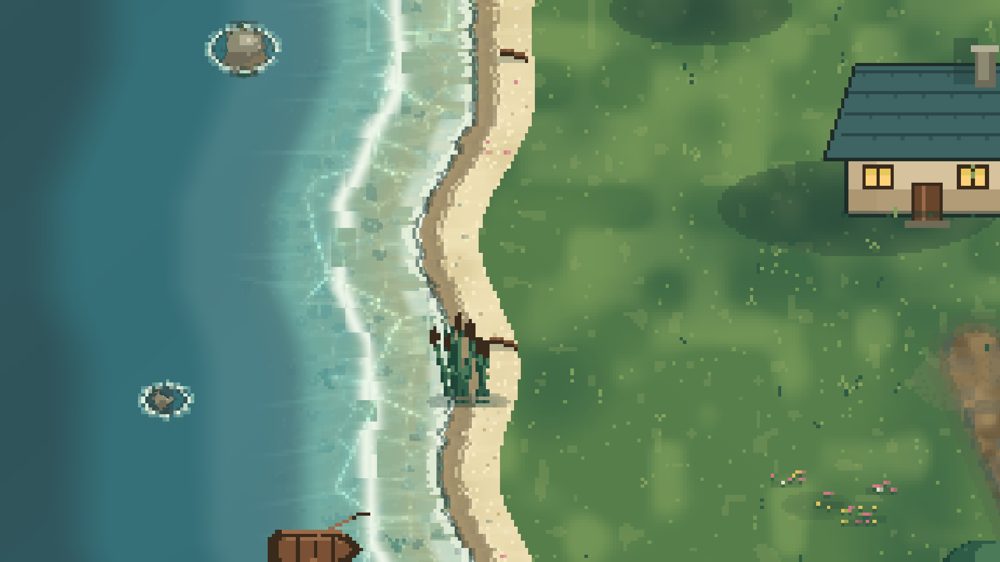
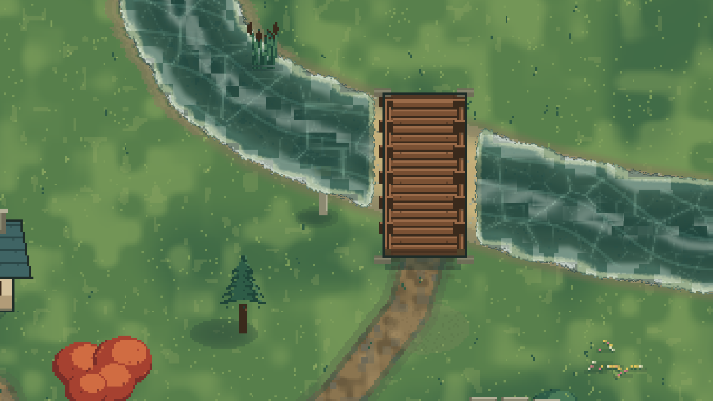
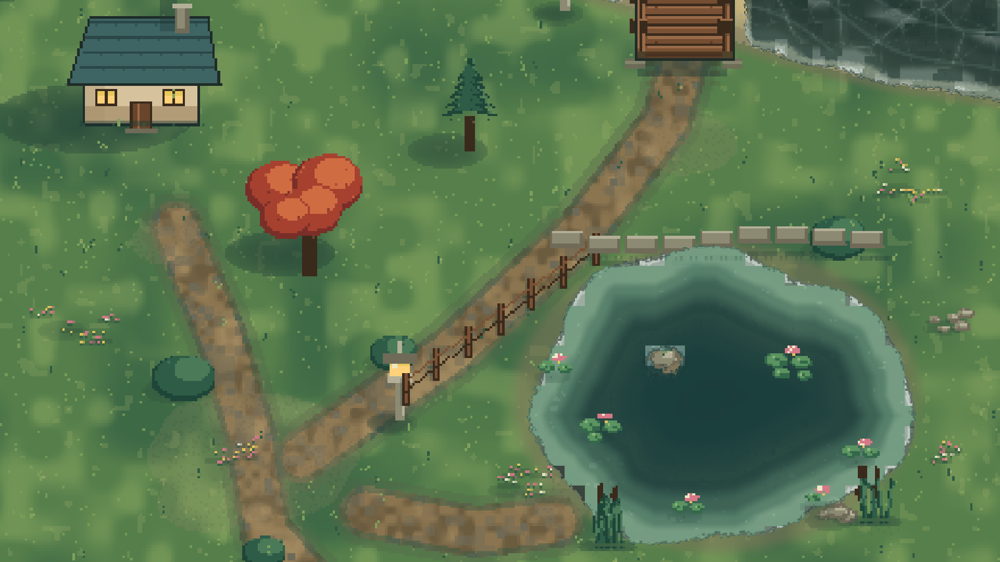
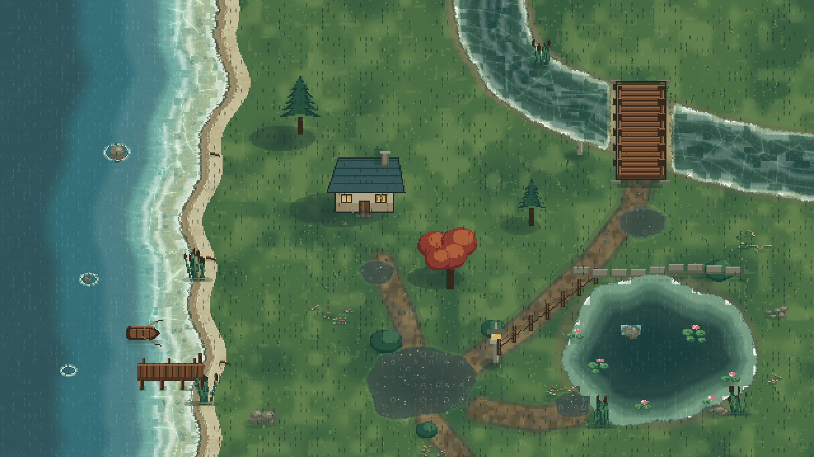
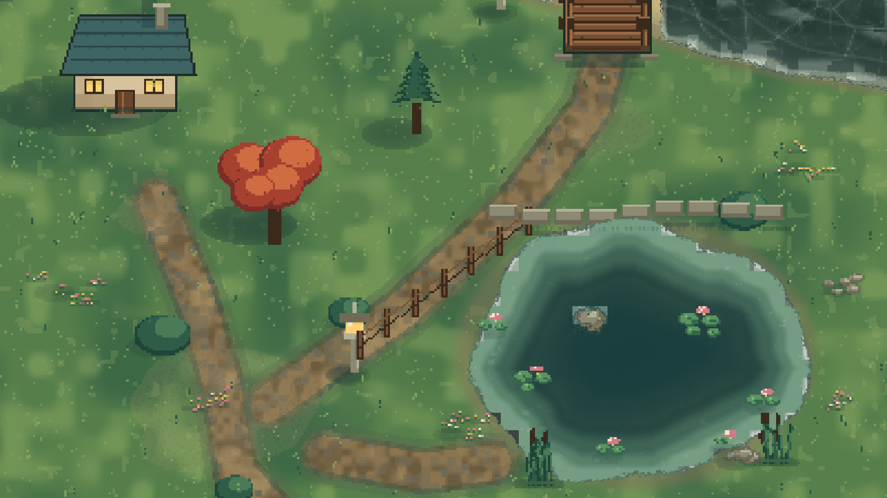
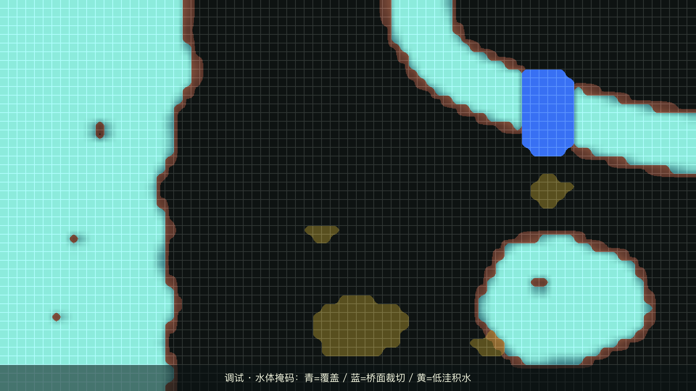
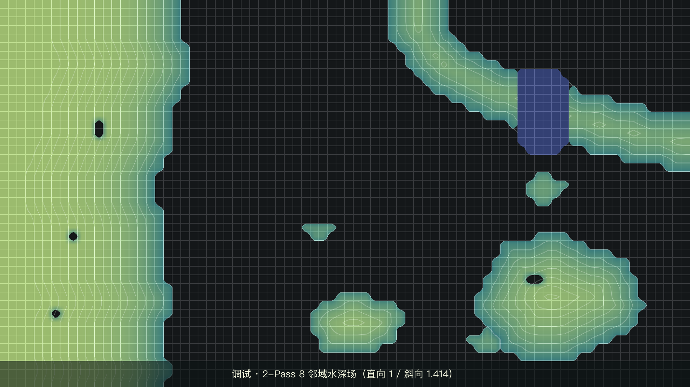
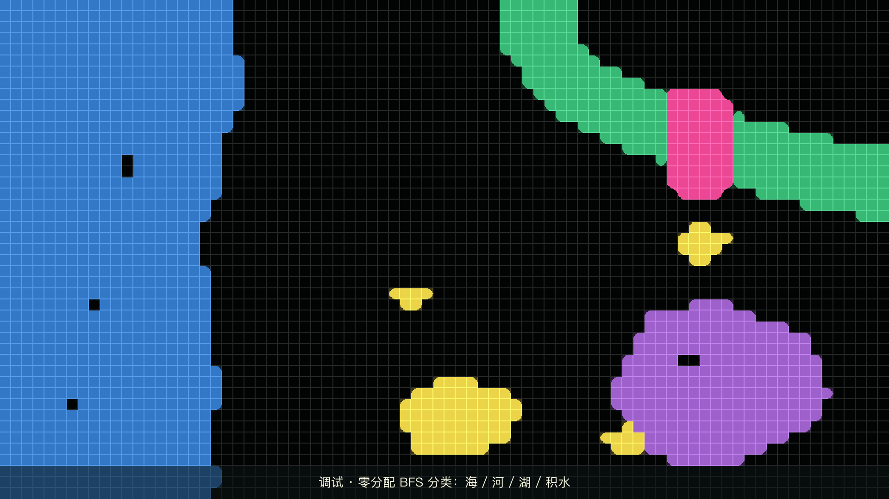
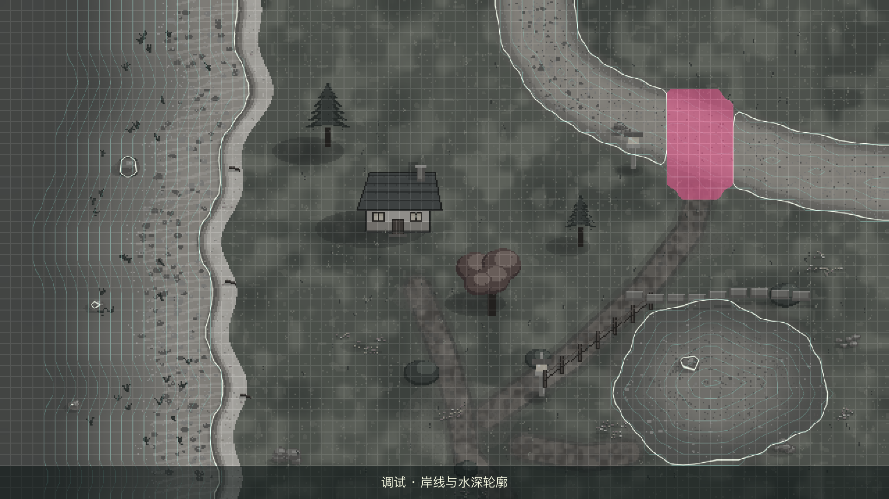
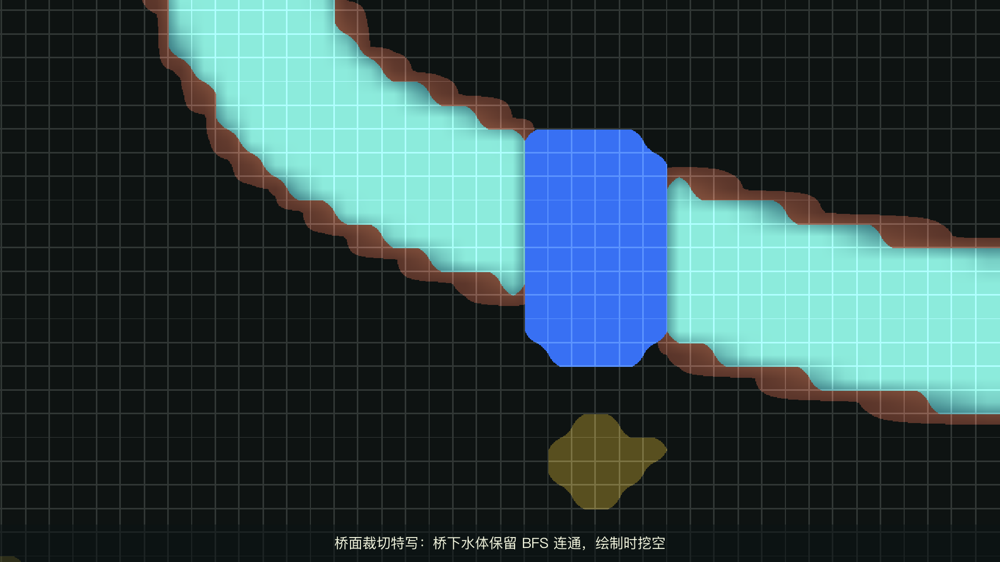

# 潮汐花园 · Tidal Garden

一个 **Godot 4.6 / GL Compatibility / 2D 像素** 水面 Demo：海、河、内陆湖共用 **1 个全屏水面 Shader**，没有额外水面网格，也不建全图高清 RT。

> **美术状态（2026-11-26）**：T-20261126-004 独立评审给出 4 项 P0（外放 REJECT）；**T-20261126-005 已完成整改**：P0 全部关闭、P1 大部分完成。真实 GPU 自检：海深/浅 L* 34.1/71.4、河心 vs 草 35.0/47.2、湖心 24.1、湿沙 61.6（8–10 逻辑 px）、焦散 p95 4.52、白沫纯白 0、HUD 面板 16.19% / 按钮 32 / 字幕 48px；720p 默认 HUD 156.1 fps、1080p 默认 HUD 122.7 fps（面板展开是开发者状态，数值见性能表）。QA `T-20261126-006` 与 AD 复评 `T-20261126-007` 仍待独立执行。
>
> Before/After 与 1920/1280/25%/4×：`docs/shots/art-review/after/`；指标 JSON：`metrics_after.json`；brief：`docs/art-review-T-20261126-004.md`。

岸线来自手绘像素 mask；运行时按 **16px 格**降采样抠图，用 **2-Pass 8 邻域倒角距离**求连续水深，再用 **预分配队列 BFS** 自动分成海 / 河 / 内陆湖。内陆湖（不贴地图边界）自动关闭海浪与焦散。同一套水面逻辑还复用在雨天低洼积水与雨点涟漪上。










## 快速运行

```bash
# 在仓库根目录
godot --path godot-water-shader

# 1920×1080 窗口（世界仍按 1280×720 逻辑渲染后放大）
godot --path godot-water-shader --resolution 1920x1080
```

- Godot **4.6**，渲染后端 **GL Compatibility**，无第三方运行时依赖。
- 默认窗口 1280×720，逻辑世界 1280×720；屏幕比例保持 16:9。
- 首次启动会程序化生成像素场景（含 shore/reflections/芦苇）并烘焙水面数据，空载约 3–4 秒（并行负载下 5–7 秒）；随后启动很快。

## 操作

| 操作 | 功能 |
| --- | --- |
| 空格 | 暂停 / 继续水面时间 |
| 1 / 2 / 3 | 观察 海域 / 河流 / 内陆湖（相机推近，并高亮该类水体） |
| 0 / Esc | 回到全部水体 |
| R | 开 / 关降雨 |
| F | 循环调试视图：关闭 / 水体掩码 / 水深场 / 水体类别 / 岸线 |
| B | 重建数据管线（输出可复现） |
| N | 重置所有参数与时间 |
| H | 展开 / 收起参数面板（默认收起，只留左上 chip） |
| T | 潮汐在 0% / 100% 之间切换（快捷演示） |

面板滑杆：

- **潮汐**：移动岸线切分阈值，并改变波前推进距离。
- **流速 / 浪幅 / 泡沫 / 焦散**：全局倍率，叠加在海 / 河 / 湖各自的基础预设上。
- **雨量**：雨丝、雨点涟漪和低洼积水的强度。

面板实时显示 **FPS、draw calls、水体数量与各自覆盖率、时间、雨量、观察目标、调试视图**。


## 三水体参数预设

| 水体 | 浪幅 | 流速 | 泡沫 | 焦散 | 说明 |
| --- | --- | --- | --- | --- | --- |
| 海域 | 1.00 | 0.55 | 1.00 | 1.00 | 5 档色阶、透沙、双波前、2 octave 焦散、向岸流动 |
| 河流 | 0.32 | 1.35 | 0.50 | 0.70 | 单向主轴流动；内部压深，桥下连通，泡沫 ×0.35 |
| 内陆湖 | 0.05 | 0.00 | 0.00 | 0.00 | BFS 判定不贴边 → 关海浪 / 关焦散 / 无泡沫环 |
| 积水 | 0.02 | 0.00 | 雨控 | 0.00 | 深湿石水膜 + 右上天空反光 + 雨环/溅水 |

滑杆是全局倍率；切换海 / 河 / 湖只改变观察机位与高亮，不改变 BFS 分类。




## 数据管线（3 步）

1. **16px 抠图**：手绘 mask 为 1280×720；每个 16px 格做 8×8 子采样，得到覆盖率和硬水格。桥面格从绘制 mask 中挖掉，但保留“桥下水体”标志用于连通。
2. **2-Pass 8 邻域水深**：直向 ×1、斜向 ×1.414 的倒角距离变换；输出 `R = 1-exp(-d/3.2)` 的展示水深，`G = d/16` 的距岸格数（供双波前使用）。
3. **零分配 BFS 分类**：一次性分配的队列 / 访问表 / 统计数组；按“是否贴图边 + 平均宽度”分类：不贴边 → 内陆湖；贴边且平均宽度 < 9.5 格 → 河流；否则 → 海域。

管线输出可直接查看与重建：

- `docs/pipeline/mask.png`（R 硬水 / G 覆盖率 / B 桥面 / A 桥下水体）
- `docs/pipeline/depth.png`（R 显示水深 / G 距岸格数）
- `docs/pipeline/category.png`（R = 类别 × 0.25）
- `docs/pipeline/flow.png`（RG 方向）
- `docs/pipeline/puddle_mask.png`、`docs/pipeline/puddle_depth.png`
- `docs/pipeline/meta.json`（类别统计、`islet_cells`、哈希、单元尺寸）
- `docs/pipeline/source_mask_1280.png`（手绘源 mask）

实测：水体 3 个；海 888 格（68% 水体）、河 210 格（16%）、湖 216 格（16%）；低洼 88 格；桥面裁切 57 格；封闭礁石/湖心岛格数见 `meta.json` 的 `islet_cells`（T-005 起，岛不参与水深种子，消除同心浅水光晕）。











## 单水面 Shader

场景里与水面相关的只有：

- 地面 `Sprite2D`（静态像素图；水下沙底/鹅卵石/海草）
- **一个** 1280×720 的 `ColorRect`（唯一水面绘制节点，挂 `water_surface.gdshader`）
- 岸线覆盖 `Sprite2D`（z=2；湿沙/水线/白沫，不含任何水面绘制）
- 倒影 `Sprite2D`（z=5；桥/船/礁石/芦苇/睡莲/石墙的静态倒影）
- 前景 `Sprite2D`（桥、栈桥、睡莲、小船，z=10）与 5 个芦苇簇（z=11）
- HUD `CanvasLayer`

没有 `MeshInstance2D` / `Polygon2D` 水面，也没有 `screen_texture` / 全屏 RT。5 档色阶、透沙、焦散、泡沫、湿沙、雨积水全部在同一个 fragment shader 或 sprite 资产里合成；水面材质只被一个节点使用（smoke 断言）。

## 自测

```bash
# 无头规则验收（末行 WATER_SHADER_SMOKE_OK）
godot --headless --path godot-water-shader -s tools/smoke_water_shader.gd

# 无头 / 真实 GPU 启动 600 帧，扫描 ERROR
godot --headless --path godot-water-shader --quit-after 600
godot --path godot-water-shader --resolution 1280x720 --quit-after 600

# 1920×1080 截图（16 张 + after/ 对照）
godot --path godot-water-shader -s tools/screenshot_water_shader.gd

# 性能探针
godot --path godot-water-shader --resolution 1280x720 -s tools/probe_water_shader.gd
godot --path godot-water-shader -s tools/probe_water_shader_1080.gd

# 一键
godot-water-shader/tools/verify.sh

# 10 秒 GIF / MP4（较慢，单独跑）
godot-water-shader/tools/build_media.sh
```

当前结果（T-20261126-005）：

- smoke：`WATER_SHADER_SMOKE_OK checks=151`，新增 HUD 16.19%/按钮 32/字幕 48、岸线泡沫像素、islet 不种子、2 octave 焦散、芦苇 5 簇、hero 机位。
- 无头 / 真实 GPU 600 帧启动：`SCRIPT ERROR / ERROR:` 均为 0；`tools/verify.sh` 通过。
- 截图：16 张 **1920×1080**；`docs/shots/art-review/after/` 同时有 1280×720（LANCZOS 缩放）、480×270 25%、4× NEAREST、before/after 与 `metrics_after.json`。
- 视频：`docs/water_shader.mp4`（10s，1920×1080，30fps，~4MB）、`docs/water_shader.gif`（10s，800×450，12fps，96 色，<5MB）。
- 复现指标：`python3 godot-water-shader/tools/make_after_evidence.py`。

## 性能（Intel HD 6000 / GL Compatibility / VSync off）

| 场景 | 平均 FPS | 1s 采样区间 | draw calls |
| --- | ---: | ---: | ---: |
| 1280×720 世界 + 满雨 | 172.7 | 168–175 | 11 |
| 1280×720 + 默认 HUD（面板收起） | **156.1** | 155–162 | 14 |
| 1280×720 + 面板展开（开发者 UI） | 116–137 | 105–145 | 75 |
| 1920×1080 离屏 + 满雨 | 137.4 | 132–142 | 11 |
| 1920×1080 + 默认 HUD | **122.7** | 121–126 | 14 |
| 1920×1080 + 面板展开 | 86–103 | 68–106 | 75 |

以上为 T-005 整改后、单独运行探针的实测（Intel HD 6000 / VSync off）；并行跑 verify/其他任务时会低 10–15%（720p 默认 HUD 曾测 146.6）。**默认 HUD（面板收起）720p 156.1 ≥150、1080p 122.7 ≥90**；面板展开是开发者状态，720p 116–137、1080p 86–103，仍远高于用户要求的 30fps。水面绘制节点始终为 **1**。1280×720 逻辑在世界层渲染，1920×1080 通过显示放大（像素风）。

## 目录

```
godot-water-shader/
├─ project.godot
├─ scenes/main.tscn
├─ scripts/
│  ├─ main.gd               主控 / 相机 / HUD 接线
│  ├─ water_pipeline.gd     mask→覆盖率→8 邻域 depth→BFS 分类→数据纹理
│  ├─ water_controller.gd   三预设 / 全局倍率 / uniform
│  ├─ pixel_art.gd          原创程序化像素场景 + 手绘式 mask + shore/reflections/芦苇
│  └─ hud.gd                默认收起的中文面板 / 调试视图 / 48px 字幕条
├─ shaders/water_surface.gdshader   唯一水面 shader（T-005 视觉版）
├─ tools/                   smoke / 截图 / 视频 / 性能 / 一键验收 / after 采样
├─ docs/
│  ├─ TECH.md               算法、shader 公式、T-005 视觉层/性能取舍
│  ├─ 迭代记录.md           参考帧观察、实现迭代、T-005 before/after
│  ├─ agency/T-20261126-001.md  程序实现报告
│  ├─ art-review-T-20261126-004.md  AD brief（P0–P2）
│  ├─ pipeline/             80×45 数据纹理 + meta（可重建比对）
│  ├─ shots/                16 张 1920×1080 截图
│  ├─ shots/art-review/after/  外放 6 图 + 1280/25%/4× + metrics JSON + before/after
│  └─ water_shader.mp4/.gif
├─ README.md
└─ CREDITS.md
```

## 许可与参考

- 代码与全部像素素材均为本任务原创；场景由 `pixel_art.gd` 以固定种子程序化绘制。
- 技术参考：B 站《2D游戏海河湖共用1个水面Shader？零额外网格源码拆解》（UP：小武同学贼下饭，https://b23.tv/KYEA6ng）。仅用于理解算法与视觉语言；未复制 Unity/C# 源码、视频画面或素材。参考视频只下载到 `/tmp` 做抽帧分析。
- 中文字体使用 `SystemFont`（PingFang SC / Noto Sans CJK 等系统回退），不随项目分发字体文件。
- 无第三方运行时库。

详细公式与验证见 [docs/TECH.md](docs/TECH.md)（T-005 以第 12 节为准），迭代过程与 before/after 见 [docs/迭代记录.md](docs/迭代记录.md)。
