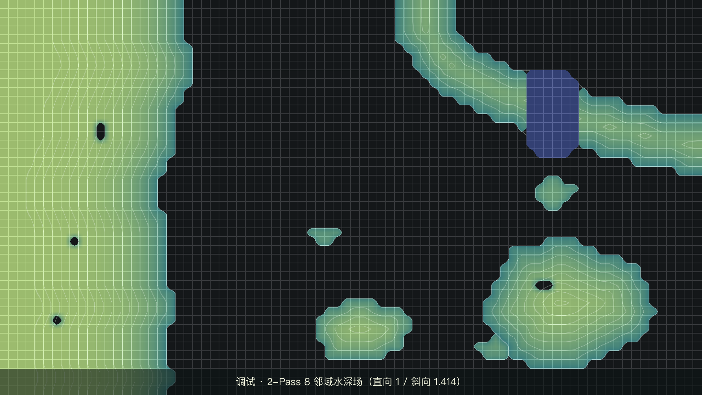
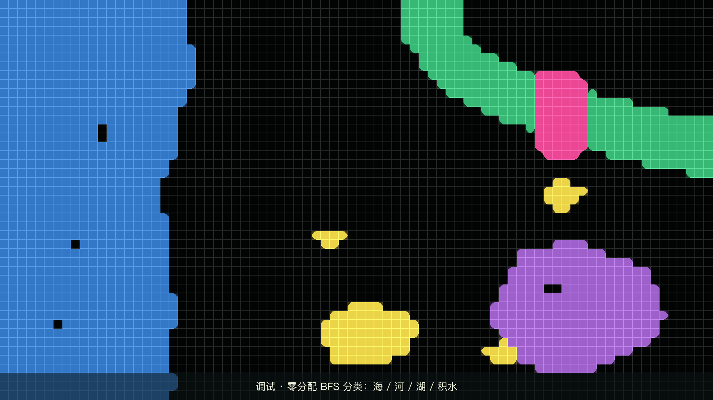
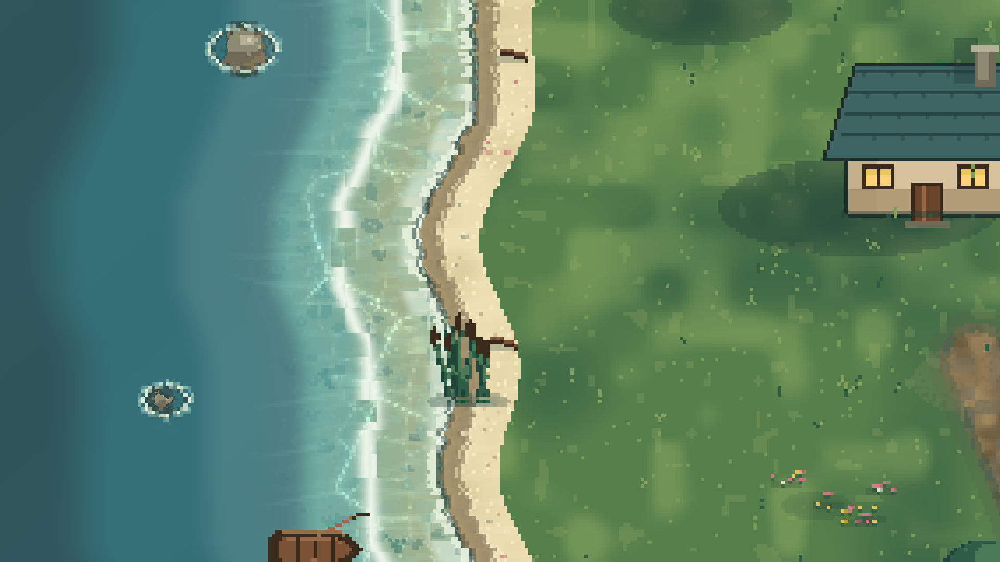
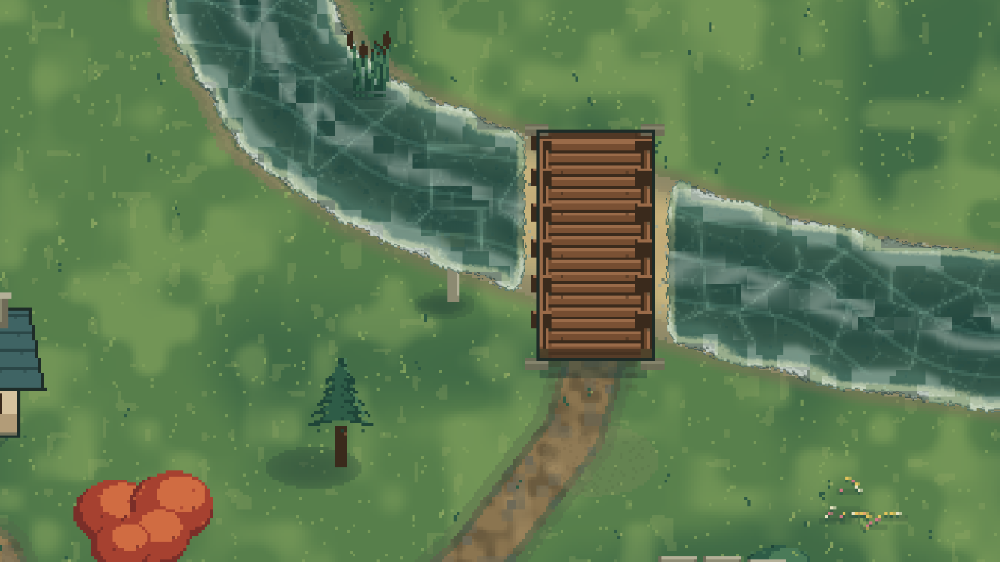
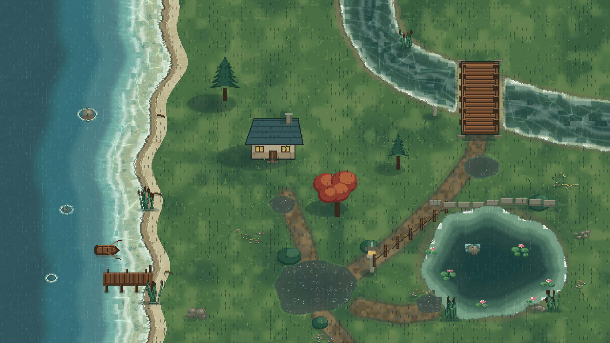
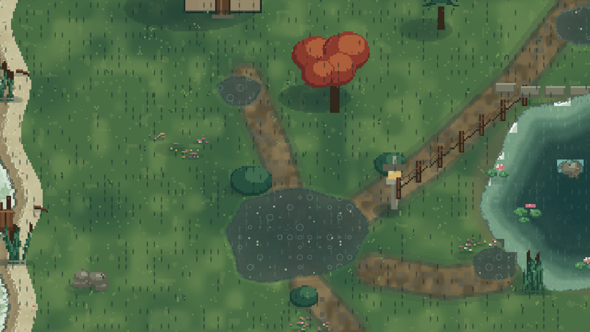

# TECH · 潮汐花园水面方案

- 引擎：Godot 4.6 stable / GL Compatibility / 2D
- 逻辑世界：1280×720；窗口默认 1280×720，可 1920×1080
- 数据栅格：16px / 格 → **80×45**
- 参考：B 站《2D游戏海河湖共用1个水面Shader？零额外网格源码拆解》（小武同学贼下饭，https://b23.tv/KYEA6ng）
  - 仅作算法与视觉语言研究；未复制 Unity/C# 源码、视频素材或贴图。
  - 视频 3:53（1080×1920 竖屏）下载到 `/tmp/water_ref/`，抽帧时间点 15 / 45 / 75 / 105 / 135 / 165 / 195 / 225s。
  - 从帧中确认的技术点：16px 离线抠图、2-Pass 8 邻域（直向 1 / 斜向 414）、3×3 Voronoi 焦散、双波前白沫、BFS 内陆湖关海浪、桥面裁切、雨天积水复用底层数据。

本实现是 clean-room 复刻：场景、像素图、数据管线、shader、UI 全部在本项目内原创生成。

> **2026-11-26 T-20261126-005 视觉整改后**：第 5 节的旧视觉参数（两色水深、单层白沫、无湿沙/倒影）已被第 12 节取代；数据骨架（16px mask / 8 邻域 / BFS / 单水面 shader）不变。第 12 节同时记录 islet depth 处理、性能取舍与实测。

---

## 1. 场景与素材

`scripts/pixel_art.gd` 先画 **640×360**，再最近邻放大 **2×** 到 1280×720：

- 左侧海湾 + 沙滩 + 水下沙底 / 鹅卵石 / 海草 / 三块礁石
- 右上河流（S 形）与 **木桥**，桥下有水、绘制时挖空
- 右下封闭 **内陆湖**（湖心小岛、睡莲、芦苇）
- 中部小屋、松树、红枫、石灯笼、木栅栏、花丛、石板小径
- 低洼石径：雨天积水种子区
- 前景层单独绘制桥、栈桥、小船、芦苇、睡莲（位于水面之上）

所有随机细节由固定种子 `20261126` 驱动；重建结果逐字节一致。

## 2. 16px 抠图

手绘 mask 是 1280×720 RGBA：

| 通道 | 含义 |
| --- | --- |
| R | 实际绘制水体（桥面已挖空） |
| G | 低洼积水种子（陆地上的洼地） |
| B | 桥面裁切格 |
| A | 桥下水体（用于 BFS / 水深保持连通） |

管线对每个 16px 格做 **8×8** 子采样（步长 2px）：

- `coverage = 水体采样数 / 64`
- 硬水格：`coverage ≥ 0.5`
- 低洼格：低洼覆盖率 ≥ 0.40，且不是水、不是桥
- 桥格：桥覆盖率 ≥ 0.35；绘制覆盖率强制为 0，但若 A 通道有水，则 BFS 与水深层把该格当水

这样手绘岸线以 16px 为单位保留，coverage 给 shader 提供亚格级的边缘抖动空间。


## 3. 2-Pass 8 邻域水深

对“水体格 ∪ 桥下水体格”做倒角距离变换；陆地/桥外为 0 种子：

**正向扫描**（上→下、左→右）：

```text
d = min(d,
        left + 1,
        up + 1,
        up_left + 1.41421356,
        up_right + 1.41421356)
```

**反向扫描**（下→上、右→左）：

```text
d = min(d,
        right + 1,
        down + 1,
        down_right + 1.41421356,
        down_left + 1.41421356)
```

输出两张数据：

- `depth.R = 1 - exp(-d / 3.2)`：0..1 的展示水深，浅水缓、深水趋近 1
- `depth.G = d / 16`：原始“距岸格数”，给双波前算距离用（shader 里 ×16 还原）

积水使用同一套倒角算法，只是种子换成低洼格，`falloff = 1.8`，因此积水比河湖更浅。

smoke 里有一个 4×4 合成用例：挖掉左上角一格，验证 `(2,2)` 格水深为 **1.414** 而不是 1，确认斜向权重真实生效。



## 4. 零分配 BFS 分类

`scripts/water_pipeline.gd`：

- `_comp`、`_queue`、统计数组按总格数一次性 `resize`。
- BFS 只复用成员数组；遍历期间没有 `new Array`、`Dictionary`、lambda 或逐格对象。
- 8 邻域入队，每个水体分量结束后立即统计并写类别/流向。

每个分量统计：

- 接触地图边界？（`x==0 / y==0 / x==cols-1 / y==rows-1`）
- 面积、包围盒、`avg_width = area / max(bbox_w, bbox_h)`
- 最大水深（格）
- 协方差主轴（PCA）；河流主轴取指向下游（+x / +y）的方向

分类规则：

```text
if not touches_border:            lake   （内陆湖）
elif avg_width < 9.5:             river  （窄长水体）
else:                             sea
```

当前地图结果：

| 类别 | 格数 | 占水比 | 最大水深（格） | 贴边 |
| --- | ---: | ---: | ---: | --- |
| 海域 | 888 | 68% | 18.56 | 是 |
| 河流 | 210 | 16% | 4.00 | 是 |
| 内陆湖 | 216 | 16% | 6.00 | 否，封闭 |
| 低洼积水 | 88 | — | — | — |

桥面有 57 个 16px 格被挖空；由于 mask.A 保留了桥下水体，河流仍然是一个连通分量（smoke 断言水体数 = 3，而不是被桥切成 4 个）。

流向：

- 海：`normalize(Vec2(1, 0.16) - 0.55 · ∇d)`，整体向岸，沿岸有弯曲
- 河：PCA 主轴，符号取下游
- 湖 / 积水：0



### 输出数据纹理

| 文件 | 尺寸 | 通道 |
| --- | --- | --- |
| `mask.png` | 80×45 | R 硬水 / G 覆盖率 / B 桥面 / A 255 |
| `depth.png` | 80×45 | R 展示水深 / G 距岸格数 |
| `category.png` | 80×45 | R = 类别 × 0.25（海 1 / 河 2 / 湖 3 / 积水 4） |
| `flow.png` | 80×45 | RG = 方向 × 0.5 + 0.5 |
| `puddle_mask.png` | 80×45 | R 低洼硬格 / G 覆盖率 |
| `puddle_depth.png` | 80×45 | R 积水展示深度 / G 距洼缘格数 |

`meta.json` 包含类别统计与所有图片的 SHA-256；`rebuild_pipeline()` 重建后比较整包哈希，实测 `reproducible=true`。

---

## 5. 单一水面 Shader（T-001 版本，视觉参数已被第 12 节取代）

> 本节保留 T-001 的实现与公式作为基线；T-005 的 5 档色阶、透沙、湿沙、泡沫分层、2 octave 焦散、倒影与 HUD 以 **第 12 节** 为准。

`shaders/water_surface.gdshader`，`shader_type canvas_item`，只挂在一个 1280×720 `ColorRect` 上。

### 5.1 数据采样

- 地面 `u_ground`、类别 `u_category`、流向 `u_flow`：最近邻
- mask / depth / puddle：线性过滤（16px 数据在边缘平滑）
- 无 `screen_texture`、无 BackBufferCopy、无额外水面网格、无全图 RT

### 5.2 岸线像素化与潮汐

```glsl
float dith = pixel_hash(uv) - 0.5;              // 2px 块哈希
float tide_shift = (u_tide - 0.5) * 0.24;
float water_sel = step(0.5, m.g + dith * 0.16 - tide_shift);
```

- 覆盖率在阈值处硬切 + 2px 抖动 → 保留手绘像素岸线
- 潮汐滑杆平移阈值：水线最多移动约 1 格（16px），同时改变波前推进距离

### 5.3 浅滩、色阶、折射、焦散

```glsl
vec2 refr = vec2(sin(uv.y * 34.0 + time * 1.05 + flow.x * 1.7),
                 cos(uv.x * 29.0 - time * 0.85 + flow.y * 1.3))
          * (0.55 + 1.8 * depth) * wave * 1.8 / world;
vec3 seabed = texture(u_ground, pixel_snap(uv + refr)).rgb;
vec3 water  = mix(seabed * 0.96 + shallow * 0.10, deep, smoothstep(0.02, 0.76, depth));
```

- 浅水采样海底（沙、鹅卵石、海草），深水过渡到类别色
- 参考帧的深色青色 + 浅滩暖沙色；用 2px 块 dither 避免高频闪烁
- 3×3 Voronoi：

```glsl
edge = sqrt(second_nearest) - sqrt(nearest);       // 晶体边界
caus = pow(smoothstep(0.20, 0.0, edge), 1.35);
seabed += caus * depth_window * caustic * 0.26;
```

- 湖 / 积水的 `caustic` uniform 为 0，自动关闭
- Voronoi 采样在 2px 块上，避免像素水面出现亚像素闪烁

### 5.4 双波前拍岸白沫

```glsl
c     = fract(time * 0.22 * (0.72 + 0.55 * tide) + k * 0.5 + phase * 0.18);
front = (1.0 - c) * (1.75 + 0.45 * tide);
band  = exp(-pow((dshore - front) * 8.5, 2.0));
band *= 0.55 + 0.45 * pow(abs(sin(c * PI)), 0.8);
```

- `dshore` 是 depth.G × 16，即“距岸格数”
- `k=0/1` 两道波前相位错开半周期 → 双波前
- 叠加 coverage 边缘白线 + 浅水 crisp 线，经过 `smoothstep(0.40, 0.66)` 量化成像素白沫
- 内陆湖禁用波前，仅保留极淡水线；海域最强、河流次之
- 礁石/湖心岛周围自然形成同心白沫环，可直接观察双波前




### 5.5 流动与雨

- 河流使用 PCA 单向流向；沿流方向叠加缓慢移动的亮纹
- 海流向由“深→浅”梯度决定，整体朝岸
- 雨：
  - 全屏雨丝：两组不同尺度/速度的 hash 线段，仅 `u_rain > 0` 时计算
  - 水面雨点涟漪：10px 世界网格上的随机扩散小环
  - 陆地覆盖一层低 alpha 的冷色雨雾，避免雨只在海面上出现

### 5.6 观察高亮

`u_focus = 1/2/3` 时，其他水体降饱和、压暗；相机同时推近对应水体。它只影响表现，不改变分类或参数。

### 5.7 调试视图

| id | 视图 | 内容 |
| --- | --- | --- |
| 0 | 关闭 | 正常水面 |
| 1 | 水体掩码 | 青=覆盖，蓝=桥面裁切，黄=低洼 |
| 2 | 水深场 | 蓝→黄深度 + 每格等深线 |
| 3 | 水体类别 | 海蓝 / 河绿 / 湖紫 / 积水黄 / 桥面洋红 |
| 4 | 岸线 | 去色地面 + 白色岸线 + 青色等深线 + 洋红桥面 |

进入调试视图时自动隐藏前景桥与芦苇，方便看数据；退出恢复。


---

## 6. 海 / 河 / 湖预设

`scripts/water_controller.gd` 的基础预设：

| 预设 | wave | flow | foam | caustic |
| --- | ---: | ---: | ---: | ---: |
| sea | 1.00 | 0.55 | 1.00 | 1.00 |
| river | 0.32 | 1.35 | 0.50 | 0.60 |
| lake | 0.05 | 0.00 | 0.07 | 0.00 |
| puddle | 0.02 | 0.00 | 雨控 | 0.00 |

全局滑杆在预设上做倍率：

```text
wave    = base.wave    × wave_scale    × (0.85 + 0.30 × tide)
foam    = base.foam    × foam_scale    × (0.55 + 0.90 × tide)
caustic = base.caustic × caustic_scale × (0.80 + 0.20 × tide)
flow    = base.flow    × flow_scale
```

湖的 caustic 基础值为 0，任何倍率都无法打开；湖的浪幅在默认与最大滑杆下也远低于海。smoke 对预设值、effective 值和 uniform 三组都做了断言。

---

## 7. 桥面裁切与遮挡

- 桥面足迹：显示坐标 **76×152**（16px 格内 57 格）
- mask.B 标记桥格；mask.R 为 0 → 不绘制水面
- mask.A 保留桥下水体 → 水深与 BFS 不断开（水体数仍为 3）
- 前景层单独绘制木桥，`z_index=10` 高于水面 `z_index=0` → 视觉遮挡
- 调试视图自动隐藏前景，显示蓝色/洋红桥格；`13_debug_bridge_cutout.png` 是特写证据
- 桥下水面在真实视角中不可见，但桥两端与河岸仍保留白沫和水位线




---

## 8. 雨积水复用

没有第二个水面 shader：

1. 低洼 mask 与积水 depth 由同一管线生成（也保存到 `docs/pipeline/`）。
2. 同一个 `water_surface.gdshader` 里，`u_puddle_mask` / `u_puddle_depth` 与主水体并列采样。
3. 只有 `u_rain` 上升时才把低洼格纳入水面；积水深度浅、无波前、无焦散。
4. 积水颜色是压暗的石面 + 冷色水膜 + 高频 sheen，避免像亮色果冻。
5. 同一 `rain_rings()` 在小网格上扩散；雨量越大，积水覆盖与涟漪越密。
6. 水体 3 个 + 积水 88 格共用唯一水面绘制节点（smoke 断言 `count_water_surfaces()==1`）。

降雨由 HUD 滑杆/按钮控制，不需要重建管线。





---

## 9. 性能与可复现

### 9.1 环境

- MacBook / **Intel HD 6000** / macOS
- Godot 4.6 stable，GL Compatibility（ANGLE / OpenGL 4.1）
- VSync disabled，`Engine.max_fps=0`
- 测量时机器上还有其他任务在跑（load average > 10 的时段也通过）

### 9.2 数据

| 场景 | 平均 FPS | 1s 采样区间 | draw calls |
| --- | ---: | ---: | ---: |
| 1280×720 满雨，隐藏 HUD | 172.7 | 168–178 | 4 |
| 1280×720 满雨 + HUD | 158.1 | 157–160 | 67 |
| 1920×1080 离屏满雨 | 142.6 | 141–147 | 4 |
| 1920×1080 离屏满雨 + HUD | 113.9 | 117–124 | 67 |

早期较轻负载下曾测到 194 / 170（720p）与 151 / 133（1080p）；最终 `verify.sh` 在与其它任务并行时仍保持上述水平。所有场景平均 FPS 最低 113.9，远高于 30fps。

- 水面绘制节点：1
- 世界层 draw calls：4（地面、水面 overlay、前景、背景清屏）；HUD 67（大量独立 Control）
- 启动：场景生成约 2–4s（空载；并行负载下 5–8s），管线约 100–300ms

### 9.3 为什么便宜

- 水数据只有 80×45，不建全图高清 RT
- 水面 overlay 先判覆盖；旱地直接 `discard`，只有雨天才计算雨丝
- 焦散只在水体、浅中水区域计算；湖/积水跳过
- 没有 screen texture 采样，没有实时反射，没有全屏二次模糊

### 9.4 可复现

- 固定种子 `20261126`；所有项目随机数使用 `RandomNumberGenerator.seed`
- 管线无时间/随机输入
- 每次重建保存数据图与 meta（含 SHA-256）
- smoke 调用 `rebuild_pipeline()` 并断言 `reproducible=true`；当前六张数据图哈希稳定（见 meta.json）

---

## 10. 已知限制

1. **分类是启发式**：以“是否贴边 + 平均宽度”区分；换一张差异很大的地图可能需要调整 `RIVER_MAX_WIDTH = 9.5`。本 Demo 的地图结果为海/河/湖各 1 个，符合预期。
2. **桥下连通依赖 mask.A**：桥面裁切（B）与桥下水体（A）分开编码是刻意设计；如果手绘 mask 忘了填 A，河流会被桥切成两段，HUD 会显示水体数 4。
3. **积水是即时水膜**：由雨量直接控制覆盖，不模拟水量积累/排干的时间曲线；这是本任务允许的简化。
4. **16px 岸线是有意的阶梯**：覆盖率 + 2px 抖动 + 白沫线缓和了台阶；如果需要更细岸线，需要把栅格降到 8px（成本×4）。
5. **中文使用系统字体**：PingFang SC / Noto Sans CJK 等由 `SystemFont` 回退；无字体文件随项目分发。
6. **截图/视频为 1920×1080 显示分辨率**：世界固定 1280×720 逻辑渲染后按像素放大；这与“1280×720 逻辑、可 1920×1080”的目标一致。
7. **参考视频的原始效果更平滑**：本实现保持像素风，且数据栅格/岸线来自本项目原创手绘 mask，非逐像素复刻。

---

## 11. 美术评审结论（T-20261126-004，外放前）

- 独立 AD 对同一构建做实拍复评（14 张 1920×1080 + 6 张真实 1280×720 + 4×/25% 裁剪 + 视频抽帧）：综合 **2.0/5（加权 1.8）**，**外放 REJECT**；技术/性能通过（1080p 世界 148.0 fps、带 HUD 131.2 fps，draw calls 4/67，pipeline 哈希未变）。
- 4 个 P0：
  1. 海面平涂、无深度渐变，浅滩不透沙（海 L*42，700px 内 Δ3.4；06 横断无沙底段）；
  2. 岸线硬切 + 连续白沫描边 + 无湿沙（湿沙带需 8–12 逻辑 px）；
  3. 场景无方向光/投影、道具平光贴片（草地 p10–p90 40–57、无影）；
  4. 构图无 hero、桥抢焦点、HUD 默认压景（面板 18.5% 屏、字幕 4.1:1）。
- 详细 brief/参数/验收：`docs/art-review-T-20261126-004.md`；标注图：`docs/shots/art-review/`。
- 本次未改代码/资产；仅新增评审文档与标注图。
- **T-20261126-005 已按上述 brief 完成整改**：4 项 P0 关闭，P1 大部分完成；外放 6 图、25%/4×、metrics JSON 见第 12 节与 `docs/shots/art-review/after/`。QA T-006 / AD T-007 仍待独立验收，不能以本节替代评审。


---

## 12. T-20261126-005 视觉整改实现（以本节为准）

> 角色：Game Artist（独立 worker）；输入 brief：`docs/art-review-T-20261126-004.md`。  
> 原则：不改玩法/数值/AI；保留 16px 手绘 mask、8 邻域 depth、BFS 海/河/湖、单一水面 shader、零额外水面网格、单相机/单 Viewport。  
> 新增的 `shore` / `reflections` / 芦苇簇是**前景/岸线美术图层**，不是水面网格；水面绘制节点仍为 1（smoke 断言）。

### 12.1 视觉层与文件所有权

| 层 | 文件/节点 | 作用 |
| --- | --- | --- |
| 地面 | `pixel_art.gd` → `Ground` Sprite2D（z=-10） | 沙底、草地、房屋、桥外景、树、石、花 |
| 水面 | `water_surface.gdshader` → 唯一 `WaterLayer` ColorRect（z=0） | 海/河/湖/积水、色阶、透沙、焦散、泡沫、雨 |
| 岸线覆盖 | `pixel_art.gd:_build_shore_overlay` → `ShoreLine` Sprite2D（z=2） | 水线暗线、湿沙带、白芯/青沫、礁石泡沫领 |
| 倒影 | `_build_reflections` → `Reflections` Sprite2D（z=5） | 桥/船/礁石/芦苇/睡莲/石墙的静态风格化倒影 |
| 前景 | `Foreground`（z=10） | 桥、栈桥、睡莲、船 |
| 芦苇 | 5 个独立 Sprite2D（z=11） | ±2px / 2.4s 风摆；每簇 9–12 根 |
| HUD | `hud.gd` | 默认收起的参数面板 + 48px 字幕条 |
| 数据管线 | `water_pipeline.gd` | 新增 `_mark_islets()`；depth/flow 哈希随之更新（可复现） |

### 12.2 水色阶与透沙（P0-1）

- 色板在 `WaterController.palette()` 以 **sRGB Color8** 传入 `source_color` uniform，shader 常量不直接写 sRGB 值，避免色彩空间错误。
- `water_ramp(cat, dc)`：
  - 海：`#74B0A1 / #66ABA6 / #4A7F85 / #356F77 / #30565C`，断点 2.5/4.5/8/12 格；
  - 河：`#87BAA2 / #5D9581 / #3A7264 / #24524A / #12332E`，断点 0.45/1.0/1.7/2.8 格（视觉压深）；
  - 湖：`#6FA28A / #4A806F / #2D5B52 / #1B3F3D`，断点 0.8/1.8/3.2 格；视觉深度 ×1.3、沙底 ×0.55；
  - 积水：`#5C7268 / #334C4A`。
- `seabed_ratio(dc)`：0.55 / 0.40 / 0.18 / 0.10 / 0（0.75/1.75/3.5/5/6.5 格）；浅水混入 `#C9B57E`（0.18 权重）和暖沙，深水 0。
- 折射：`refr_px = 1.5 × (1-smoothstep(0.5,4.5,dc))`，4.5 格归零；UV 结果 snap 到 2px 世界块；不再出现 4px 果冻岸线。
- 实测：海深 34.1 / 浅 71.4 L*，S 0.478/0.165；06 浅水横断可见 ≥60 逻辑 px 的沙底/鹅卵石/海草。

### 12.3 岸线、湿沙与泡沫（P0-2）

**资产层 `_build_shore_overlay(mask)`**（z=2）：
- 海：逐 y 从解析 shore 附近扫描 **真实 16px 掩码边缘** `edge_x`，避免资产层与 shader 数据边错位；
- 水侧：2px `#2B4A45` 水线（α0.55/0.35）+ 白芯 2–3 base px（4–6 逻辑）+ shader 4–8px（#F4FAEE，α0.95，20–30% 行断口）+ 青沫 4–6 base px（#9CCDBD，α0.17–0.22）；
- 陆侧：4–5 base px 湿沙 `#A89670`→`#82755A`（=8–10 逻辑 px），外缘 1px 暗湿沙，右上 1px 干沙亮边 `#F5E9C0`；
- 河：两岸 1px 水线 + 断口白沫 1px + 湿土 4–5 base px；
- 湖：1–2px 暗水线 + 陆侧湿土，**无泡沫环**；
- 礁石：三块岩 + 2–4 逻辑 px 断续泡沫领 + 水侧接触影；湖心岛只 1px 水线/影（无泡沫）。

**Shader 泡沫**：
- `t = clamp((m.g - cut)/(1-cut),0,1)` + `dc` 联合；白芯在 t 0.20–0.52（约 3–8px），dc 领口兜住全水格；20–30% 8–18px 岸段断口；
- 双波前：cycle 0.18、相位差 0.5、front 3.6→1.2 格、宽 0.50 格、振幅 1.0/0.65、`sin²` 包络；前缘加 0.85 格青沫光晕；河 ×0.35，湖 0；
- 白芯 #F4FAEE（近白但不触发全通道 >245），青沫 `mix(#9CCDBD, #2B4A45, 0.28)` 保证在白水/浅水上可读；
- 水线暗线在泡沫之后叠加（0.62），保证“沙→湿沙→白芯→青沫→水”层序。

**数据侧**：`_mark_islets()` 识别被水包围、不贴边界的陆地块（海礁/湖心岛），在 `_chamfer_water()` 中让它们**参与距离传播但不作为 0 种子**。这消除了 T-004 指出的礁石/湖心岛同心浅水光晕（“月亮”），礁石泡沫改由覆盖层断口领提供。`stats.islet_cells` 可查；smoke 验证合成 5×5 岛屿不种子。

### 12.4 焦散（P1-1）

- 2 octave Voronoi：主 56 world px、次 23 world px（次权重 0.50）；`tq = floor(u_time*8)/8`（8Hz）；漂移随 flow。
- `core = pow(smoothstep(0.035,0,e),1.15)` 细亮芯；`glow = smoothstep(0.17,0,e)` 柔光晕；`water += caustic_col*(core*0.20+glow*0.06)*window*amt`。
- 窗口 `smoothstep(0.20,0.60,dc)*(1-smoothstep(3.4,4.2,dc))`，窗口外**直接跳过 Voronoi**（Intel 预算优化）；湖/积水 caustic=0。
- 实测（`after/03_sea_caustics.png` 600,300–900,600 裁剪）：9×9 中值高通 p95 **4.52 L***，>2 L* 像素 **8.3%**（代理覆盖；测量窗口不同会在 8–9% 间浮动）；深水 0。
- 流动亮纹从 0.32 → 0.07；暖色太阳闪 #FFE9B0 0.4%、6–8Hz；近岸 sheen #A9CEC6（海/河 0.04、湖 0.02）。

### 12.5 反射与光（P1-1）

- `Reflections` 是静态 sprite：桥端木板/栏杆向下 8–12 base px（α0.28，2px dither）、船 7px（α0.16）、礁石/湖心岛 6–13px（α0.11–0.24）、芦苇 4–6px 细线（α0.08–0.12）、睡莲下暗斑、石墙落影；z=5 位于水面与前景之间，调试视图隐藏。
- 不是实时反射/屏幕空间反射；不会随相机变化。深水不加反射贴图。
- 阴影：右上光，左下影；屋/树/枫 α0.56、桥 0.42、石 0.30、接触影 2–3px；实测影 L*35.0 vs 草地 47.8；25% 可读出方向。

### 12.6 场景美术（P0-3 / P1-2）

- 房屋：3/4 屋顶（约 70% 足迹）、4 条瓦带、屋脊/右缘高光、烟囱影 6px、暖窗 2px、整屋左下影；墙基湿边。
- 桥：板面 +6 L*，4px 板缝，双侧 4px 栏杆 + 12px 立柱 + 端部湿木 + 桥影/倒影 + 两端石块。
- 礁石：3 色叠块 + 右上 rim 1–2px + 接触影 + 断口泡沫领（2–4 逻辑 px）；湖心岛加草/花。
- 芦苇：9–12 根/簇、5 簇、基部 2px 影、独立 sprite 风摆；睡莲：6 组、12–18 显示 px、2 色+缺口+1px 高光。
- 草地 5 档大色块（20–40 base px）+ 8–12% 稀疏斑点 + 草簇/花丛；土路 10–14 base px，碎石/草侵边/左下影。
- 新增沙滩贝壳/海玻璃、漂流木、湖岸石挡墙、栅栏/花丛影；密度提升但仍是程序化。

### 12.7 河 / 湖 / 积水 / 雨（P1-1/P1-3）

- 河：色阶压深 + 内部 `water_ramp(dc_vis+2.2) × 0.85`（3–4 格宽河流的视觉补偿），沙底 ×0.55；中心 L*35.0（30–42），草 47.2（Δ12.2）；25% 不靠白边也能读。
- 湖：视觉深度 ×1.3、沙底 ×0.55；中心 L*24.1、湖缘 50.9；无焦散/泡沫，1–2px 水线 + 石墙/湿土/岛影/睡莲影。
- 积水：`stone×0.45 + #5C7268→#334C4A`，右上小范围天空反光（α0.07）、2px glints、2px 水线；雨环 0.5s、10% 溅水；雨量 gate（`u_rain`）。不是体积积水。
- 雨：全屏单层雨丝（T-005 性能取舍）+ 0.13 雨雾 + CanvasModulate（地表 -8% L / -5% S 近似）+ 水面粗糙化 5%；雨态 07/08 可见湿地/积水/溅水。

### 12.8 HUD / 构图 / 机位（P0-4）

- 外放 6 图无 HUD/字幕；HUD 默认收起，只留左上 32px “☰ 参数”chip。
- 面板：352×424 = **16.19%** 屏（≤20%）；按钮全部 ≥32 逻辑 px；字号 9/10/11/20；焦点环/滑块未做 2px 金圈（P2）。
- 字幕：底部 48 逻辑 px `#0B1414` α0.55 条 + 18px `#F5F7E0`，对比 ≥4.5:1；6s 自动隐藏未做（截图用 `show_caption("")`）。
- 机位：`hero_shore (420,420,1.70)`、`hero_bridge (900,300,1.70)`、`hero_lake (866,468,1.55)`、`hero_rain (640,360,1.0)`；`sea/river/lake/shallow/islet` 保留旧机位做同机位对照（03/06）。
- 图：`docs/shots/art-review/after/01_wide_hero…16_hero_lake`（1920×1080）；1280/720 为 LANCZOS 等比缩放（注明方法），480×270 为 25%，4× 为 NEAREST。

### 12.9 性能与取舍（Intel HD 6000 / GL Compatibility / VSync off）

| 场景 | world | 默认 HUD（收起） | 面板展开 |
| --- | ---: | ---: | ---: |
| 1280×720 满雨 | 172.7 | **156.1** | 116–137 |
| 1920×1080 离屏满雨 | 137.4 | **122.7** | 86–103 |

> 单独跑探针；verify/并行任务负载下会低 10–15%（720p 默认 HUD 曾测 146.6，1080p 119.4）。用户要求 30fps+ 全部通过；brief 的 150/90 以默认 HUD（收起）为准。

- draw calls：world 11 / 默认 HUD 14 / 面板 75；水面节点 1；无新增相机/Viewport/水面网格。
- 关键优化：浅水窗口内才做 2 octave Voronoi；水位/积水深度只在覆盖像素采样；低洼 mask 仅在雨天采样；雨丝单层；岸线/倒影/芦苇用静态 sprite（每帧只做芦苇 position 正弦）。
- 取舍：面板展开 720p 116–137 <150，但默认 HUD 156.1 ≥150；1080p 面板 86–103（默认 122.7 ≥90）。若 QA 的 720p 硬门槛要求“面板展开 ≥150”，需把 HUD 改为自绘/减节点（技术/性能 → game-engineer）。HUD 收起时不再每帧重排文本（T-005 优化）。
- 启动：`PixelArt.build()` ~3.0s + pipeline ~0.1s；verify 并行负载下 READY 4–7s；不影响 30fps。

### 12.10 已知限制 / 未做

1. 16px 岸线阶梯仍在；湿沙/泡沫/4px dither 遮大部分，8px 栅格是数据×4 的另预算。
2. 倒影为静态 sprite，无实时反射/折射；2D 俯视限制。
3. 地表仍是程序化手绘风，不是手绘资产；密度低于参考视频。
4. 阴影是 2D 假 3/4；无动态光照/夜景/天气过渡（P2）。
5. 湖心岛/石墙是 sprite 组合，不是几何体；桥无透视。
6. 积水是即时水膜，无体积积累/排干。
7. 分类是启发式，换图需重调 `RIVER_MAX_WIDTH`。
8. P2 未做：6s 雨起停过渡、HUD 120ms 收展、3 段 3s GIF；已交付 6 张 hero/技术图 + 10s MP4/GIF。

### 12.11 复现

```bash
godot --headless --path godot-water-shader -s tools/smoke_water_shader.gd
godot --path godot-water-shader -s tools/screenshot_water_shader.gd
godot --path godot-water-shader --resolution 1280x720 -s tools/probe_water_shader.gd
godot --path godot-water-shader -s tools/probe_water_shader_1080.gd
godot-water-shader/tools/verify.sh
godot-water-shader/tools/build_media.sh
python3 godot-water-shader/tools/make_after_evidence.py
```

- smoke：`WATER_SHADER_SMOKE_OK checks=151`（含 HUD 面板 16.19%/按钮 32/字幕 48、岸线泡沫像素、islet 不种子、2 octave 焦散、芦苇 5 簇、hero 机位）。
- 截图：16 张 1920×1080；after/ 同时输出 1280/25%/4×/before-after。
- 媒体：10s MP4（1920×1080/30fps）+ GIF（800×450/12fps/96 色，<5MB）。
- 参考视频未入库；全部像素/色板/场景原创。
