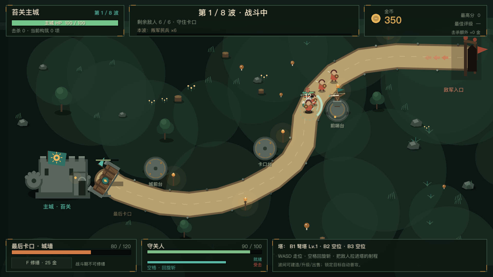
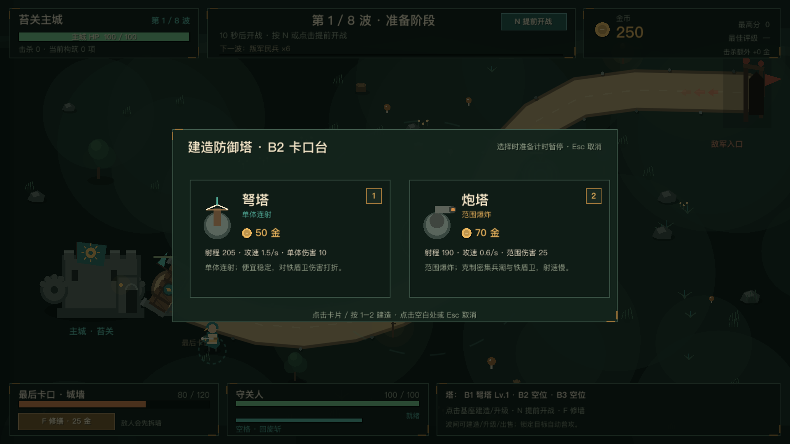
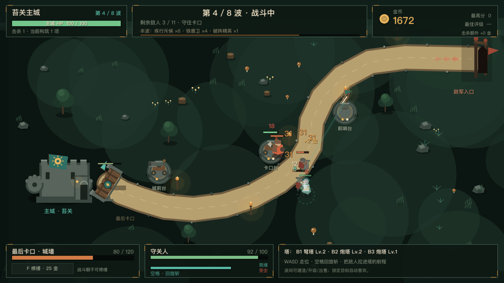
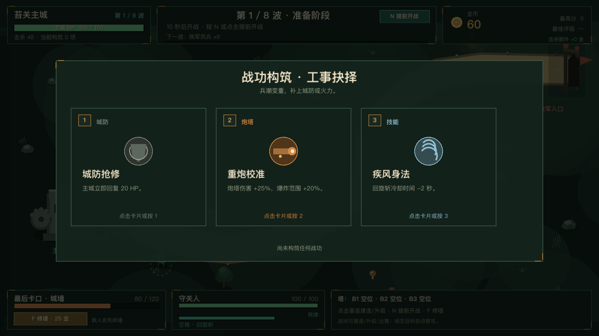
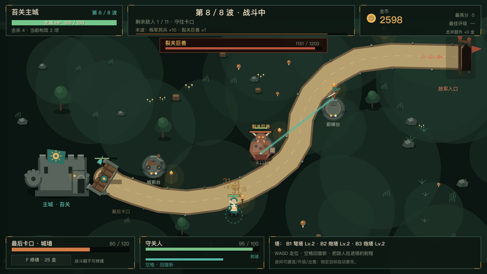
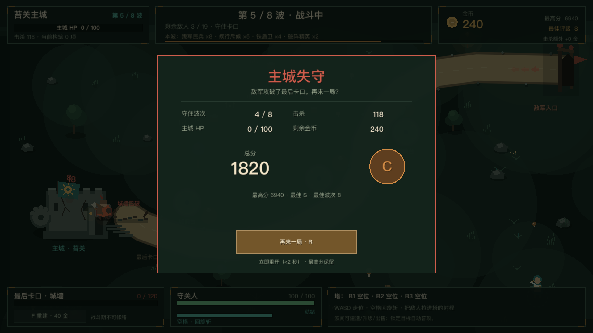
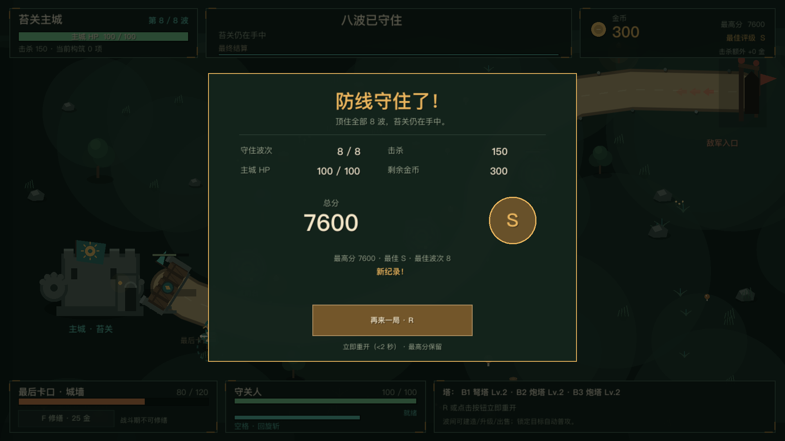

# 苔关八波 · Mossgate Stand

Godot 4.6 / GL Compatibility / 1280×720 逻辑画布（可 1920×1080）/ **100% 原创程序化美术**。

单场地波次防守 vertical slice：领主自由走位、射程内自动普攻；波间在 3 个固定基座建塔/升级/出售、花金币修墙；顶住 8 波，失败立即重开，本地保存最高分。

> 只抽象“单局守波”的通用玩法（固定路径、建塔、引怪、波间变强）。角色、场景、UI、数值、关卡均为本项目原创；与《奔奔王国》/Kingshot 无关联，未使用其任何素材。



| 建造面板 | 第 4 波精英 |
| --- | --- |
|  |  |

| 三选一构筑 | 第 8 波 Boss |
| --- | --- |
|  |  |

| 失败结算 | 胜利结算 |
| --- | --- |
|  |  |

10 秒实机片：`docs/shots/wd_gameplay_10s.mp4`（1280×720 / 30fps）· `docs/shots/wd_gameplay_10s.gif`

---

## 运行

```bash
godot --path godot-wave-defense
# 1080p 窗口
godot --path godot-wave-defense --resolution 1920x1080
```

首屏直接进入第 1 波准备阶段，没有主菜单。

## 操作

| 输入 | 作用 |
| --- | --- |
| `WASD` / 方向键 | 领主移动（射程内自动攻击最近敌人，精英/Boss 优先） |
| `空格` | 回旋斩：冲刺 + 范围伤害 + 击退，默认 8 秒冷却 |
| 鼠标左键 | 点击 3 个基座 → 建造/升级/出售；点击 UI 按钮 |
| `1` / `2` | 建造面板中快速选弩塔/炮塔；三选一面板中选卡 |
| `N` | 准备阶段提前开战 |
| `F` | 准备阶段修墙/重建（25 / 40 金） |
| `R` | 失败/胜利结算后立即重开 |
| `Esc` | 关闭建造/塔面板 |

## 一局内容

| 项 | 实现 |
| --- | --- |
| 场地 | 1 条主路 + 右上敌军入口 + 左下山口主城 + 最后卡口木石墙 |
| 波次 | 8 波，每波前 10–12 秒准备；HUD 预告下一波兵种/数量 |
| 敌人 | 民兵、疾行斥候、铁盾卫、破阵精英、裂关巨兽（Boss，半血召唤 4 民兵） |
| 塔 | 弩塔（单体、对盾兵 ×0.6）/ 炮塔（范围爆炸）；3 个固定基座；各 2 级；出售返还总投入 50% |
| 领主 | 100 HP，死亡 4 秒后主城前复活并扣 10 金；一局不因领主死亡结束 |
| 构筑 | 第 2/4/6 波后各一次三选一（射程、攻速、经济、城防、炮塔、技能等） |
| 经济 | 击杀 2–50 金 + 波次奖励 20–100 金；建塔 50/70，升级 60/80 |
| 失败 | 主城 HP 归零；结算显示波次/击杀/剩余金币/总分/评级/最高分 |
| 分数 | `波数×100 + 击杀×10 + 剩余主城 HP×50 + 剩余金币`；S/A/B/C/D |
| 重开 | 按 `R` 或点击按钮立即重置（保留最高分） |
| 存档 | `user://wave_defense_save.json`（最高分/最佳评级/最佳波次/局数） |

## 验证

```bash
# 1) 600 帧 headless 启动（0 ERROR）
godot --headless --path godot-wave-defense --quit-after 600

# 2) 99 项 headless 验收（末行 WAVE_DEFENSE_SMOKE_OK，退出码 0）
godot --headless --path godot-wave-defense --script tools/smoke_wave_defense.gd

# 3) 真实 GPU 1920×1080 截图（7 张 → docs/shots/）
godot --path godot-wave-defense --resolution 1920x1080 --script tools/screenshot_wave_defense.gd

# 4) 10 秒 30fps 实机帧（→ docs/frames/，再用 ffmpeg 合成）
godot --path godot-wave-defense --script tools/capture_wave_defense_reel.gd

# 5) 性能压力探针（3×Lv.2 塔 + 敌人同屏；真实渲染）
godot --path godot-wave-defense --resolution 1280x720 --disable-vsync --max-fps 0 \
  --script tools/probe_perf_wave_defense.gd -- --enemies=16
```

已实测（2026-11-25，Intel HD Graphics 6000 / i7-5650U）：

- headless 600 帧：`0` 个 SCRIPT ERROR / ERROR。
- smoke：`99 passed, 0 failed`，`WAVE_DEFENSE_SMOKE_OK`，退出码 `0`。
- 截图工具：7 张 `1920×1080`，0 报错；实机片 `10.000s`。
- 性能（1280×720，no-VSync，Intel HD 6000）：16 敌人 + 3×Lv.2 塔持续 12s，**平均 39.6 FPS**（min 22 / max 81；测试时同机还有 2 个其他 Godot worker）。详见 `docs/TECH.md §8.1`。

## 目录

```
godot-wave-defense/
├─ project.godot
├─ scenes/main.tscn           # 单场景；世界/单位/HUD 由 main.gd 运行时搭建
├─ scripts/
│  ├─ main.gd                 # 主控：tick、建造经济、构筑、结算、测试钩子
│  ├─ game_data.gd            # 路径/敌人/塔/8 波/升级/数值表
│  ├─ game_state.gd           # 单局状态、分数、评级、JSON 存档
│  ├─ wave_manager.gd         # 准备→战斗→清场→下一波；seed 确定性出怪
│  ├─ enemy.gd                # 5 种敌人 FSM + 原创程序化绘制
│  ├─ player.gd               # 领主移动/自动攻击/回旋斩/复活
│  ├─ tower.gd                # 弩塔/炮塔、索敌、弹道、升级、出售
│  ├─ wall.gd                 # 可修木石墙（敌人先拆墙）
│  ├─ arena_map.gd            # 静态场景：苔草地、路径、主城、基座、火把
│  ├─ hud.gd                  # 中文 HUD/面板/结算/命中区
│  ├─ art.gd                  # 色板、系统 CJK 字体、面板/血条/图标基元
│  └─ fx.gd                   # 单 CanvasItem 批量反馈层
├─ tools/                     # smoke/截图/录像/性能探针
└─ docs/                      # TECH、迭代记录、CREDITS、shots
```

## 许可与原创性

- 运行时代码与美术全部在本仓库内原创；无第三方运行时依赖、无外部贴图/模型/音频。
- 字体使用系统 CJK 字体（PingFang SC / Noto Sans CJK 等），不随仓库分发。
- 详细来源与 IP 边界见 [`docs/CREDITS.md`](docs/CREDITS.md)。
