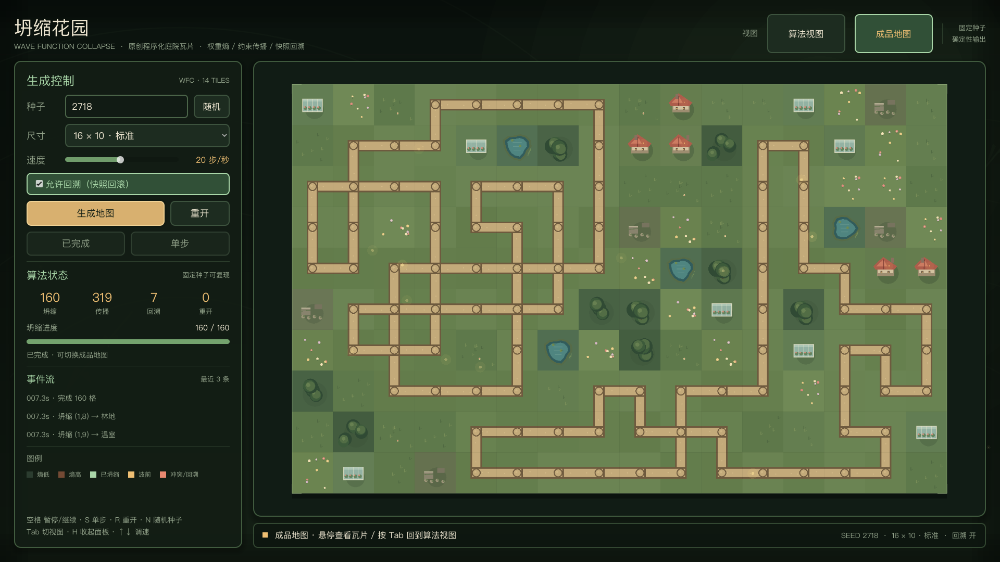
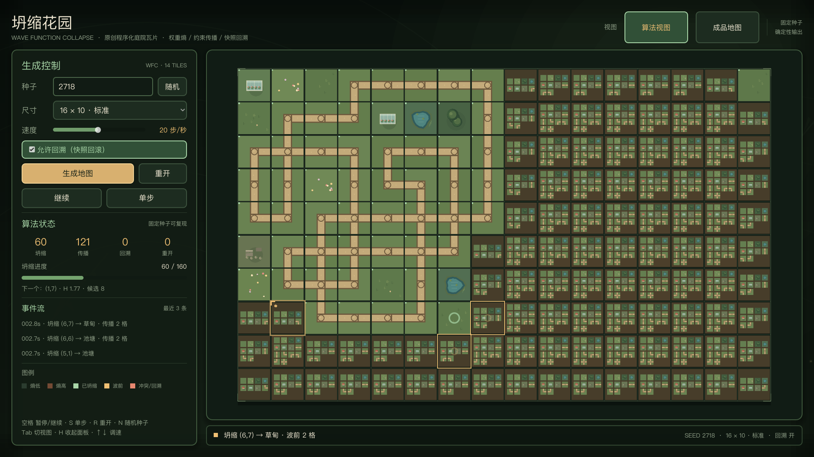
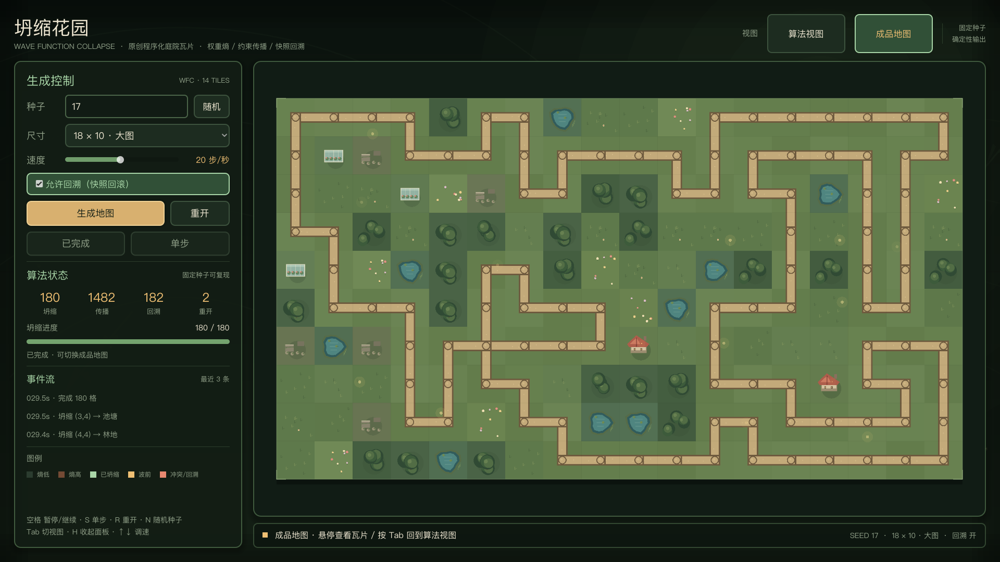

# 坍缩花园 · Wave Function Collapse

Godot 4.6（GL Compatibility）的 **波函数坍缩（WFC）随机地图生成** 交互实验：每一格先保留一叠
候选瓦片，按权重计算 Shannon 熵，从熵最低的格开始坍缩，用栈把邻接约束的波前推出去；
遇到矛盾可撤销快照改选，或按确定性重试重新开始。

参考 B 站《〈地图随机生成〉波函数坍缩算法是如何实现的》（BV1Br421M7Vm，4:50）。
视频里实际演示的是 **4×4 网格 + 5 张抽象瓦片 + 候选叠加 + 邻接约束 + 权重熵 + 快照回溯**，
片尾另有 3D 城镇生成效果；本工程按 **2D 庭院瓦片** 重新实现交互版，**没有复制视频画面或素材**。
逐帧取证、算法结构、与视频差异和性能取舍见 [docs/TECH.md](docs/TECH.md)。



## 运行

```bash
# 从仓库根目录
godot --path godot-wfc

# 或在 Godot 编辑器里打开
godot --editor --path godot-wfc
```

要求 Godot 4.6；渲染器 GL Compatibility；无第三方运行时依赖。所有瓦片、图集与 UI 都由代码在运行时绘制，
没有外部美术文件。

## 操作

| 输入 | 作用 |
| --- | --- |
| 种子输入框 + `生成地图` | 用当前种子、尺寸、回溯开关从头演示 |
| `随机` / `N` | 换一个随机种子并立即生成 |
| 尺寸下拉 | 12×8 / 16×10 / 18×10；切换后立即重生成 |
| 速度滑杆 `1–40 步/秒` | 每秒做多少次坍缩（默认 20） |
| `暂停 / 继续` / `Space` | 暂停或继续自动坍缩 |
| `单步` / `S` | 暂停并只推进一步（会显示传播波前） |
| `重开` / `R` | 同种子、同尺寸从头演示；固定种子输出完全一致 |
| `允许回溯（快照回滚）` | 开：矛盾时恢复上一步并换候选；关：直接确定性重开 |
| `算法视图` / `成品地图` / `Tab` | 切换可视化 |
| 鼠标悬停 | 查看格坐标、候选数、熵或最终瓦片名 |
| `H` | 收起/展开左侧控制面板 |
| `↑ / ↓` | 速度 ±2 |
| `B` | 切换回溯开关 |

## 页面上的信息

- **算法视图**：每格显示精确候选瓦片的微型拼贴；背景颜色是熵热力（深绿=低熵，暖棕=高熵），
  琥珀角标与脉冲标出下一个熵最低格；琥珀描边是最近的传播波前；珊瑚色/红框是冲突与回溯。
- **成品地图**：14 种原创庭院瓦片（草甸、花圃、林地、池塘、石屋、温室、废墟、石径横/竖/四拐/十字）。
- **事件流**：最近 3 条坍缩/传播/回溯/重开事件；完整统计在左侧四宫格与进度条。
- **默认种子 `2718`**：16×10 会在第 127 次推进时出现一次可观察的回溯；不依赖随机运气才能演示。

## 截图与视频

| 文件 | 内容 |
| --- | --- |
| `docs/shots/01_superposition_1920.png` | 初始叠加态、熵热力、最低熵目标 |
| `docs/shots/02_wavefront_1920.png` | 中盘，最近一步的传播波前 |
| `docs/shots/03_backtrack_1920.png` | 矛盾 → 回溯，红框与事件流 |
| `docs/shots/04_complete_algorithm_1920.png` | 算法视图完成态 |
| `docs/shots/05_finished_map_1920.png` | 成品地图 hero（种子 2718，16×10） |
| `docs/shots/06_large_map_1920.png` | 18×10 大图成品（种子 17） |
| `docs/wfc_garden.mp4` / `.gif` | 10 秒逐步坍缩 → 切成品地图（1280×720 / 30fps） |





## 固定种子与回溯

- 随机数只来自 `RandomNumberGenerator`；种子由数字或文字哈希而来。
- 内部重开的 RNG 种子是 `(base_seed, attempt)` 的确定性混合；同一基础种子的重试序列固定。
- 同种子两次生成的瓦片签名、坍缩次数、回溯次数、重开次数完全一致，已由 smoke 断言。
- 回溯用完整棋盘快照：矛盾时恢复上一格坍缩前的状态，把失败选择从候选集里删掉；
  单次尝试的累计回溯超过 48 次会走「无解 → 自动重开」路径（仍可复现）。
- 石径没有断头，所有路臂必须继续连接，因此会产生真正的环路和矛盾；这也是回溯演示的来源。

## 验收 / 工具

```bash
# 一键验收（导入 + headless smoke + 600 帧启动 + GPU 截图）
./tools/verify.sh

# 追加真实 GPU 性能探针（默认 16×10 / 20 步/秒 / vsync off）
./tools/verify.sh --probe

# 单独运行
godot --headless --path . -s tools/smoke_wfc.gd
godot --path . --resolution 1280x720 -s tools/screenshot_wfc.gd
godot --path . --resolution 1280x720 -s tools/probe_wfc.gd
./tools/build_media.sh
```

## 实测记录

见文末「自测记录」与 [docs/迭代记录.md](docs/迭代记录.md)。

## 目录

```
godot-wfc/
├─ project.godot                1280×720 / GL Compatibility
├─ scenes/main.tscn             单场景入口
├─ scripts/
│  ├─ wfc_solver.gd             掩码 / 权重熵 / 传播 / 快照回溯 / 确定性重开
│  ├─ wfc_tileset.gd            14 种原创瓦片的接口、权重、颜色
│  ├─ tile_art.gd               程序化瓦片画法（草地/水/路/建筑/……）
│  ├─ tile_baker.gd             启动时把瓦片烘焙成纹理图集
│  ├─ board_view.gd             算法视图/成品地图、热力、波前、回溯提示
│  ├─ backdrop.gd               月下庭院背景
│  ├─ hud.gd                    中文控制面板/事件流/统计
│  ├─ ui_theme.gd               系统 CJK 字体 + 统一控件样式
│  └─ main.gd                   UI 接线、速度循环、视图切换、键盘
├─ tools/
│  ├─ smoke_wfc.gd              WFC 约束/确定性/回溯/UI 接口无头验收
│  ├─ screenshot_wfc.gd         6 张 1920×1080 GPU 实拍
│  ├─ probe_wfc.gd              FPS 探针
│  ├─ render_wfc_video.gd       固定 30fps 录帧
│  ├─ build_media.sh            帧 → MP4/GIF
│  └─ verify.sh                 一键验收
└─ docs/
   ├─ TECH.md                   取证、算法、约束、复杂度、视频差异
   ├─ 迭代记录.md               设计与性能迭代
   ├─ shots/                    1920×1080 实拍
   ├─ wfc_garden.mp4
   └─ wfc_garden.gif
```

## 自测记录

本机：MacBook Air（2015）Intel HD Graphics 6000 · Godot 4.6 · GL Compatibility · 窗口 1280×720。
性能探针在关闭垂直同步、关闭其它 GPU 任务后采样；截图工具保存 PNG 的开销不参与 FPS 统计。

```
WFC_SMOKE_OK maps=24 edges=6384
BACKTRACK_OK seed=2718 first_event=127 backtracks=7 contradictions=4 restarts=0 steps=147
RESTART_OK seed=2718 restarts=9 contradictions=9 steps=1055
DETERMINISM_OK seed=2718 signature=FBAKHHHLAEAAFBGAAK... steps=147 bt=7 rs=0
UI_CONTRACT_OK

headless boot: 600 frames, no SCRIPT ERROR / ERROR
GPU screenshots: WFC_SHOTS_OK (6 × 1920×1080)
GPU video: WFC_VIDEO_FRAMES_OK (300 frames @30fps, 10.000 s)
WFC_VERIFY_OK
```

真实 GPU 默认档（16×10 / 20 步/秒 / vsync off）：

```
default_16x10_algo_20steps: avg=42.6 min=38.0 samples=[38,40,40,41,41,47,47,43,43,46]
default_16x10_map:          avg=73.8 min=46.0 samples=[46,75,75,81,81,85]
WFC_PROBE_OK
```

平均与最低采样都高于 30 FPS。额外临时压力测试：18×10 大图、同速度时约
`avg 38.3 / min 25 FPS`，成品地图约 `avg 77.3 FPS`；若机器同时有其它 GPU 负载，
建议默认 16×10 或降低速度。

## 已知限制

- 目标是 **2D 俯视庭院瓦片**，不包含参考视频片尾那种 3D 体素城镇；见 TECH 的差异表。
- 18×10 大图比默认 16×10 更重；如果机器同时运行其他 GPU 应用，建议把速度降到 10–20 步/秒，
  或使用默认尺寸。
- 瓦片是程序化几何/纹理，不是手绘美术；美术目标为“风格统一、可读”，不是商业级城镇资产。
- 中文 UI 使用系统 CJK 字体（macOS PingFang 等），Linux 需要安装中文字体；
  不随工程分发字体文件。
- 回溯预算和重开上限是为了让病态路径在交互时间内终止；不是完整 SAT/WFC 精确求解器。

## 许可与致谢

见 [CREDITS.md](CREDITS.md)。参考视频仅用于研究算法与演示形式；本项目与视频作者无隶属关系。
