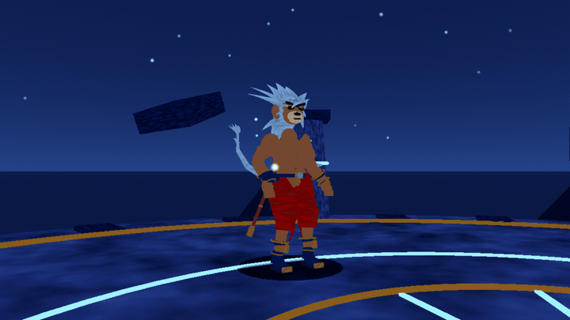
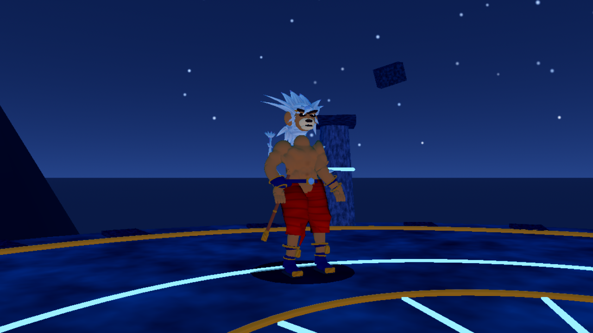
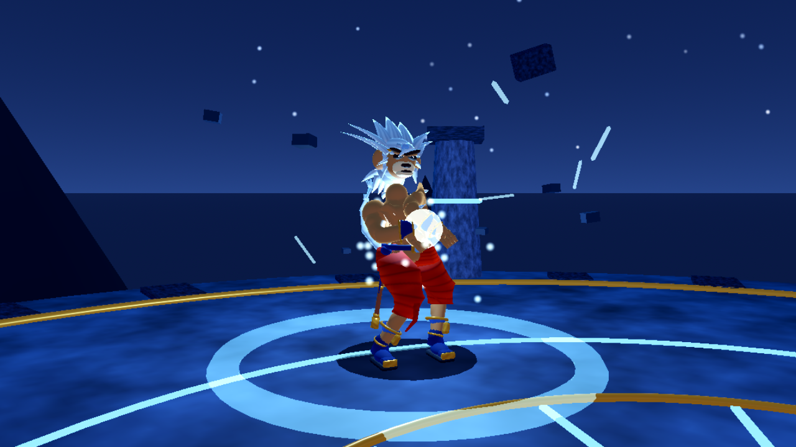
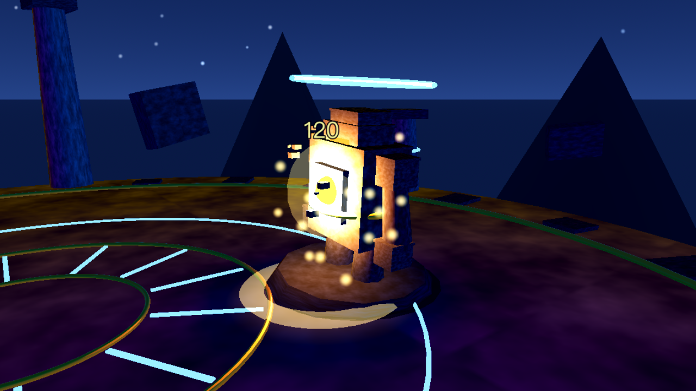
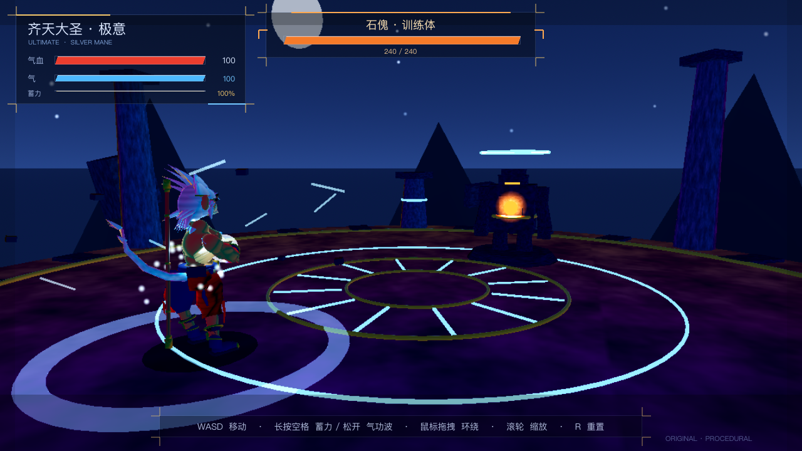
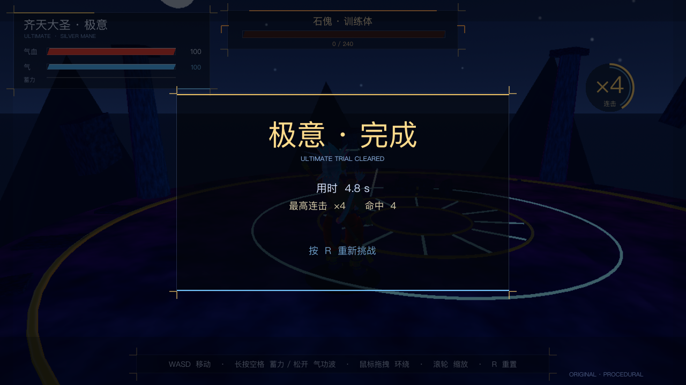
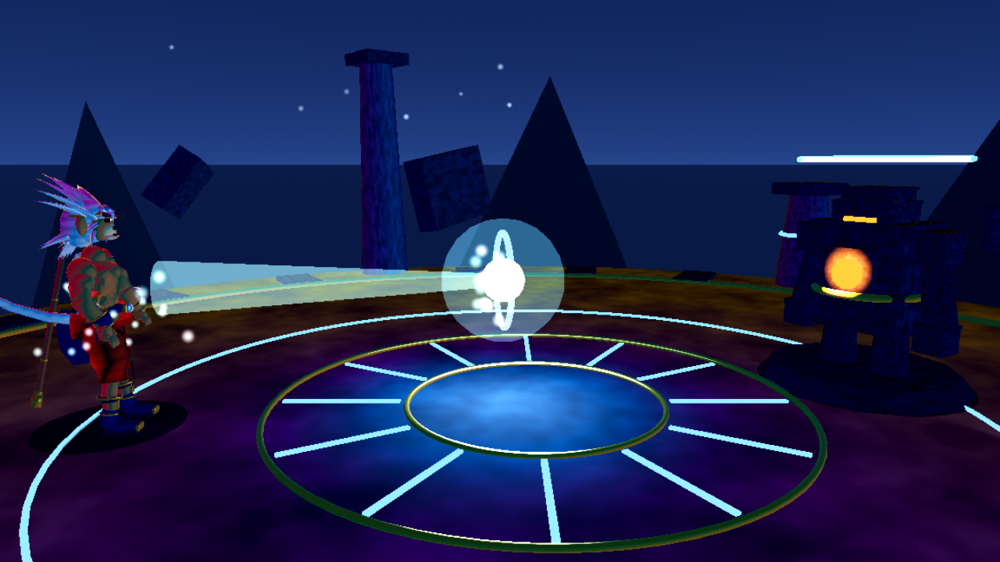
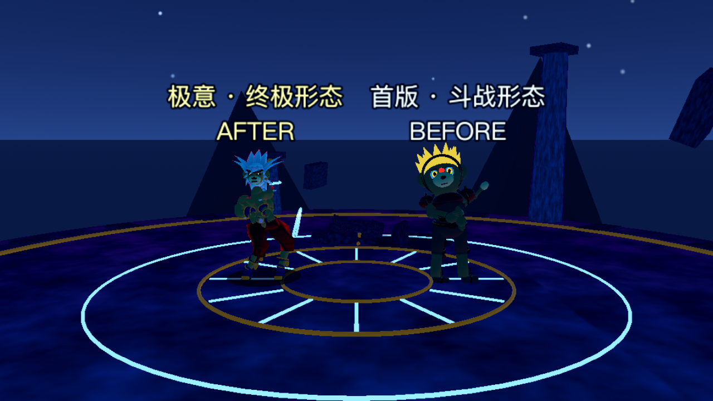

# 齐天大圣 · 极意 — 极意试炼场

原创「齐天大圣 · 极意」的可玩展示：**银白尖发、银白斗气 + 浮空碎石、赤膊肌肉躯干、破损橙裤、蓝腰带 / 护腕 / 靴、猴脸 / 尾巴 / 金箍棒元素**。
Blender 程序化角色（非 chibi，约 6.5 头身）+ Godot 4.6 第三人称训练场：蓄力气功、命中扣血/击退、HUD、屏幕震动、伤害数字、胜利与重置。

> **原创声明**：不是《龙珠》悟空的复刻。没有复制任何版权角色的脸、发型轮廓、服装、标志或 UI。
> 只借鉴“银白极意气质”这一通用视觉语汇；角色/剧情元素取自公有领域《西游记》，造型与贴图均为本项目原创。



> 8 秒实机录屏：`docs/wukong_ultimate.mp4`（1280×720，H.264）；GIF 同名。逐帧源在 `/tmp/wukong_ult_gif/`（由工具脚本生成）。

## 跑起来

```bash
cd godot-wukong-ultimate
godot --headless --path . --editor --quit   # 首次导入资源
godot --path . --resolution 1280x720         # 打开游戏
```

- 实测 Godot `4.6.stable.official.89cea1439`，GL Compatibility，窗口 1280×720。
- 无第三方运行时依赖；所有环境、VFX、UI、伤害数字、贴图均由项目代码/GLB 生成。
- 角色 GLB：`assets/models/wukong_ultimate.glb`（Blender 工程见 `../blender-wukong-ultimate/`）。

## 操作

| 输入 | 作用 |
| --- | --- |
| `W A S D` / 方向键 | 相机相对移动（奔跑动画随速度切换） |
| 长按 `空格` | 蓄力（角色进入 Charge，斗气/碎石/能量球成长） |
| 松开 `空格` | 放出气功波；蓄力越久伤害/击退越强，消耗气 |
| 鼠标拖拽 | 环绕相机 |
| 滚轮 | 相机推拉（3.2–8.6 m） |
| `R` | 任意时刻重置本场 |

- 气功波伤害：`30 + 90 × power`；能量消耗 `22 + 28 × power`；气每秒回复 12。
- 石傀每 6.6 s 可能蓄力一次地面脉冲（石傀脚下红圈），1.15 s 后判定半径 3.4 m、伤害 14；离开红圈可躲。
- 石傀 240 血；最大蓄力两发胜利。HUD 显示气血/气/蓄力、目标血量、连击、提示与结算。

## 内容

- **角色**：单一蒙皮网格（15 个材质分区），56,072 tris；29 根 GLB 骨骼；6 段动画（Idle/Run/Charge/Cast/Hit/Victory，长度 2.0/0.67/1.33/1.21/0.54/2.0 s）。
- **场景**：夜色浮空试炼场（程序化石材、符文环、断柱、浮石、星海、月亮）+ 石傀训练体；全部原创程序化几何。
- **战斗**：蓄力气功、飞行弹道 + 拖尾、命中爆炸/碎石/火花、屏幕震动、伤害数字、连击、石傀反击脉冲、胜负与重置。
- **镜头**：第三人称环绕；相机自带暖色 key，保证暗场可读；`set_cinematic_camera` 供截图/录屏工具使用。
- **HUD**：自绘银色/金色面板，系统 CJK 字体；不使用外部 UI 素材。

## 截图（真实 GPU，1280×720）

| | |
| --- | --- |
|  |  |
|  |  |
|  |  |
|  | 光束尾 / beam tail（in flight） |

## Before / After（与首版 chibi 对比）

- 首版 `blender-wukong/`：金色 chibi、程序化拼装、单一蓄力/放波动画。
- 极意版：银白英雄比例、肌肉躯干、破损橙裤、蓝金装备、猴脸/尾巴/金箍棒；29 骨骼 + 6 段动画；Godot 可玩。
- 工程内对比图：`docs/shots/06_before_after.png`（两版同场，Godot 实时）。
- Blender 定帧对比图：`../blender-wukong-ultimate/docs/before_after.png`（首版海报 vs 极意蓄力定帧）。

## 验证

```bash
bash tools/verify.sh
```

本机实测：

```text
WUKONG_ULT_SMOKE_OK
WUKONG_ULT_VERIFY_OK
```

Smoke 覆盖：GLB 载入（29 骨骼 / 6 动画）、Idle→Run→Idle、蓄力→Cast→气功命中、石傀脉冲命中玩家（Hit 动画）、胜利（Victory + 结算）、R 重置回 Idle/满血。

- 无解析错误；`godot --headless --path . --quit-after 600` 运行 600 帧退出码 0，无 SCRIPT ERROR。
- 真实 GPU 截图：`bash` 见下；7 张 1280×720（含光束在飞）。
- 8 秒 GIF/MP4：见 `docs/`；由 160 帧 20 fps 采集，GIF 12 fps 缩放 720 宽。
- 渲染帧采集脚本会用 `Engine.time_scale` 自适应，让每帧约 1/20 s 游戏时间，避免录屏加速。

### 复现命令

```bash
# 真实 GPU 定帧（需要窗口/OpenGL）
godot --path . --resolution 1280x720 -s tools/screenshot_ultimate.gd

# 录 160 帧源画面（需要窗口/OpenGL）
godot --path . --resolution 1280x720 -s tools/capture_ultimate_gif.gd
ffmpeg -y -framerate 20 -i /tmp/wukong_ult_gif/frame_%03d.png \
  -c:v libx264 -pix_fmt yuv420p -crf 19 -movflags +faststart docs/wukong_ultimate.mp4
ffmpeg -y -framerate 20 -i /tmp/wukong_ult_gif/frame_%03d.png \
  -vf "fps=12,scale=720:-1:flags=lanczos,split[a][b];[a]palettegen=max_colors=160[p];[b][p]paletteuse=dither=bayer:bayer_scale=3" \
  -loop 0 docs/wukong_ultimate.gif

# 真实窗口性能（Intel HD 6000）
godot --path . --resolution 1280x720 -s tools/probe_fps.gd
```

## 性能（本机 Intel HD 6000）

```text
OpenGL API 4.1 INTEL-18.8.16 - Compatibility
WUKONG_ULT_FPS avg=39.2 min=11.0 samples=24
WUKONG_ULT_FPS_OK
```

- 1280×720 窗口、3D 内部渲染比例 0.9、GL Compatibility、无实时阴影（角色/石傀用 blob 阴影）、5 盏常驻光源、无环境 glow。
- 最终采样平均 39.2 fps > 30（多轮 39–43）。`min=11` 是压力循环中一次命中爆发的瞬时掉帧（材质/粒子分配）；持续战斗约 40。加光束尾前曾测得 43.3/22.0。
- 若目标机型更弱：可进一步把 `scaling_3d/scale` 降到 0.8，或复用 VFX 对象池。

## 代码结构

| 文件 | 作用 |
| --- | --- |
| `scripts/main.gd` | 场景装配、相机/震屏、充能/技能回调、连击/结算、演示 API |
| `scripts/player.gd` | 角色控制、动画状态机、蓄力/放波、斗气/碎石/能量球 |
| `scripts/dummy.gd` | 石傀 240 HP、后仰/击退、红圈脉冲、崩塌 |
| `scripts/ki_blast.gd` | 气功弹道、拖尾、射线命中 |
| `scripts/hud.gd` | 自绘 HUD、连击、教学、胜负面板 |
| `scripts/arena.gd` | 浮空试炼场、程序化贴图、灯光/天空 |
| `shaders/aura.gdshader` | 银蓝斗气壳（保留供扩展；当前斗气以粒子/能量刃/碎石表现） |
| `tools/verify.sh` | 导入 + headless smoke 一键验收 |
| `tools/smoke_ultimate.gd` | 可重复的战斗/动画断言 |
| `tools/screenshot_ultimate.gd` | 7 张实机截图（含光束在飞 / before-after） |
| `tools/capture_ultimate_gif.gd` | 8 秒源帧采集 |
| `tools/probe_fps.gd` | 真实窗口 FPS 采样 |

技术细节：[docs/TECH.md](docs/TECH.md)；迭代记录：[docs/迭代记录.md](docs/迭代记录.md)；验证日志：[docs/verification.txt](docs/verification.txt)；
原创与第三方声明：[assets/CREDITS.md](assets/CREDITS.md)；任务报告：[docs/agency/T-20261119-008.md](docs/agency/T-20261119-008.md)。

## 已知边界

- 这是 stylized / 程序化风格化角色：肩背/躯干有少量体素重构的块面感，手指为简化体块；无面部 blendshape、无布料/毛发物理解算。
- 没有音效/音乐、移动端触控、设置菜单；属于单场景可玩 Demo 而非完整商业游戏。
- 石傀击退是视觉回弹；静态体不参与刚体推挤。
- 中文 UI 依赖系统 CJK 字体（PingFang SC / Hiragino / Noto Sans CJK / 微软雅黑）；无这些字体的环境会回退。
- 首次进入游戏会有一个很小的银色入场闪光，用于预热 shader，降低首次命中卡顿。
