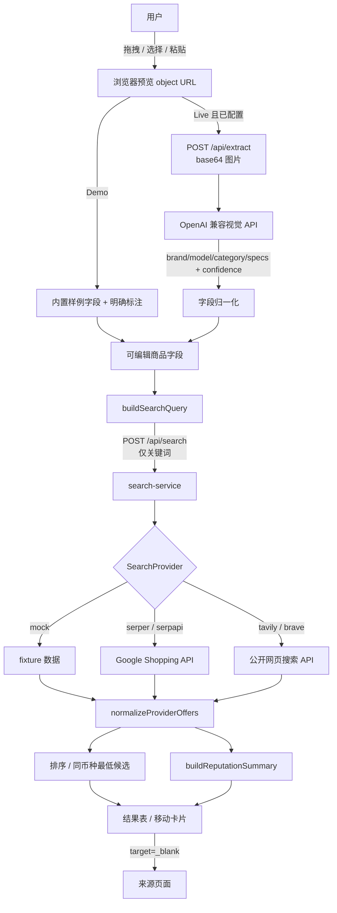

# Product Scout · 架构说明

## 1. 定位与原则

Product Scout 是一个本地单用户的“公开信息侦察台”：截图只用于得到商品身份，价格与口碑全部来自用户配置的公开搜索 API。架构的硬约束：

1. **不爬站**：没有 HTML 抓取器、无头浏览器抓商品页、无验证码处理；只请求官方搜索 API 并打开公开链接。
2. **不伪造**：Demo 与 Live 在数据模型、UI、来源上明确分开；最低候选限定本次结果；评论缺失就显示“未获取”。
3. **不落盘**：没有数据库；用户图片不写入文件系统；API key 只在服务端 env 中使用。
4. **可插拔**：搜索、视觉识别都通过接口 + 归一化层接入；替换 provider 不影响 UI 与口碑逻辑。

## 2. 数据流



### 关键路径

1. **上传**
   - 浏览器校验类型/大小，用 `URL.createObjectURL` 预览；原图不进入搜索。
   - Demo：不调用外部视觉 API，字段来自 `fixtures/demo.ts`，`ExtractionResult.mode = "demo"`，通知文案明确“非真实识别”。
   - Live：只有 `VISION_PROVIDER=openai` 且 `VISION_API_KEY` 存在时才把 base64 POST 到 `/api/extract`；路由校验 data URL、大小（≤ 8MB）与 MIME，然后转发给配置的视觉接口。不写文件、不写日志。
2. **字段校正**
   - UI 维护 `ProductIdentity` + 每字段 `FieldEvidence {confidence, source}`；用户编辑后 source 变 `manual`。
   - 前端/服务端共用 zod schema `productSchema`：字段长度、至少品牌或型号。
3. **检索**
   - `buildSearchQuery` = 去空白 + 去重（大小写不敏感）+ `品牌 型号 品类 价格`。
   - `/api/search` 只接收商品字段，不接收图片；服务端根据 `SEARCH_PROVIDER` 构造 provider，调用官方 API。
   - provider 返回 `ProviderOfferSeed[]`，统一经 `normalizeProviderOffers`：URL 只允许 http(s)、去重链接、价格解析、评分/评论数解析、限制条数、给 id/rank/fetchedAt。
4. **最低候选**
   - `pickLowestCandidate` 只在**所有有价结果同一币种**且币种已识别时返回最低；跨币种/未知币种返回 `null`，不伪造“最低”。
   - `sortOffersByPrice` 先按币种分组、组内按价格升降序，无价结果永远在末尾。
5. **口碑**
   - 只接受显式 `reviewExcerpt` 作为评论正文；Live provider 的 `snippet` 只是页面摘要，永远归零 `reviewExcerpt = null`。
   - 目前只有 Demo fixture 提供 `reviewExcerpt`；Live 一般显示评分汇总 + “未获取”优缺点。
   - 用确定性情感词典从评论片段中抽句子，正/负向各最多 3 条，每条保留来源渠道与链接。没有用 LLM 生成口碑。

## 3. 核心接口

### SearchProvider

```ts
export interface SearchProvider {
  id: SearchProviderId;
  label: string;
  mode: "demo" | "live";
  requiredEnv: string[];
  hint: string;
  isConfigured(): boolean;
  missingEnv(): string[];
  search(input: SearchInput): Promise<ProviderSearchOutput>;
}

export interface SearchInput {
  product: ProductIdentity;
  query: string;
  limit: number;
}

export interface ProviderSearchOutput {
  offers: ProviderOfferSeed[];
  notes: string[]; // 展示给用户的边界/计费说明
}
```

- `mock`：内置 3 个商品（Sony / Anker / Dyson）；关键词未匹配到样例时返回空结果并解释，不伪造任意商品。
- `serper`：`POST https://google.serper.dev/shopping`，`num` / `gl` / `hl` 可配。
- `serpapi`：`GET https://serpapi.com/search.json?engine=google_shopping`。
- `tavily`：`POST https://api.tavily.com/search`，basic 深度。
- `brave`：`GET https://api.search.brave.com/res/v1/web/search`。

所有 Live provider 用 `fetchJson`（15s 超时）发起请求；HTTP 错误映射为安全的中文错误，不包含响应体、请求头或 key。解析器使用宽松 zod schema，无法解析的条目跳过而不是让整个响应崩溃。

### 添加新搜索 provider

1. 在 `src/lib/providers/` 新增文件，实现 `SearchProvider`，导出解析函数便于单测；
2. 把 provider 加入 `SearchProviderId` union 和 `createSearchProvider` 工厂；
3. 在 `getAllSearchProviders` 注册，补充 `.env.example` / README 的 key 与定价说明；
4. 用真实响应录制一个脱敏 fixture，增加单元测试覆盖解析与错误路径；
5. 确认只调用官方 API、不越过 ToS；若返回的是网页摘要而非购物数据，在 `notes` 中明确标注。

### 视觉 provider

当前支持 OpenAI 兼容的 `/chat/completions` 视觉接口（OpenAI、火山方舟等通常兼容）。请求包含：

- system 约束 + 用户提示（只输出 JSON、不猜、不提取价格/评论）；
- `image_url` data URL；
- 30s 超时，解析 `choices[0].message.content`，剥离 Markdown fence 后 zod 校验。

扩展 Anthropic 或其他格式时，在 `src/lib/vision.ts` 里 `getVisionConfig()` 的 provider 分支添加请求适配，并保持输出归一化为 `ExtractionResult`。视觉输出同样要限长、限置信度 0–1、要求至少品牌或型号。

## 4. 数据契约与安全规则

| 契约 | 规则 |
| --- | --- |
| `ProductIdentity` | 四字段均为字符串；前端/后端共用 zod；至少品牌或型号之一非空；长度上限 80/120/80/240 |
| 抓取范围 | 仅 `http:` / `https:` 来源链接；`javascript:`、`ftp:` 等直接丢弃 |
| 价格 | `price: number \| null` + `currency` + 原始 `priceText`；区间取第一价格并保留原文；**不做汇率换算** |
| 评分 | 只接受 0–5；越界返回 `null`，不 clamp 成假数据 |
| 评论数 | 支持 `1.2万` / `1k` / `23,000`；无法解析为 `null` |
| 评论正文 | 只有显式 `reviewExcerpt` 才可作为口碑来源；Live snippet 一律不作为评论 |
| 最低候选 | 仅同一非 UNKNOWN 币种的有价结果；否则 `null` |
| Demo | provider search mode 为 `demo`，结果表、口碑、页脚多处标注；来源链接是公开搜索页，不是伪造成交页 |
| 请求校验 | `/api/search` 32KB body 上限；`/api/extract` 12MB body 上限 + 8MB 解码图片上限；拒绝非 JSON |
| 密钥 | 只从服务端 `process.env` 读取；错误与日志不包含请求头/URL 查询 string/图片 |
| 持久化 | 无数据库、无文件写入；浏览器 object URL 在替换/移除/卸载时 revoke |
| 第三方跳转 | `target="_blank"` + `rel="noopener noreferrer"` |

状态 API `/api/status` 只暴露 provider 名称、模式、是否配置、缺失变量名（不含值）和限制说明。

## 5. UI 状态与组件

```text
idle
  └─ 选择文件/示例 → 预览
       ├─ Demo：延时 520–760ms 的“演示识别”，填样例字段
       └─ Live：POST /api/extract → 成功填充 / 失败保留图片并要求手动填写
            ↓
          ready（字段可编辑）
            ├─ 校验失败 → 字段 inline error + 汇总错误
            ├─ provider 未配置 → 按键禁用 + env 提示
            └─ 点击检索 → searching → results / API error
                  ↓
             结果 + 口碑；编辑字段会清空旧结果，避免新旧字段混用
```

主要组件：

- `ScoutApp`：状态机、异步请求、竞态令牌 `opSeq`（切换图片/清空后丢弃过期响应）、粘贴监听、object URL 清理。
- `UploadDropzone`：拖拽/选择/粘贴入口、预览、Demo 示例、加载遮罩。
- `ProductEditor`：字段编辑、置信度/来源、检索词预览、provider 状态与无 key 提示。
- `ResultsPanel`：加载骨架、空态、错误、结果表/移动卡片、价格排序、最低候选、检索说明。
- `ReputationPanel`：加权样本评分、一句话结论、逐条优缺点与来源、未获取提示。

可访问性：语义表格/表单 label、`aria-invalid`、`role="status"`/`role="alert"`、`aria-pressed`、粗可见 focus ring、响应式断点，无横向溢出（390px 宽实测）。

## 6. 测试与验证

| 层 | 内容 |
| --- | --- |
| Jest | 43 tests：`money` 价格/评分/评论数解析；`sort` 升降序/无价/跨币种/最低候选；`validation` 字段上限与检索词；`providers` 四家解析器 + 归一化（含丢弃 Live 评论正文、链接去重）；`reputation` 只用 reviewExcerpt、不拿 snippet 当评论、无数据“未获取”；`search-service` mock 全流程 |
| Playwright | 生产构建 `next start`；上传→Demo 识别→检索→5 通道→价格排序→口碑来源；检查 `/api/extract` 未被调用；断言 console error 为 0；手动空字段校验 |
| Build | `npm run build` 通过；First Load JS ≈ 124 kB |
| 人工 | 1920×1080 三张截图 + 10s 录屏；390×844 移动端无横向滚动、结果卡片正常 |

## 7. 取舍与已知风险

1. **不做浏览器 OCR**：tesseract.js 中文包体大、准确率不稳定、离线资源下载不可控；默认 Demo 不伪装 OCR，Live 视觉 + 手动输入满足 MVP。
2. **情感词典而非 LLM**：确定性、可测、可解释，不会编造；代价是只能从明确评论正文中抽点。Live 数据通常没有正文，因此口碑模块经常“未获取”。
3. **网页搜索与购物搜索分开标注**：Tavily/Brave 适合发现讨论与来源，但摘要里的价格不是结算价；UI 用“页面摘要”标签避免误导。
4. **不缓存 provider 结果**：避免 stale price 与数据再分发风险；每次请求实时调用，记录时间。
5. **无数据库**：单用户本地工具，刷新即清空；简化隐私与部署，但不支持历史追踪。
6. **未联调 Live**：环境缺少 key；解析器以 fixture 测试，真实 provider 字段变化需联调时回归。低价/高可用场景上线前必须补集成测试与条款评审。

## 8. 文件地图

```text
src/
  app/
    page.tsx                 Server 入口，注入 runtime status
    layout.tsx               metadata / lang=zh-CN
    globals.css              Tailwind + 纸张视觉系统
    api/status/route.ts      provider 状态（不泄 key）
    api/search/route.ts      关键词检索，错误映射
    api/extract/route.ts     图片识别，仅 Live 视觉
  components/
    ScoutApp.tsx             状态机与页面编排
    Hero.tsx / Header.tsx    品牌与上传入口
    UploadDropzone.tsx       拖拽/粘贴/示例/预览
    ProductEditor.tsx        字段与证据、检索 CTA
    ResultsPanel.tsx         表格/卡片/排序/最低候选
    ReputationPanel.tsx      口碑摘要与引用
  lib/
    config.ts                env 解析与上限
    types.ts                 共享契约
    validation.ts            zod + 检索词
    money.ts                 价格/评分/评论数
    offers.ts                provider 结果归一化
    sort.ts                  排序与最低候选
    reputation.ts            确定性口碑归纳
    vision.ts                视觉状态/提取
    client-api.ts            前端 fetch 封装
    search-service.ts        搜索编排
    providers/               mock/serper/tavily/brave/serpapi/http/parse
    fixtures/demo.ts         样例数据
    __tests__/               单元测试
e2e/
  scout.spec.ts              E2E
  capture.mjs                截图 + 录屏
```
