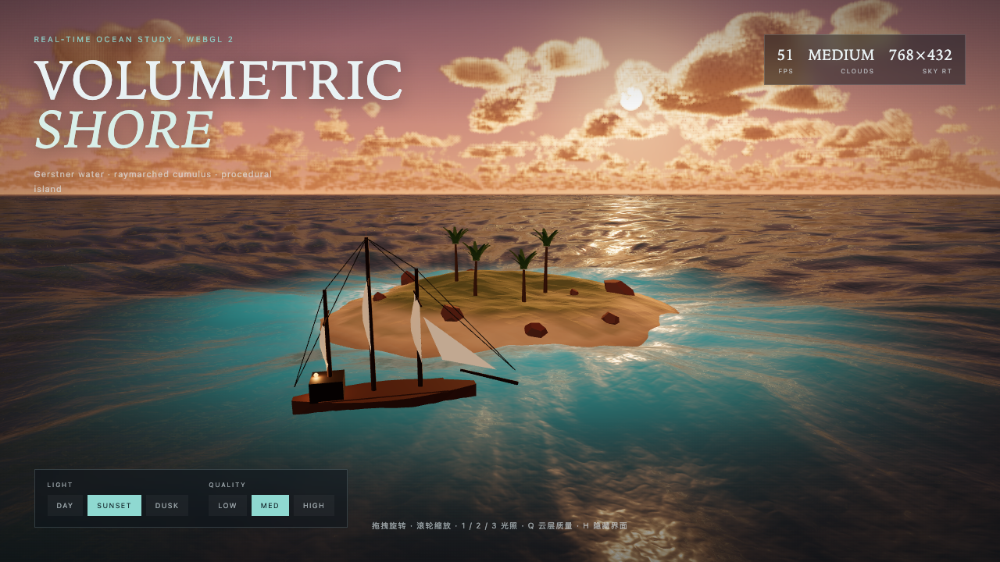

# Volumetric Shore

A clean-room, static Three.js study of the look in the Bilibili video
《waterpro+threejs体积云复刻，开源！！！》 (BV1BRHw6fEfW): a turquoise
Gerstner ocean around a small island, a three-masted ship, a low sun with a
glitter path, and a raymarched cumulus sky.

No build step, no CDN, no runtime network. Three.js r180 is vendored in
`vendor/`; the sky, cloud, water, island and ship are generated in code.



*Day / sunset / dusk and a 7.5 s clip: `../docs/shots/waterpro-clouds-day.png`,
`../docs/shots/waterpro-clouds-dusk.png`, `../docs/waterpro-clouds-demo.mp4`,
`../docs/waterpro-clouds-demo.gif`.*

## Run

```sh
cd threejs-water-clouds
python3 -m http.server 8145
# open http://127.0.0.1:8145/
```

Any static file server works. ES modules require HTTP(S), not `file://`.

## Controls

| Input | Action |
| --- | --- |
| Left drag | Orbit the camera (damped) |
| Wheel | Dolly in / out (34–165 m) |
| `1` / `2` / `3` | Day / sunset / dusk |
| `Q` | Cycle cloud quality (low / medium / high) |
| `R` | Reset camera |
| `Space` | Toggle the slow idle orbit |
| `H` | Hide the UI |

The three lighting presets cross-fade in about 1.5 s. Quality buttons are also
in the HUD. The cloud quality preset changes the sky raymarch step count
(20 / 30 / 38) and the half-resolution sky target (0.42 / 0.60 / 0.72 of
1280×720). If the measured frame rate drops below 27 FPS for 2.5 s, the demo
steps down one quality level.

## Verification

```sh
cd threejs-water-clouds
./verify.sh
```

The harness starts its own HTTP server, launches real Google Chrome with
Playwright, checks console/page errors and external requests, writes three
1280×720 screenshots, a 6–10 s MP4/GIF, and
`../docs/waterpro-clouds-verification.json`.

Requirements: Node.js, Playwright (`npm i playwright` or `PLAYWRIGHT_MODULE`),
Google Chrome, Python 3, ffmpeg/ffprobe. The browser is launched headed because
on the current Intel Mac headless Chrome falls back to SwiftShader.

**ANGLE note.** The requested launch args include `--use-angle=metal`. On this
Intel HD 6000 machine Chrome maps that to SwiftShader. The harness probes it,
records the result, then relaunches with `--use-angle=gl`, which reaches the real
Intel GPU. The report shows both the Metal probe and the final GPU.

Last run (2026-11-19):

| Preset | Median FPS | Quality | Sky RT |
| --- | ---: | --- | --- |
| Day | 50.7 | medium | 768×432 |
| Sunset | 45.3 | medium | 768×432 |
| Dusk | 52.0 | medium | 768×432 |

GPU: `ANGLE (Intel Inc., Intel(R) HD Graphics 6000, OpenGL 4.1)`; console
errors 0; external requests 0; MP4 1280×720 / 7.50 s; GIF 960×540 / 7.50 s.

## What is implemented

- **Ocean** — radial LOD mesh (200 × 256), 8 Gerstner waves (61 m … 3.3 m)
  with analytic tangents, a procedural detail-normal texture, sky-cubemap
  Fresnel reflection, sun glitter, depth/sand tint based on distance to the
  island, crest foam and a noisy shoreline foam band. A CPU copy of the wave
  sum makes the ship bob and tilt.
- **Volumetric clouds** — 96³ procedural RGBA noise + 256² weather map, a
  30-step raymarch at half resolution, 5-step light march, Beer–Lambert
  transmittance, powder term, Henyey–Greenstein phase and distance haze.
- **Sky** — analytic gradient, sun disk/glow, aerial haze; the same shader
  feeds a 128² sky cubemap for the water reflection (refreshed every 24 frames
  at 18 steps).
- **Props** — original low-poly island (heightfield, vertex colours, rocks,
  palms) and sailing ship (custom hull, masts, sails, rigging, lantern).
- **Camera / UI** — damped orbit, presets, quality controls, FPS/quality HUD,
  adaptive one-way quality fallback.

## Structure

```
threejs-water-clouds/
  index.html, style.css
  src/main.js        renderer, palettes, sky target + blit, loop, input
  src/sky.js         sky dome, cloud raymarch, sky cubemap
  src/ocean.js       radial ocean mesh, water shader, CPU wave sampler
  src/props.js       procedural island and ship
  src/noise.js       64³/96³ cloud volume, weather + water detail textures
  src/controls.js    orbit rig
  vendor/            Three.js r180 + MIT license
  tools/capture.cjs  Playwright / screenshot / MP4 / GIF verifier
  verify.sh          end-to-end check
  TECH.md            source identification, techniques, parameters
  ITERATIONS.md      tuning log, bugs and measurements
  CREDITS.md         licenses and clean-room statement
```

## Limitations

This is a visual study, not a port of the referenced project. The reference
uses three JONSWAP spectra with GPU inverse FFT, planar object reflections,
screen-depth refraction, an underwater pipeline, Takram's layered clouds and
temporal reconstruction. Here the water is Gerstner-based, reflection is a sky
cubemap (no island/ship reflection), clouds are a single-slab raymarch, and
there are no shadows, bloom, underwater mode or temporal accumulation. The
island and ship are deliberate low-poly stand-ins; no original assets are used.

## Credits

See [CREDITS.md](CREDITS.md). Three.js (MIT) is the only third-party runtime
code. The referenced Gitee repository has **no license**, so none of its code or
assets were copied; Takram is MIT and is cited as a technique reference only.
Water Pro / Sky Pro are commercial products and are not included.
