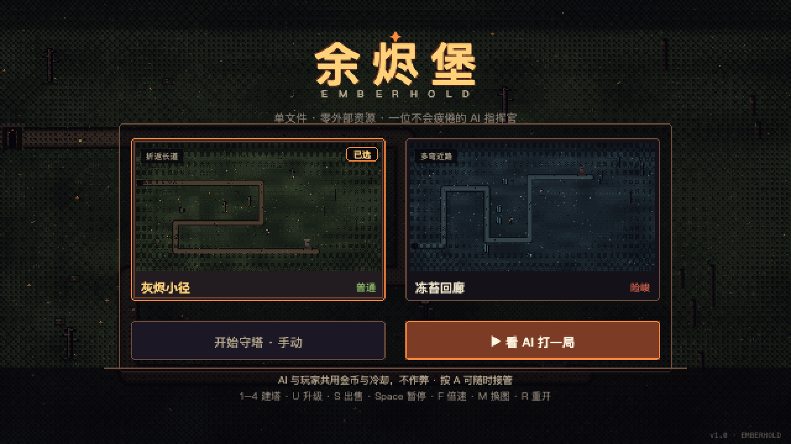

# 余烬堡 · Emberhold

**一个单 HTML 文件、零后端、零外部美术资源、AI 指挥官可以自己守完 12 波的抖动像素塔防。**



## 直接开始

- **双击 `index.html`** 即可玩（`file://` 可用）。
- 也可以在目录里运行：

```bash
cd web-html-tower-defense
python3 -m http.server 8000
# 打开 http://127.0.0.1:8000/
```

页面无构建步骤、无 CDN、无外部图片/字体/音频、无网络请求；HTML + CSS + 原生 JavaScript 全内联。内部分辨率为 **640×360**，按窗口整数倍最近邻放大（1280×720、1920×1080 分别为 2×/3×）。

## 原创内容

- **两座地图**：灰烬小径（普通，折返长道） / 冻苔回廊（险峻，多弯近路），切换使用 Bayer 抖动擦除过渡。
- **四种塔，三级升级**：
  - 燧石哨塔：单体高射速，优先打最靠前的敌人。
  - 焰心炉：抛掷炽炭，范围溅射。
  - 霜苔环：减速控场，Boss 与孢母有减速抗性。
  - 铸币圣坛：经济塔，每波结束产出金币；越早建回本越快。
- **五种敌人**：灰烬行者、幽火蛾、锈甲兽、孢母（治疗周围敌人）、无光巨像（Boss）。
- **12 波，140 起始金币，20 生命**；可升级、出售（65% 返还）、暂停、1×/2×/3× 倍速。
- **烬雨 Q**：全场真伤 30 并短暂减速，冷却 35 秒。
- **AI 指挥官**：自动经济、选择建造位置、建造、升级、存钱、施放技能；HUD 显示最近 AI 决策与原因。
- **AI 托管 / 手动**随时切换；AI 与玩家使用同一套金币、冷却、建造和升级函数，没有作弊入口。
- **“看 AI 打一局”**：从主菜单直接以 AI 托管 + 2× 倍速开局，无人操作可完整守住两图。

## 操作

| 输入 | 行为 |
| --- | --- |
| 鼠标点击卡牌 | 选择要建造的塔 |
| 鼠标点击空地 | 在可建造草地放置；无效格会提示原因 |
| 鼠标点击塔 | 选中，查看属性、射程与升级/出售 |
| 右键 / `Esc` | 取消建造或选中 |
| `1`–`4` | 选择燧石 / 焰心 / 霜苔 / 圣坛 |
| `U` / `E` | 升级选中的塔 |
| `S` / `X` | 出售选中的塔（返还 65%） |
| `Space` / `P` | 暂停 / 继续 |
| `F` / `Tab` | 1× → 2× → 3× 倍速 |
| `A` | AI 托管 ↔ 手动；手动建造/升级/出售/技能也会自动接管 |
| `Q` | 施放烬雨 |
| `M` | 换图并重开（保留当前 AI 模式） |
| `R` | 重开当前图 |
| 菜单内 `Enter` / `W` / `←` `→` | 手动开局 / 看 AI 打一局 / 选图 |

暂停时仍然可以建造和升级。顶栏显示波次、金币、生命、烬雨冷却、倍速、AI 状态、地图与 FPS。

## 验证与证据

内置一个可复现的 Playwright 验收/截图/采集脚本：

```bash
/opt/anaconda3/bin/python tools/verify_and_capture.py
# 快速只跑验收与截图、不采集视频：
/opt/anaconda3/bin/python tools/verify_and_capture.py --skip-video
```

最近一次完整运行（2026-11-26）：

- **48 项检查全部通过**，0 console error / 0 page error。
- **两张地图均由 AI 无人值守通关**：灰烬小径 204 击杀 / 剩 20 生命 / 模拟 559.67s；冻苔回廊 204 击杀 / 剩 20 生命 / 模拟 444.75s。AI 的 `cheats: false`，没有额外金币或冷却。
- **无外部网络请求**；`file://` 与本地 HTTP 均可加载。
- 布局：1920×1080 → canvas 1920×1080；1280×720 → canvas 1280×720。
- 文件大小 **124,212 bytes**，单文件自包含。
- 截图：10 张 1920×1080，覆盖地图 / 建造 / 战斗 / AI 面板 / 地图过渡 / Boss / 暂停 / 胜利。
- 演示：**10 秒 MP4（1280×720，30fps）** 与 **10 秒 GIF（960×540）**。
- 渲染基准：headless 无上限渲染耗时约 **1.85–2.03 ms/帧**（约 493–542 FPS 的 JS 渲染吞吐）；游戏主动封顶 60 FPS。截图 HUD 实测 33–64 FPS；autotest 结束后待机 47–53 FPS（测试机当时 loadavg ≈ 9.7，属于共享环境负载）。

完整机器可读结果：`captures/verification.json`。

### 截图

| 文件 | 内容 |
| --- | --- |
| `captures/01-menu-ashen.png` | 主菜单，灰烬小径 |
| `captures/02-menu-frost.png` | 主菜单，冻苔回廊 |
| `captures/03-map-transition.png` | 4px Bayer 8×8 抖动换图过渡 |
| `captures/04-build-preview.png` | 建造预览、射程与造价 |
| `captures/05-wave-combat.png` | 第 6 波战斗与 AI 决策 |
| `captures/06-ai-command.png` | AI 托管下的另一战斗瞬间 |
| `captures/07-boss-wave.png` | 无光巨像与 Boss 血条 |
| `captures/08-frost-assault.png` | 冻苔回廊战斗 |
| `captures/09-victory.png` | AI 无人值守胜利结算 |
| `captures/10-pause.png` | 暂停界面与选中塔信息 |

演示视频/GIF：`captures/emberhold-demo.mp4`、`captures/emberhold-demo.gif`。

## 目录

```
web-html-tower-defense/
  index.html                 # 唯一运行文件：HTML/CSS/JS 全内联
  README.md
  CREDITS.md
  docs/TECH.md               # 渲染 / 塔防循环 / AI / 地图过渡 / 性能 / QA
  docs/迭代记录.md            # 与参考对照、原创边界、迭代与实测
  captures/                  # 10 张截图 + MP4 + GIF + verification.json
  tools/verify_and_capture.py# Playwright 验收、截图、视频采集
```

## 说明与已知限制

- **单文件、零外部资源**是硬约束：没有音频，字体使用系统中文字体栈；字体本身不随页面分发。
- **AI 全程共用玩家规则**。它只在 `simulate()` 中通过 `tryBuild` / `tryUpgrade` / `castSkill` 行动；`freeze` / `fastForward` / `holdTransition` 是给无头截图和视频取景用的 QA 钩子，不参与游戏内 AI 决策，也不改变金币或冷却。
- 完整 1× 一局约 9 分钟（灰烬小径 AI 模拟 559.67s），适合用 2×/3× 或观看模式；这是 12 波的节奏取舍，不是性能瓶颈。
- 无头 Chromium 的 `requestAnimationFrame` 可能被节流；游戏中 60 FPS 封顶，截图/视频由 QA 钩子固定步进生成，具体方法见 `docs/TECH.md`。
- 参考《Cinderwatch》的**概念与体验**（MIT，原项目链接见 `CREDITS.md`）；本项目未复制其代码、美术、名称或文本，全部为净室原创。
